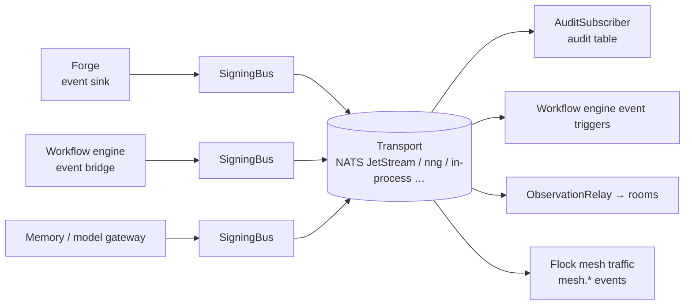

# Event bus

The event bus is how services announce what happened ("session started", "run
needs approval", "page written") so whoever cares can subscribe. It moves
facts; it never decides what they mean.

## In one minute

- One event shape (`SleipnirEvent`) and one registry of event type names, shared by
  every service.
- One port (`SleipnirPublisher` / `SleipnirSubscriber`), many transports. The
  transport is configuration, not code.
- Only **NATS JetStream** gives at-least-once delivery with redelivery and a dead-letter
  queue. Every other transport is at-most-once.
- Handlers acknowledge by returning and ask for redelivery by raising, so they must be
  idempotent on `event_id`.
- Platform events are **signed** by the service that published them; a consumer that acts
  on one checks the signature first.

## How it fits

Publishers wrap their bus in `SigningBus`. Consumers that act on an event verify it with
`PlatformEventVerifier`. The audit subscriber records everything it sees.

## The event

| Field | Meaning |
|---|---|
| `event_type` | Dot-separated, lowercase, at least two segments (`ting.run.state_changed`). The first segment is a namespace. |
| `source` | Publisher identity, for example `volundr` or `ravn:agent-abc123`. |
| `payload` | Event-specific data. Typed payloads and factory functions live in the catalog. |
| `event_id` | UUID4. The deduplication key for at-least-once delivery. |
| `correlation_id` / `causation_id` | Groups causally related events; names the event that caused this one. |
| `urgency` | `0.0`–`1.0` priority hint. |
| `domain` | One of `code`, `infrastructure`, `home`, `business`, `personal`; anything else raises. |
| `tenant_id`, `ttl` | Tenant scope; seconds until expiry (`ttl=0` is never delivered). |
| `trace_context` | W3C trace context carried with the event (see the index page). |

Namespaces (`EVENT_NAMESPACES`): `volundr`, `ting`, `ravn`, `skuld`, `bifrost`, `mimir`,
`github`, `system`, `environment`, `signal`, `valkyrie`, `participant`, `room`, `mesh`. An
event in an unknown namespace is published with a warning, so a new producer must register
its namespace. The registry holds about 120 named types as constants; code imports the
constant, never the string.

## Who publishes what

| Producer | How | Typical types |
|---|---|---|
| Forge | `SleipnirEventSink` in the session event pipeline maps session events to bus events | `volundr.session.*`, `volundr.git.*`, `volundr.tool.use`, `volundr.token.usage` |
| Forge | Session stop/restart revocations, signed with its `authority` certificate | `mesh.revocation` |
| Workflow engine | `TingSleipnirBridge` republishes the workflow engine's internal events | `ting.run.*`, `ting.task.*`, `ting.run.needs_approval` |
| Memory, model gateway | Their adapters, when wired | `mimir.page.written`, `bifrost.*` |
| Rooms | `participant.*` and `room.*` from the collaboration library | `room.message.recorded`, `room.transcript.recorded` |
| Mesh peers | Mesh traffic rides the bus under `mesh.*` (`mesh.realm_<id>.*` for an isolated Workspace mesh), signed by each peer | `mesh.announce` |

| Consumer | What it does with them |
|---|---|
| `AuditSubscriber` (Forge, or the standalone audit service) | Subscribes to `*` and writes every event to `sleipnir_events`; read at `GET /api/v1/audit/events` |
| Workflow engine event triggers | Starts a run from a saga template when a verified event matches a rule (`event_triggers.rules`); `auto_start: false` creates it pending and emits `ting.run.needs_approval` |
| `ObservationRelay` | Projects verified events into collaboration rooms |

## Transports and guarantees

| Transport | Alias / class | Delivery | Replay | Overflow | Use it for |
|---|---|---|---|---|---|
| NATS JetStream | `nats` → `sleipnir.adapters.nats_transport.NatsTransport` | **At-least-once.** Ack after the handler returns; nak with backoff; dead-letter to `system.dlq.message` after `max_deliver` | Yes: a stream with retention, durable consumers, `replay_from_sequence` | Withholds acks (backpressure); nothing dropped | Any multi-node deployment where delivery matters |
| Core NATS subjects | `core_subscriptions`, or `stream_name: core` | At-most-once | No | — | Live control traffic |
| nng | `nng` → `NngTransport` | At-most-once | No | Drops the oldest queued event, logged | One node, many processes (Pi mode) |
| In-process | `in_process` → `InProcessBus` (the default class) | At-most-once | No | Drops the oldest, logged | Mini mode, tests |
| Webhook | `sleipnir.adapters.webhook.WebhookTransport` | At-most-once; `max_attempts` POSTs, then logged and dropped | No | Drops the oldest | Crossing hosts without a broker |
| CLI command | `sleipnir.adapters.cli_command.CLICommandTransport` | At-most-once (subscribe only) | No | — | Run a script on matching events |
| RabbitMQ, Redis Streams | `rabbitmq.py`, `redis_streams.py` | At-most-once: they ack before the handler runs. No chart uses them | Redis only | Drops the oldest | Not recommended |

**Ordering.** Events for one subscription are handled one at a time, in the order the
transport delivers them. There is no global order across subscriptions, and a redelivered
event arrives after events published later. Use `causation_id`, sequence fields in the
payload, or idempotent state transitions rather than arrival order.

## Signed platform events

A platform service signs every event it publishes except `mesh.*` (peers sign their own)
through `SigningBus`, using a `service` certificate it issues itself with the platform
signing key (Forge uses its `authority` certificate). A subscriber that *acts* on an event
calls `PlatformEventVerifier`: unsigned, altered, stale or peer-signed events are refused,
logged at error and counted on `niuu.mesh.attestation.refusals`. A service without the key
cannot sign and, with `mesh.attestation.required: true`, fails at startup.

## Levers

| Knob | Default | What it changes | Where it is set |
|---|---|---|---|
| `sleipnir.enabled` | `false` | Turns the bus on for Forge or the workflow engine. Enabled but unable to start is fatal | Forge and workflow engine settings |
| `sleipnir.adapter` | `sleipnir.adapters.in_process.InProcessBus` | Transport class (dynamic adapter) | Forge and workflow engine settings |
| `sleipnir.kwargs` / `secret_kwargs_env` | `{}` | Constructor arguments; secrets read from named env vars | Forge settings (the workflow engine has `kwargs`) |
| `mesh.nats.stream_name` / `subject_prefix` | `ravn_environment` / `ravn.environment` (the transport class itself defaults to `sleipnir` / `sleipnir`) | Which JetStream stream and subjects | Mesh settings of the session gateway (and any mesh peer) |
| `mesh.nats.max_age_seconds` / `max_bytes` | 7 days / 1 GiB | Stream retention, hence the replay window | Mesh settings |
| `mesh.nats.max_deliver` | `5` | Deliveries before dead-lettering | Mesh settings |
| `mesh.nats.ack_wait_s` / `ack_progress_interval_s` | `30` / `10` | Redelivery after silence; in-progress pings while a handler runs | Mesh settings |
| `mesh.nats.nak_backoff_s` | `[1, 5, 30, 60]` | Redelivery delays after a handler raises; the last repeats | Mesh settings |
| `mesh.nats.ring_buffer_depth` | `1000` | Events queued per subscription before acks are withheld | Mesh settings |
| `mesh.nats.consumer_group` | empty | Share one durable consumer across replicas | Mesh settings |
| `event_triggers.enabled` / `rules` | `false` / `[]` | Map an event pattern (plus payload `filter`) to a saga template | Workflow engine settings |
| `mesh.attestation.required` | `true` | Sign and verify; `false` is an explicit choice to run unauthenticated | Every platform service |
| `mesh.attestation.event_max_age_s` | `3600` | Oldest event accepted; must exceed the redelivery window | Every platform service |

## Tradeoffs

| Choice | Gains | Costs |
|---|---|---|
| NATS JetStream | Redelivery, dead letters, replay from a sequence, multi-node | A broker to run; handlers must be idempotent |
| nng / in-process | Nothing to run | Lost on crash, overflow or handler failure; one node only |
| Webhook | Crosses hosts with plain HTTP | Fire-and-forget after retries; no replay |
| Signing every platform event | A consumer cannot be tricked by a forged "plan approved" | One platform-wide signing key; signing required means a service without it does not start |

## Code map

| Concern | Where |
|---|---|
| Event model, namespaces, validation | [`sleipnir/domain/events.py`](https://github.com/niuulabs/niuu/blob/dev/src/sleipnir/domain/events.py) |
| Event type constants | [`sleipnir/domain/registry.py`](https://github.com/niuulabs/niuu/blob/dev/src/sleipnir/domain/registry.py) |
| Typed payloads and factories | [`sleipnir/domain/catalog.py`](https://github.com/niuulabs/niuu/blob/dev/src/sleipnir/domain/catalog.py) |
| Ports and the delivery contract | [`sleipnir/ports/events.py`](https://github.com/niuulabs/niuu/blob/dev/src/sleipnir/ports/events.py) |
| Transports | [`sleipnir/adapters/`](https://github.com/niuulabs/niuu/blob/dev/src/sleipnir/adapters) |
| Transport aliases and NATS kwargs | [`niuu/mesh/transport_builder.py`](https://github.com/niuulabs/niuu/blob/dev/src/niuu/mesh/transport_builder.py), [`niuu/mesh/config.py`](https://github.com/niuulabs/niuu/blob/dev/src/niuu/mesh/config.py) |
| Forge bus start and sink | [`volundr/composition_builders.py`](https://github.com/niuulabs/niuu/blob/dev/src/volundr/composition_builders.py), [`volundr/adapters/outbound/sleipnir_event_sink.py`](https://github.com/niuulabs/niuu/blob/dev/src/volundr/adapters/outbound/sleipnir_event_sink.py) |
| Workflow engine bridge and triggers | [`ting/adapters/sleipnir_event_bridge.py`](https://github.com/niuulabs/niuu/blob/dev/src/ting/adapters/sleipnir_event_bridge.py), [`ting/config.py`](https://github.com/niuulabs/niuu/blob/dev/src/ting/config.py) |
| Signed platform events | [`niuu/mesh/platform_events.py`](https://github.com/niuulabs/niuu/blob/dev/src/niuu/mesh/platform_events.py), [`niuu/mesh/platform_identity.py`](https://github.com/niuulabs/niuu/blob/dev/src/niuu/mesh/platform_identity.py) |
| Audit log | [`sleipnir/adapters/audit_subscriber.py`](https://github.com/niuulabs/niuu/blob/dev/src/sleipnir/adapters/audit_subscriber.py), [`sleipnir/adapters/audit_postgres.py`](https://github.com/niuulabs/niuu/blob/dev/src/sleipnir/adapters/audit_postgres.py) |

## Related

- [Communication overview](index.md): how the bus differs from rooms, the mesh and A2A.
- [Collaboration rooms](rooms.md): rooms publish `room.*` and `participant.*` here.
- [Flock mesh and A2A](mesh-and-a2a.md): mesh traffic rides this bus, signed per peer.
