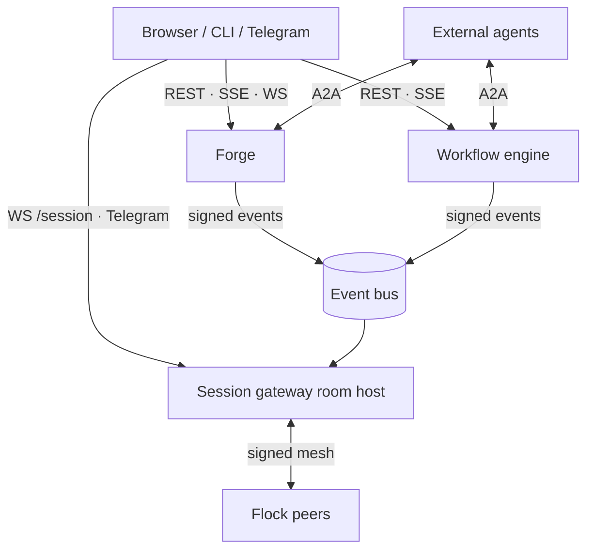

# Communication

Niuu has five ways for things to talk, and each one exists for a different job. Pick by
**who is talking to whom**, not by which transport happens to be nearby.

## In one minute

- **Service APIs** (REST, SSE, WebSocket): a client or service asks another service, or
  watches it live.
- **Event bus**: a service announces a fact; anyone may subscribe.
- **Collaboration rooms**: people and agents share one conversation.
- **Flock mesh**: certified peers in one flock talk to each other directly.
- **A2A**: talk to an agent system outside the flock, found by URL.

## The five, side by side

| | Service APIs | Event bus | Collaboration rooms | Flock mesh | A2A |
|---|---|---|---|---|---|
| **Who talks** | Browser, CLI, apps, services → Forge, workflow engine, session gateway, Platform | Platform services → any subscriber | People and agents in one room, hosted by the session's gateway | Session peers, resident peers, platform services | Workflow engine, Forge residents ↔ external agent systems |
| **Shape** | Request/response; live streams | Publish / subscribe on typed events | Membership, presence, messages, directed replies | `publish`/`subscribe` + RPC `send` | JSON-RPC tasks + agent card |
| **Delivery** | HTTP semantics; streams are live only | NATS JetStream: at-least-once with dead letters. Every other transport: at-most-once | Live to channels; member sessions get a delivery with a fixed request id (no duplicates) | Events: the transport's guarantee. RPC: one reply, or a timeout or typed refusal | Synchronous; the workflow engine adds durable push callbacks |
| **Persistence / replay** | Forge session log, read by cursor (`?after=<seq>`); replay WebSocket | JetStream stream (7 days by default), `replay_from_sequence`; audit table `sleipnir_events` | Forge `session_event_log` per hosting session; huddle log in memory | None for the mesh itself; a session's peer inbox is durable in its event log | Workflow engine: the workflow run; Forge: resident turns |
| **Transport** | HTTPS behind the edge (Envoy + identity provider) | NATS, nng, in-process, webhook, CLI command | Browser WebSocket, Telegram; Forge for member sessions | An event bus transport, or HTTP webhooks | HTTPS |
| **Identity** | OIDC bearer, PAT, scoped workload tokens | Signed platform events (`service` / `authority` certificates) | Room role: viewer, approver, owner | Forge-signed `mesh_peer` certificate, signature per message | Bearer token at the HTTP edge |
| **Typical use** | Create a session; stream its chat; list runs | "Session started", "run needs approval", "page written" | Operator answers a resident's question; two sessions in one room | A session asks a resident peer; flock-wide announcements | An outside client launches a workflow; the workflow engine calls an external agent |
| **What it is NOT** | Not a bus: nobody else hears it | Not a conversation, not a command channel, not where meaning is decided | Not A2A, not the bus, not the agent runtime's judgment | Not A2A, not a room | Not the mesh, not a room |

## How it fits

The user reaches services through APIs. Services announce on the bus. A session hosts the
room. Peers inside the flock use the mesh, and everything outside it uses A2A.

## Service APIs

| Stream | Route | What it carries |
|---|---|---|
| Forge sessions (SSE) | `GET /api/v1/forge/sessions/stream` | `session_created`, `session_updated`, `session_deleted`, `stats_updated`, `session_notification`, a heartbeat every 30 s |
| Workflow engine events (SSE) | `GET /api/v1/ting/events` | A state snapshot on connect, then live workflow engine events; 15 s keepalive |
| Workspace detail (SSE) | `GET /api/v1/realms/{slug}/stream` | `realm.detail` events |
| Platform sessions (SSE) | `GET /sessions/stream?scope=guild` (or `local`) | Sessions across every Platform host |
| Session chat (WebSocket) | Session gateway `/session`, proxied at `/s/{session_id}/session` | Live frames; a `conversation_history` snapshot and room state on connect |
| Session replay (WebSocket) | `WS /api/v1/forge/sessions/{id}/replay?after=<seq>` | The recorded log, paced like a live session |
| Session log (REST) | `GET /api/v1/forge/sessions/{id}/log?after=<seq>`, `…/log/page` | Durable frames by cursor |

Streams have no `Last-Event-ID` resume. A client that reconnects reads what it missed from
the session log by sequence cursor, then goes live again.

## Trace context

W3C trace context (`traceparent`, `tracestate`) follows work across every path, so model,
runtime, agent and platform behaviour can be diagnosed apart.

| Path | How it is carried |
|---|---|
| HTTP (REST, A2A) | OpenTelemetry instrumentation of FastAPI and httpx; the workflow engine parents its A2A span on the request headers |
| Process spawn | Forge sets `TRACEPARENT` / `TRACESTATE` for the session; the session gateway attaches them at start and the runtime inherits them |
| Event bus | `SleipnirEvent.trace_context` field, serialised with the event |
| Mesh | `MeshEvent.trace_context`, carried in the payload by the event bus mesh adapter |
| Rooms and Telegram | `trace_context` in directed-message metadata and in the opaque reply context, so a reply resumes the original trace |

Export is off until `observability.enabled` is set; then `trace_endpoint`, `metric_endpoint`
and `log_endpoint` (OTLP) are all required. There is no default endpoint.

## Levers

| Knob | Default | What it changes | Where it is set |
|---|---|---|---|
| `sleipnir.enabled` / `adapter` | `false` / in-process | The bus and its transport | Forge, workflow engine |
| `room.enabled` | `false` | A room in this session | Session gateway |
| `mesh.enabled` / `adapters` | `false` / `[]` | The mesh and its transports | Session gateway, mesh peers |
| `mesh.attestation.required` | `true` | Signed mesh and platform events | Every platform service |
| `a2a.*` | card name `Niuu Workflows`; push off | The workflow engine's A2A surface | Workflow engine |
| `observability.enabled` | `false` | Trace, metric and log export | Every service |

Each page below has the full lever table for its mechanism.

## Tradeoffs

| If you need … | Use | Not |
|---|---|---|
| An answer from one service now | A service API | The bus (no reply) |
| Many services to react to a fact | The bus | A room or the mesh |
| People and agents in one conversation | A room | The bus (no membership, no replies) |
| One peer in your flock to answer | Mesh `send` | A2A (no certified membership) |
| An agent you found by URL | A2A | The mesh (it would not admit them) |

## Code map

| Concern | Where |
|---|---|
| Ownership rules for these paths | [`.claude/rules/ravn-niuu-boundary.md`](https://github.com/niuulabs/niuu/blob/dev/.claude/rules/ravn-niuu-boundary.md) |
| Event bus | [`sleipnir/`](https://github.com/niuulabs/niuu/blob/dev/src/sleipnir) |
| Rooms | [`niuu/collaboration/`](https://github.com/niuulabs/niuu/blob/dev/src/niuu/collaboration) |
| Mesh | [`niuu/mesh/`](https://github.com/niuulabs/niuu/blob/dev/src/niuu/mesh), [`niuu/adapters/mesh/`](https://github.com/niuulabs/niuu/blob/dev/src/niuu/adapters/mesh) |
| A2A | [`ting/api/a2a.py`](https://github.com/niuulabs/niuu/blob/dev/src/ting/api/a2a.py), [`niuu/adapters/a2a_task.py`](https://github.com/niuulabs/niuu/blob/dev/src/niuu/adapters/a2a_task.py) |
| SSE and WebSocket routes | [`volundr/adapters/inbound/rest.py`](https://github.com/niuulabs/niuu/blob/dev/src/volundr/adapters/inbound/rest.py), [`ting/api/events.py`](https://github.com/niuulabs/niuu/blob/dev/src/ting/api/events.py), [`skuld/broker_api.py`](https://github.com/niuulabs/niuu/blob/dev/src/skuld/broker_api.py), [`volundr/adapters/inbound/ws_session_replay.py`](https://github.com/niuulabs/niuu/blob/dev/src/volundr/adapters/inbound/ws_session_replay.py) |
| Trace context | [`niuu/observability.py`](https://github.com/niuulabs/niuu/blob/dev/src/niuu/observability.py), [`niuu/domain/observability.py`](https://github.com/niuulabs/niuu/blob/dev/src/niuu/domain/observability.py) |

## Related

- [Event bus](event-bus.md)
- [Collaboration rooms](rooms.md)
- [Flock mesh and A2A](mesh-and-a2a.md)
- [One request end to end](../stack/request-flow.md): these paths in a real request.
- [Credentials](../security/credentials.md): the bearer tokens behind service APIs and A2A.
