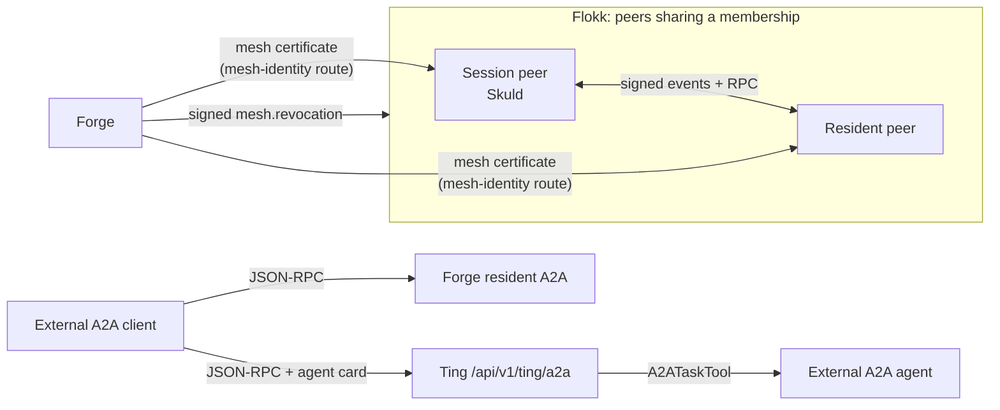

# Flokk mesh and A2A

Two ways for agents to talk to other agents. The **Flokk mesh** is direct, signed traffic
between peers that Forge has certified as members of the same tenant, flock or Workspace.
**A2A** is the open protocol for talking to agent systems *outside* that circle. The mesh is
not A2A, and A2A is not the mesh.

## In one minute

- **Mesh:** publish/subscribe plus point-to-point RPC (`send`) between peers, carried on a
  Sleipnir transport (NATS, nng, in-process) or HTTP webhooks.
- Every mesh message is signed with a key whose certificate Forge issued. A receiver refuses
  a sender that shares no membership (`tenant:`, `flock:`, `realm:`) with it.
- **A2A:** JSON-RPC over HTTPS with an agent card. Ting exposes workflows as A2A tasks; Forge
  exposes each resident runtime as an A2A agent; Niuu components call external A2A agents
  with a client tool.
- Pick the mesh for peers you share a Flokk with; pick A2A for anything you discover by URL.

## How it fits

The mesh lives inside the platform's trust boundary, proven per message. A2A crosses it,
authenticated by ordinary bearer credentials at the HTTP edge.

## Side by side

| | Flokk mesh | A2A |
|---|---|---|
| Who talks | Session peers (Skuld), resident peers, platform services | Ting, Forge resident runtimes, and any external agent system |
| Discovery | Discovery adapters: `mdns`, `sleipnir`, `k8s`, `static`, `registry`, `event_bus` | Agent card at `/.well-known/agent-card.json` |
| Identity | Forge-signed `mesh_peer` certificate + Ed25519 signature per message | Bearer token on HTTP (OIDC, workload token) |
| Shape | `publish(event, topic)`, `subscribe(topic)`, `send(peer, message)` → reply | `SendMessage`, `GetTask`, `CancelTask`, `ListTasks`, push config |
| Delivery | Events: the transport's guarantee. RPC: one request, one reply or `TimeoutError` | Synchronous JSON-RPC; Ting adds durable push notifications |
| State | No durable mesh log. RPC replies cached in memory for dedup; a session's peer inbox is durable in its event log | Ting: the task *is* the workflow run. Forge: a task is one resident turn |
| What it is NOT | Not A2A, not a room, not the platform event bus's meaning | Not a transport for Flokk peers; not a room |

## The mesh

**Port.** `MeshPort` has `publish`, `subscribe`, `unsubscribe` and `send(target_peer_id,
message, timeout_s=10.0)`. `send` raises `TimeoutError`, or `PeerNotFoundError` when the
peer is not in the verified peer table. Discovery (`announce`, `scan`, `watch`) is a separate
`DiscoveryPort`.

| Adapter | What it does |
|---|---|
| `SleipnirMeshAdapter` | Mesh over a Sleipnir transport. RPC goes to `<prefix>.rpc.<target>`; the reply returns on a per-request subject matched by correlation id |
| `WebhookMeshAdapter` | HTTP POSTs between peers (`listen_port` 7490, path `/ravn/mesh`) |
| `CompositeMeshAdapter` | Every configured transport at once (not failover). `send` uses the first transport that knows the peer; any error other than "unknown peer" is raised, because RPCs are not idempotent |
| `AttestedMesh` | Wraps any of the above: signs what goes out, verifies what comes in, fails closed |

**Membership and admission.** A peer asks Forge for its certificate at
`POST /api/v1/forge/sessions/{id}/mesh-identity` with its session credential, naming only its
public key, peer id and mesh realm. Forge sets everything else.

| Peer | Memberships Forge certifies |
|---|---|
| Forge session | `tenant:<id>` |
| Resident runtime | `flock:<flock_id>`, `realm:<workspace id>` when it has one, `tenant:<id>` |
| Platform service, Forge authority | none; exempt from the membership check |

**Leases.** A peer id belongs to one live holder at a time (`mesh_peer_claims`). The claim
expires with the holder's latest certificate, so a crashed holder frees its id one
certificate lifetime later; a second holder gets a 409. Stopping or restarting a session
releases its claims and publishes a signed `mesh.revocation`, so peers drop it at once.

**Refusals.** Unsigned, stale, wrong-recipient, revoked or non-member messages are refused:
a request gets a signed `refused` reply naming the reason, an event is not handled, a reply
raises. Each is counted on `niuu.mesh.attestation.refusals`.

**A session's inbox.** A message to a session is accepted only once it is written to the
session's event log and Forge confirmed it; duplicates (same `message_id`) are recognised;
after a restart the inbox is rebuilt from the log. The harness gets messages at turn
boundaries; `urgent` ones do not wait.

## A2A

| Surface | Route | Model | Not supported |
|---|---|---|---|
| Ting workflows | `POST /api/v1/ting/a2a`; card at `/.well-known/agent-card.json` (system-scope workflows only) | `taskId` is the workflow run (campaign) slug; `INPUT_REQUIRED` maps to a workflow gate | Streaming and subscribe ("poll `GetTask`") |
| Forge resident runtimes | `POST /api/v1/forge/resident-runtimes/{id}/a2a`; card at `…/{id}/a2a/.well-known/agent-card.json` | `contextId` is a resident channel; a task is one turn | `ListTasks`, streaming, push |
| Client | `A2ATaskTool` (`SendMessage`, `GetTask`, `CancelTask`, header `A2A-Version: 1.0`) | Ting's default child-task gateway; Ravn's tool-build backend | — |

Ting's push notifications are durable (Postgres-backed launches and push claims) and are on
only when both `a2a.push_encryption_key` and `a2a.push_callback_allowed_origins` are set.

## Levers

| Knob | Default | What it changes | Where it is set |
|---|---|---|---|
| `mesh.enabled` | `false` | Turns the mesh on for a peer | Skuld / mesh peer settings |
| `mesh.adapters` | `[]` | Mesh transports (dynamic adapters) | Mesh settings |
| `mesh.rpc_timeout_s` | `10.0` | Default wait for an RPC reply | Mesh settings |
| `mesh.rpc_reply_cache_size` | `1024` | Completed replies kept to answer a duplicate request | Mesh settings |
| `discovery.adapters` / `peer_ttl_s` | `[]` / `90` | How peers are found; when a silent peer is forgotten | Mesh peer settings |
| `forge_mcp.mesh_identity.ttl_seconds` | `900` | Certificate lifetime; renewed at half | Forge settings |
| `mesh.attestation.required` | `true` | `false` runs an unauthenticated mesh, by explicit choice | Every mesh peer and platform service |
| `mesh.attestation.clock_skew_s` | `300` | Replay window for requests and replies | Same |
| `a2a.agent_name` | `Niuu Workflows` | Name on Ting's agent card | Ting settings |
| `a2a.launch_lease_seconds` | `60` | How long a launch claim is held | Ting settings |
| `a2a.push_*` | off until key and origins are set | Durable push callbacks to A2A clients | Ting settings |
| `a2a_reply_timeout_seconds` | `45` | How long a resident A2A call waits for its turn | Forge settings |

## Tradeoffs

| Pick | When |
|---|---|
| Mesh `publish` | Many peers in a Flokk should hear it; loss is acceptable or the transport is JetStream |
| Mesh `send` | One peer must answer now; you want a typed refusal, not silence |
| A2A | The other side is outside the Flokk, found by URL, or not a Niuu peer at all |
| A room | Humans and agents share one conversation (see [Collaboration rooms](rooms.md)) |

The webhook mesh adapter does not carry trace context; use a Sleipnir transport when a
trace must follow the message.

## Not built yet

- A Flokk control plane with roles and admission policy beyond certified memberships.

## Code map

| Concern | Where |
|---|---|
| Mesh port, discovery port | [`niuu/ports/mesh.py`](https://github.com/niuulabs/niuu/blob/dev/src/niuu/ports/mesh.py), [`niuu/ports/discovery.py`](https://github.com/niuulabs/niuu/blob/dev/src/niuu/ports/discovery.py) |
| Mesh adapters | [`niuu/adapters/mesh/`](https://github.com/niuulabs/niuu/blob/dev/src/niuu/adapters/mesh) |
| Attestation | [`niuu/mesh/attestation.py`](https://github.com/niuulabs/niuu/blob/dev/src/niuu/mesh/attestation.py), [`niuu/adapters/mesh/attested.py`](https://github.com/niuulabs/niuu/blob/dev/src/niuu/adapters/mesh/attested.py) |
| Mesh and discovery settings | [`niuu/mesh/config.py`](https://github.com/niuulabs/niuu/blob/dev/src/niuu/mesh/config.py), [`niuu/mesh/discovery_builder.py`](https://github.com/niuulabs/niuu/blob/dev/src/niuu/mesh/discovery_builder.py) |
| Certificates, memberships, claims | [`volundr/domain/services/mesh_identity.py`](https://github.com/niuulabs/niuu/blob/dev/src/volundr/domain/services/mesh_identity.py), [`volundr/adapters/outbound/postgres_mesh_peer_claims.py`](https://github.com/niuulabs/niuu/blob/dev/src/volundr/adapters/outbound/postgres_mesh_peer_claims.py) |
| Resident flock peers | [`volundr/adapters/outbound/resident_flock.py`](https://github.com/niuulabs/niuu/blob/dev/src/volundr/adapters/outbound/resident_flock.py) |
| Session peer inbox | [`skuld/peer_inbox.py`](https://github.com/niuulabs/niuu/blob/dev/src/skuld/peer_inbox.py), [`skuld/mesh_attestation.py`](https://github.com/niuulabs/niuu/blob/dev/src/skuld/mesh_attestation.py) |
| Ting A2A server and card | [`ting/api/a2a.py`](https://github.com/niuulabs/niuu/blob/dev/src/ting/api/a2a.py), [`ting/api/a2a_card.py`](https://github.com/niuulabs/niuu/blob/dev/src/ting/api/a2a_card.py) |
| Forge resident A2A | [`volundr/adapters/inbound/rest_resident_a2a.py`](https://github.com/niuulabs/niuu/blob/dev/src/volundr/adapters/inbound/rest_resident_a2a.py) |
| A2A client | [`niuu/adapters/a2a_task.py`](https://github.com/niuulabs/niuu/blob/dev/src/niuu/adapters/a2a_task.py), [`niuu/adapters/child_task_a2a.py`](https://github.com/niuulabs/niuu/blob/dev/src/niuu/adapters/child_task_a2a.py) |

## Related

- [Communication overview](index.md)
- [Sleipnir event bus](sleipnir.md): the transports the mesh rides on.
- [Collaboration rooms](rooms.md): shared conversation, a third path.
- [Machine identities](../security/machine-identities.md): how mesh certificates fit with other machine credentials.
