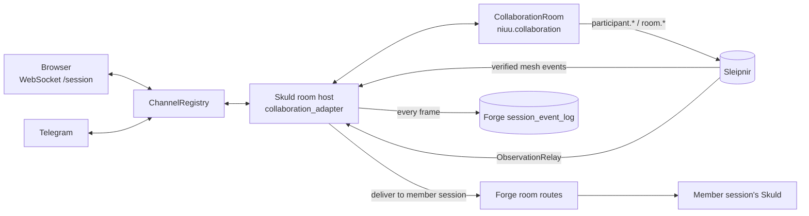
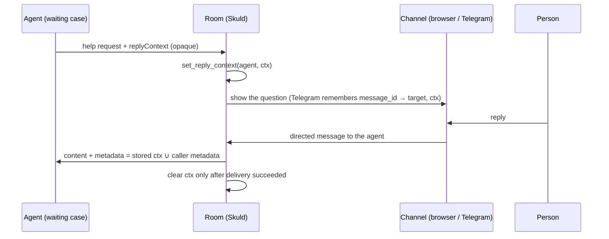

# Collaboration rooms

A collaboration room is the shared conversation that people and agents join together: who
is here, who is listening, what was said, and where an answer goes. The mechanics live in a
shared library; Skuld (the runtime session gateway) hosts a room per session and shows it on
the browser and Telegram.

## In one minute

- `niuu.collaboration.CollaborationRoom` owns membership, presence, routing and the huddle
  log. It imports neither Ravn nor Skuld; every effect (broadcast, publish, deliver) is a
  callback.
- A session's Skuld hosts the room. Browser WebSockets and Telegram are **channels**, not
  the room.
- The join route is for people **and** agents from other sessions. Joining grants no
  authority; what you may do is your room role.
- Going quiet never removes anyone. Membership ends only with an explicit leave.
- An answer to a waiting agent carries an **opaque reply context** back to it. The room
  stores and forwards it; only the agent reads it.

## How it fits

The room is in memory. The durable record is the hosting session's event log in Forge, which
is why a restarted Skuld can rebuild its conversation and re-seat members.

## Membership

| Way in | Who | Notes |
|---|---|---|
| `POST /api/room/join` | A person (`participant_type: human`) or an agent from another session (`session_id` set) | A member with a `session_id` gets a `room_member` frame in the durable log and takes delivery in its own session, through Forge |
| Mesh discovery | Mesh peers announced on the bus | Registered as participants when they appear |
| Forge proxy | Services acting for the owner | `POST /api/v1/forge/sessions/{id}/room/{join,leave,direct,…}`; Forge checks ownership and stamps the role |

| Rule | What the code does |
|---|---|
| Join is not human-only | `join_environment` takes `participant_type` and `session_id`; agents from other sessions join the same way |
| Joining grants no authority | Rights come from the room role (`viewer` < `approver` < `owner`), checked per route |
| Quiet is not gone | `mark_quiet_participants` sets `attention_state: away` for a disconnected participant whose heartbeat expired. It keeps its seat, its rooms and any reply it is owed |
| Back from quiet | The next heartbeat or activity makes it `available` again |
| Leave is explicit | `leave_environment` removes the seat and drops any pending reply context; only a person or a session member may leave by role |

**Room roles.** Viewer routes: `room/message`, `room/direct`, `GET room/participants`.
Join, leave, heartbeat and any unlisted route need `owner`. Skuld resolves the role from
the deployment, a trusted proxy header (`x-niuu-room-role`), or by asking Forge
(`room_role_source: remote`); a failed lookup denies.

## Presence and routing

| Concept | Meaning |
|---|---|
| `subscribes_to` / `emits` | Event patterns a participant hears and produces. A person joins hearing `room.message`, `room.direct`, `participant.*` |
| `attention_state` | `available` or `away`, set by the presence sweep or by the participant |
| `wakefulness`, `status` | Declared by the participant; the room never interprets them |
| Directed message | `route_directed_message(peer, content)`: delivered through the configured transport; `False` when it cannot be delivered |
| Member session delivery | A `RoomDelivery` with a fixed `request_id`, so a retry is never delivered twice; a failure raises `RoomDeliveryError` |

## Huddles and the log

A **huddle** is a replayable room scoped to an environment, opened for a purpose
(`open_environment_huddle`). It records a context snapshot for late joiners, sequenced
messages, and on close a Markdown transcript published as `room.transcript.recorded`
(`huddles/<environment>/<room>.md`).

| Record | Where | Survives a restart |
|---|---|---|
| Huddle events, sequence numbers | In memory in `CollaborationRoom` | No |
| Conversation turns, `room_member` seats | Forge `session_event_log`, appended by Skuld | Yes |
| `room.*`, `participant.*` events | Sleipnir (and the audit log when on) | Per transport |
| Live presence frames (`participant_joined`, …) | Broadcast to channels only | No |

A reconnecting browser gets a `conversation_history` snapshot and the current room state on
connect; older history is read by cursor from Forge (`GET /api/v1/forge/sessions/{id}/log?after=<seq>`).

## An answer returns to the exact case

- The context carries what the agent needs to resume: correlation and root correlation ids,
  workflow node, session and task ids, trace context. Skuld never reads inside it.
- Only an `approver` or above may consume a pending reply context. Callers below `owner`
  cannot inject `reply_context`, `participant_id` or `source` into metadata.
- On Telegram, a reply to a bot message finds its target through the remembered
  `message_id`. If exactly one peer could be meant, it goes there.
- The room keeps one pending context per peer: the latest.

## Levers

| Knob | Default | What it changes | Where it is set |
|---|---|---|---|
| `room.enabled` | `false` | Hosts a room in this session. An ordinary session pays nothing for it | Skuld settings |
| `room.environment_id` | `local` | Environment the room belongs to | Skuld settings |
| `room.presence_sweep_interval_s` | `30` | How often quiet participants are marked away; `0` turns the sweep off | Skuld settings |
| `room.default_target_peer_id` | empty | The resident a message goes to when none is named | Skuld settings |
| `observation_relay.enabled` / `event_patterns` | `true` / `["*"]` | Projects verified bus events to the room's resident | Skuld settings |
| `ws_auth.room_role_source` | `deployment` | Where the room role comes from: `deployment`, `proxy`, `remote` | Skuld settings |
| `telegram.enabled` / `topic_mode` | `false` / `topic_per_session` | Telegram channel and how chats map to sessions | Skuld settings |
| `event_log_enabled` | `true` | The durable log that rebuilds the room after a restart | Skuld settings |
| `history_hydration_enabled` | `true` | Rebuild conversation and seats from Forge on start | Skuld settings |

## Tradeoffs

| Choice | Gains | Costs |
|---|---|---|
| Room state in memory, record in the session log | No new store; one source of truth per session | Huddle sequences and presence frames do not survive a restart |
| Quiet means away, not gone | No lost seats or orphaned answers | Rosters show participants that may never return until they leave |
| Opaque reply context | The room stays free of agent semantics | One pending context per peer; a second question replaces the first |

## Code map

| Concern | Where |
|---|---|
| Room mechanics | [`niuu/collaboration/room.py`](https://github.com/niuulabs/niuu/blob/dev/src/niuu/collaboration/room.py), [`niuu/collaboration/models.py`](https://github.com/niuulabs/niuu/blob/dev/src/niuu/collaboration/models.py) |
| Mesh → room bridge, observation relay | [`niuu/collaboration/mesh.py`](https://github.com/niuulabs/niuu/blob/dev/src/niuu/collaboration/mesh.py), [`niuu/collaboration/observation_relay.py`](https://github.com/niuulabs/niuu/blob/dev/src/niuu/collaboration/observation_relay.py) |
| Room roles | [`niuu/room_access.py`](https://github.com/niuulabs/niuu/blob/dev/src/niuu/room_access.py), [`skuld/room_role_port.py`](https://github.com/niuulabs/niuu/blob/dev/src/skuld/room_role_port.py) |
| Skuld room host and routes | [`skuld/collaboration_adapter.py`](https://github.com/niuulabs/niuu/blob/dev/src/skuld/collaboration_adapter.py), [`skuld/broker_api.py`](https://github.com/niuulabs/niuu/blob/dev/src/skuld/broker_api.py), [`skuld/room_delivery.py`](https://github.com/niuulabs/niuu/blob/dev/src/skuld/room_delivery.py) |
| Channels | [`skuld/channels.py`](https://github.com/niuulabs/niuu/blob/dev/src/skuld/channels.py) |
| Durable log and hydration | [`skuld/event_log.py`](https://github.com/niuulabs/niuu/blob/dev/src/skuld/event_log.py), [`skuld/history_hydration.py`](https://github.com/niuulabs/niuu/blob/dev/src/skuld/history_hydration.py), [`volundr/adapters/inbound/rest_session_log.py`](https://github.com/niuulabs/niuu/blob/dev/src/volundr/adapters/inbound/rest_session_log.py) |
| Settings | [`skuld/config.py`](https://github.com/niuulabs/niuu/blob/dev/src/skuld/config.py) |

## Related

- [Communication overview](index.md)
- [Sleipnir event bus](sleipnir.md): rooms publish `room.*` and `participant.*`.
- [Flokk mesh and A2A](mesh-and-a2a.md): mesh peers appear as room participants.
- [Channels, rooms and Forge tools](../skuld/channels-and-tools.md): the session side of rooms and channels.
