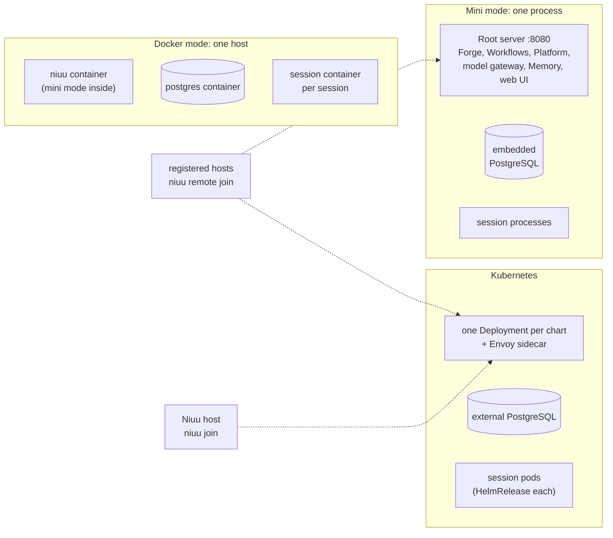

# Deployment modes

The same code runs in three shapes — one process on a laptop, a container bundle
on one Docker host, or a set of Helm releases on Kubernetes — and other machines
can join any of them to add compute.

## In one minute

- **Mini mode** (`niuu platform up`, `./start-dev`): one Python process serves every
  API and the web UI on one port, with an embedded PostgreSQL. Sessions are local
  processes.
- **Docker mode** (`niuu up` with `mode: docker`): the same mini-mode process in a
  container, next to a PostgreSQL container; each session is a sibling container.
- **Kubernetes**: one Helm chart per service (`charts/`), composed by the `niuu`
  umbrella chart. Sessions are pods (by default a Flux `HelmRelease` each).
- **Joined machines** add to any mode: `niuu remote join` turns a Linux machine or
  Mac into a *registered host* of a Forge; `niuu join` registers a whole Niuu host
  with a Platform.
- What changes between modes is **which adapter fills each port** — the domain code
  is identical. The CLI picks adapters for mini and Docker; chart values pick them on
  Kubernetes.

## How it fits

## The matrix

| | Mini | Docker | Kubernetes |
|---|---|---|---|
| **What runs where** | One process: root server mounts every service as a route domain | `niuu` container (mini mode) + `postgres` (+ optional `vllm`) | One Deployment per enabled chart: Forge, Workflows, shared APIs, Platform, model gateway, Observatory, Memory |
| **Database** | Embedded PostgreSQL, data in `~/.niuu/pgdata`; one database per service | `pgvector/pgvector:pg17` container, data under `docker.data_dir` | External PostgreSQL per chart (`database.external.*` + a Secret) |
| **Identity / edge** | `host_auth.mode: none` (allow-all, every caller admin) by default; `oidc` verifies JWTs in process | Same switch as mini | Envoy sidecar (`jwt_authn`) + identity adapter + Cedar, from the `values-cedar.yaml` / `values-central-identity.yaml` profiles; chart defaults are allow-all |
| **Event transport** | Event bus off; session mesh off until `mesh.enabled: true`, then nng with peers found through `~/.niuu/mesh/peers.json` | Same as mini | `sleipnir.adapter` (in-process by default; NATS, RabbitMQ, nng, Redis Streams available) |
| **Session runtime** | `LocalProcessPodManager`, wrapped by `PlacementPodManager` when the hosts pool is on | `DockerContainerPodManager` (sibling containers via the Docker socket) | `podManager.adapter`: `FluxPodManager` by default; `DirectK8sPodManager`, `OpenShellGatewayPodManager`, `VmPodManager` |
| **Secrets** | `FileCredentialStore` under `~/.niuu/credentials` (no encryption key set) | `FileCredentialStore`, Fernet-encrypted with `NIUU_CREDENTIAL_KEY` from `secrets.env`; per-session files bind-mounted read-only | `credentialStore.adapter` (in-memory by default; OpenBao via `charts/niuu/values-openbao.yaml`), Kubernetes Secrets |
| **Scaling** | One machine; registered hosts add capacity | One machine; registered hosts or a `compute:` pool add capacity | `replicaCount` / `autoscaling` per chart, session pods spread over the cluster, VM pools and registered hosts |
| **Who it is for** | Contributors, one developer | One machine for a person or small team (DGX Spark, a Linux server, Docker Desktop) | Shared, multi-user installs run through GitOps |

`niuu platform init` also offers `cluster` and `openshell`: the platform stays on
this machine (embedded database) and sessions go to a k3d/k3s cluster
(`DirectK8sPodManager`) or an OpenShell gateway. Allow-all identity and the hosts
pool are set up only in `mini`.

## Pick a mode

| Pick | When | You give up |
|---|---|---|
| Mini | You change Niuu or want it on your own machine in one command | Authentication (allow-all unless you set `oidc`), isolation between sessions (host processes as you), plaintext credential files |
| Docker | One machine should serve a team or run a local model on its GPU | Multi-node scaling of the platform itself; Kubernetes-only session features (workload identity is switched off) |
| Kubernetes | Several users, real identity provider, OpenBao, many concurrent sessions | Setup cost: database, IdP, ingress, secrets and a GitOps owner are yours to provide |
| + registered hosts | Spare machines (or Macs) should run sessions for an existing Forge | Forge must reach each host over SSH (direct, or the NAT endpoint on Kubernetes) |

## Migrations per mode

Forge's schema lives in `migrations/`, Workflows' in `migrations/ting/`. Every mode
reads those directories; no chart, image or binary keeps its own copy.

| Mode | Who applies them | When |
|---|---|---|
| Mini | The root server, through `apply_startup_migrations`, over the Forge database connection (both streams, tracked separately); then the shared, Platform and Observatory databases get their bootstrap SQL | Every start, before the API listens; a failure stops the start |
| Docker | The same code, inside the `niuu` container, against the `postgres` container | Every `niuu up` |
| Kubernetes | Init containers running `migrate/migrate up` over the chart's `migrations/` symlink, rendered into a ConfigMap; Forge first runs `migration-lineage` (`volundr.schema_bridge`) | Every Forge / Workflows pod start |
| Platform, shared-API charts | The one exception: tailored SQL for their own databases in `templates/migrations-configmap.yaml` | Every pod start |

Installed binaries and wheels carry the same files as `cli/migrations`
(`cli.resources.migration_dir`).

## Code map

| Concern | Where |
|---|---|
| Mode and every CLI knob | [`src/cli/config.py`](https://github.com/niuulabs/niuu/blob/dev/src/cli/config.py) (`CLISettings`) |
| `up`: adapter choice for mini | [`src/cli/commands/platform.py`](https://github.com/niuulabs/niuu/blob/dev/src/cli/commands/platform.py) (`_resolve_local_pod_manager_env`) |
| Identity adapters per `host_auth.mode` | [`src/cli/config.py`](https://github.com/niuulabs/niuu/blob/dev/src/cli/config.py) (`auth_adapter_env`) |
| Embedded database, startup migrations | [`src/niuu/root_server.py`](https://github.com/niuulabs/niuu/blob/dev/src/niuu/root_server.py) |
| Docker bundle | [`src/cli/services/compose_bundle.py`](https://github.com/niuulabs/niuu/blob/dev/src/cli/services/compose_bundle.py) |
| Pod managers | [`src/volundr/adapters/outbound/`](https://github.com/niuulabs/niuu/tree/dev/src/volundr/adapters/outbound) |
| Charts | [`charts/`](https://github.com/niuulabs/niuu/tree/dev/charts) |
| Migration sources | [`migrations/`](https://github.com/niuulabs/niuu/tree/dev/migrations), [`src/cli/resources.py`](https://github.com/niuulabs/niuu/blob/dev/src/cli/resources.py) |

## Related

- [Mini and Docker mode](single-host.md) — the one-machine shapes and their levers
- [Joined machines](joined-machines.md) — registered hosts and Platform nodes
- [Kubernetes](kubernetes.md) — charts, profiles, GitOps and single-replica rules
- [Configuration reference](../../reference/configuration.md) — every knob
- [Config and adapters](../design/config-and-adapters.md) — how a class path in config picks each adapter
- [Security](../security/index.md) — what allow-all and `oidc` mean at each entry point
