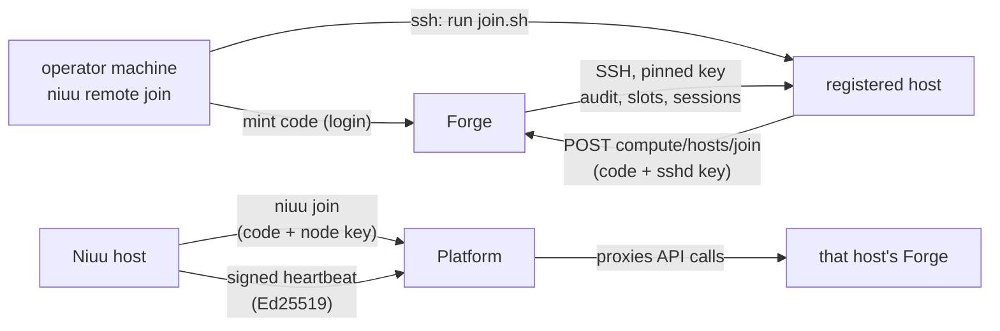

# Joined machines

Two different joins add machines to a deployment: a **registered host** gives a
Forge somewhere else to run sessions, and a **Platform node** offers a whole Niuu
host's Forge to a Platform.

## In one minute

| | Registered host | Platform node |
|---|---|---|
| Command | `niuu remote join <ssh destination>` (or **Add host** in the UI), run from the operator's machine | `niuu join <platform url> --code <code>`, run on the Niuu host |
| Joins | One Forge's compute pool | A Platform's instance registry |
| The machine runs | Sessions only (the session gateway from the release's session image or macOS bundle) | Its own full Niuu stack (mini or Docker) |
| Proof of identity | Its sshd Ed25519 key, registered with a single-use `compute_host_join` code | An Ed25519 node key in `~/.niuu`, used to sign heartbeats |
| Who connects to whom | Forge connects to the host over SSH (directly, or through the NAT endpoint) | The node sends signed heartbeats; the Platform proxies to the Forge URL it offered |
| Leave | `niuu remote leave` drains sessions, then Forge forgets the host | `niuu leave` |

## How it fits

The left half is compute: the host only ever calls the two join routes, and from then
on Forge drives it. The right half is federation: a Platform lists and proxies Forges
that live elsewhere.

## Registered hosts

| Step | What happens |
|---|---|
| Mint | The operator's login asks the Forge for a pairing code. Pool, execution, connector, tags and slots are fixed in the code, never taken from the host |
| Run `join.sh` | The operator's own `ssh` runs it on the machine (`--port`, `--jump` for bastions) |
| Join | The host posts the code and its sshd public key; the code is consumed once |
| Audit | Forge connects over SSH pinned to that key, checks the machine and suggests a slot count from `reserved_cpu` / `reserved_memory_mib` |
| Ready | `niuu remote join` follows the host until ready (`remote.follow_timeout_seconds`, 900 s) and exits 1 naming the step that failed |
| Place | A session lands on a host only when it asks (`workload_config.host_selector` or `execution_profile`); others stay where the Forge's own pod manager puts them |

Per mode:

| Mode | How the hosts pool is turned on | How Forge reaches a host |
|---|---|---|
| Mini | On by default when no `compute:` is configured (`hosts.enabled`). The pod manager becomes `PlacementPodManager`: local sessions plus a `VmPodManager` over the pool | `DirectSshConnector`. Hosts join through a pinned TLS listener on `https://<join_host>:8443` (no CA needed) unless `hosts.join_url` is set |
| Kubernetes | `computeHosts.enabled: true` with `computeHosts.joinUrl` (Forge's ingress); replaces `podManager` and `compute` | `DirectSshConnector`; for hosts behind NAT, the `hostConnect` sshd sidecar plus a `ReverseSshConnector` in the pool's connectors |

On Kubernetes, `guestMetadata.enabled` lets hosts pull session credentials from
Forge's metadata route, authenticated by the host's own key.

## Platform nodes

| Step | What happens |
|---|---|
| Pair | An operator mints a single-use code on the Platform: `niuu guild pair` |
| Join | `niuu join` sends the code, a display name, the node's public key and the instance it offers: its Forge at `http://<server.external_host>:<server.port>`. With `server.external_host` unset the join refuses: a bind address is not reachable |
| Persist | `guild.url`, `guild.node_id` and the Forge instance id land in `~/.niuu/config.yaml`; Forge serves them at `GET /api/v1/forge/guild` |
| Adopt identity | When the Platform verifies identity (Envoy or OIDC), the node merges the Platform's issuers into `host_auth` and switches to `oidc`. It never downgrades an `oidc` host to `none`; a refused adoption is printed as a warning |
| Stay present | `niuu guild heartbeat` (run it under a supervisor) signs method, path, timestamp and body hash every `guild.heartbeat_interval_seconds` (60 s) |

A Platform can also list instances statically (`registry.instances` in the `guild`
chart); `niuu join` is for hosts that come and go.

## Levers

| Knob | Default | What it changes | Where it is set |
|---|---|---|---|
| `hosts.enabled` | unset: on in mini without `compute:` | Serve the registered-hosts pool | `~/.niuu/config.yaml` |
| `hosts.join_host` / `hosts.join_url` | empty | Address hosts reach this Forge at; loopback is refused | config file |
| `hosts.max_hosts` | `16` | Hosts the pool may hold; one beyond waits ready and unclaimed | config file |
| `hosts.allowed_sources` | `[]` (any) | `from=` networks on Forge's key on each host | config file |
| `hosts.session_images.linux` / `.darwin` | `ghcr.io/niuulabs/openshell:dev`, `ghcr.io/niuulabs/skuld-darwin:dev` | What hosts run; tags are pinned by digest at Forge start | config file |
| `computeHosts.*` | `enabled: false` | The same pool on Kubernetes (`joinUrl`, `maxHosts`, `slot`, `platforms`) | `volundr` chart values |
| `hostConnect.enabled` | `false` | NAT endpoint; requires `replicaCount: 1`, `strategy.type: Recreate`, no autoscaling, a host-key Secret | `volundr` chart values |
| `--slots`, `--isolation`, `--tag`, `--execution`, `--connector` | Forge's defaults | Fixed into the pairing code | `niuu remote join` flags |
| `server.external_host` | empty | The Forge URL a Platform node offers | config file |
| `guild.heartbeat_interval_seconds` | `60` | How often presence is re-signed | config file |

## Tradeoffs

| Choice | Gains | Costs |
|---|---|---|
| Registered hosts over a bigger single host | Use Macs and spare Linux boxes; capacity grows one machine at a time | Forge needs SSH reach; host-mode sessions are separated by slot users and namespaces, not containers |
| `hostConnect` for NAT | Hosts with no inbound port | Forge is pinned to one pod and `Recreate` rollouts (downtime on upgrade) |
| Platform nodes over one big install | Each Forge keeps its own database and machine; one Platform shows them all | Each node owns its own upgrades and data; reaching it depends on the address it offered |

## Code map

| Concern | Where |
|---|---|
| `niuu remote` | [`src/cli/commands/remote.py`](https://github.com/niuulabs/niuu/blob/dev/src/cli/commands/remote.py), [`src/cli/services/remote_hosts.py`](https://github.com/niuulabs/niuu/blob/dev/src/cli/services/remote_hosts.py) |
| Hosts pool for mini | [`src/cli/config.py`](https://github.com/niuulabs/niuu/blob/dev/src/cli/config.py) (`HostsConfig`) |
| Pairing codes, host service | [`src/volundr/domain/services/compute_hosts.py`](https://github.com/niuulabs/niuu/blob/dev/src/volundr/domain/services/compute_hosts.py) |
| Connectors, provider | [`host_connectors.py`](https://github.com/niuulabs/niuu/blob/dev/src/volundr/adapters/outbound/host_connectors.py), [`registered_hosts.py`](https://github.com/niuulabs/niuu/blob/dev/src/volundr/adapters/outbound/registered_hosts.py) |
| Chart wiring | [`charts/volundr/templates/_helpers.tpl`](https://github.com/niuulabs/niuu/blob/dev/charts/volundr/templates/_helpers.tpl), [`host-connect-configmap.yaml`](https://github.com/niuulabs/niuu/blob/dev/charts/volundr/templates/host-connect-configmap.yaml) |
| `niuu join`, `niuu leave` | [`src/cli/app.py`](https://github.com/niuulabs/niuu/blob/dev/src/cli/app.py), [`src/cli/commands/node_instances.py`](https://github.com/niuulabs/niuu/blob/dev/src/cli/commands/node_instances.py) |
| `niuu guild pair` / `heartbeat` | [`src/cli/commands/guild.py`](https://github.com/niuulabs/niuu/blob/dev/src/cli/commands/guild.py), [`src/cli/auth/node_key.py`](https://github.com/niuulabs/niuu/blob/dev/src/cli/auth/node_key.py) |

## Related

- [Deployment modes](index.md) — the full mode matrix
- [Mini and Docker mode](single-host.md) — the hosts pool's home mode
- [Kubernetes](kubernetes.md) — `computeHosts`, `hostConnect`, `guestMetadata`
- Operator guide: [compute hosts](https://github.com/niuulabs/niuu/blob/dev/docs/operator/compute-hosts.md)
- [Machine identities](../security/machine-identities.md) — pairing codes, node signing, the host connect endpoint
