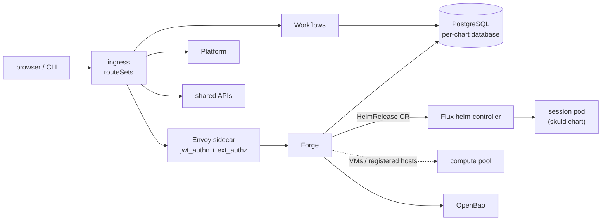

# Kubernetes

On Kubernetes each service is its own Helm chart and Deployment, an Envoy sidecar
verifies identity at the edge, and Forge runs each session as its own Kubernetes
workload.

## In one minute

- `charts/niuu` is an **umbrella chart**: Forge (`volundr`), Workflows (`ting`), the
  shared APIs (`niuu-shared`), Platform (`guild`), `bifrost`, `observatory` and a
  shared Mímir (`mimir-shared`) are on by default; each is also a chart of its own.
- Sessions are **not** part of that release. With the default `FluxPodManager`, Forge
  writes one Flux `HelmRelease` of the `skuld` chart per session and Flux's
  helm-controller makes it real.
- **The chart defaults are allow-all and in-memory.** Real deployments layer values
  profiles on top: `values-cedar.yaml` (Envoy JWT + Cedar), `values-central-identity.yaml`
  (shared identity service), `charts/niuu/values-openbao.yaml` (OpenBao credentials).
- PostgreSQL, the identity provider, ingress and secrets are **yours**. The charts
  point at them; they do not install them.
- Migrations run as **init containers** on every pod start, from the same
  `migrations/` files every other mode uses.

## How it fits

The ingress splits paths across services (`ingress.routeSets` in the umbrella). Each
service keeps its own database. Forge never runs session processes itself: it asks
the configured pod manager, which on the default path hands Flux a release to
reconcile.

## What each mode-defining value picks

| Concern | Chart value (volundr unless noted) | Default | Production profile |
|---|---|---|---|
| Edge identity | `envoy.enabled`, `envoy.jwt.enabled` | off | on, via `values-cedar.yaml` |
| Identity adapter | `identity.adapter` | `AllowAllIdentityAdapter` | `EnvoyHeaderIdentityAdapter` |
| Authorization | `authorization.adapter` | `AllowAllAuthorizationAdapter` | `CedarAuthorizationAdapter` |
| Credentials | `credentialStore.adapter` | `MemoryCredentialStore` | `OpenBaoCredentialStore` (`values-openbao.yaml`, also for `niuu-shared` and `ting`) |
| Database | `database.external.host` / `.port`, `database.existingSecret` | `postgresql.default.svc.cluster.local:5432` | your cluster's PostgreSQL |
| Sessions | `podManager.adapter` + `podManager.kwargs` | `FluxPodManager` | as chosen below |
| Event bus | `sleipnir.enabled`, `sleipnir.adapter` | off, `InProcessBus` | a networked adapter (NATS, RabbitMQ, nng, Redis Streams) |
| Workload identity | `workloadIdentity.enabled`, `workloadIdentity.signingKey.existingSecret` | off | on: scoped tokens and session credentials |
| Session credential files | `sessionCredentialProjection.enabled` | follows the signing key | one Secret per session, mounted read-only |
| Registered hosts | `computeHosts.enabled`, `hostConnect.enabled`, `guestMetadata.enabled` | off | see [Joined machines](joined-machines.md) |

`values-no-auth.yaml` exists per chart to say "no authentication" explicitly.

## Session runtimes

| `podManager.adapter` | What a session becomes | Pick it when |
|---|---|---|
| `FluxPodManager` | A `HelmRelease` of the `skuld` chart in `kwargs.namespace` | The cluster runs Flux and sessions should be reconciled like any release |
| `DirectK8sPodManager` | A Deployment, Service and path-based Ingress | k3s/k3d without DNS or Flux |
| `OpenShellGatewayPodManager` | A sandbox in an OpenShell gateway | Sessions must run in OpenShell sandboxes |
| `VmPodManager` (with `compute:`) | A slot on a VM from a compute pool | Sessions need a VM boundary (`podManager.runtimeBackend: vm`) |

All live in `src/volundr/adapters/outbound/`; the Forge architecture pages cover how
each one launches and stops a session.

## GitOps

| What | Who reconciles it |
|---|---|
| The platform (umbrella or per-service charts) | Your GitOps owner, from reviewed values and a pinned chart version. Do not run a manual `helm upgrade` over a release a reconciler owns |
| Each session | Flux, from the `HelmRelease` Forge writes (`FluxPodManager`); stopping the session deletes the CR |
| Migrations | The release's init containers, on each rollout |

Render before you apply: `helm template` proves the chart renders, not that the
secrets, database or IdP it names exist.

## Single-replica and rollout rules

| Feature | Constraint, enforced by the chart | Why |
|---|---|---|
| `hostConnect` (NAT endpoint) | `replicaCount: 1`, `strategy.type: Recreate`, `autoscaling.enabled: false`, a host-key Secret; render fails otherwise | A host's tunnel ends in one Forge pod, the one that dials it |
| Workflows `workflowMigration.applyOnStart` | `Recreate` strategy | No old pod may write workflow definitions during the migration |
| Everything else | `replicaCount: 1` by default; `autoscaling` available (off) | Scale per chart once its own state allows |

## Levers

| Knob | Default | What it changes | Where it is set |
|---|---|---|---|
| `<chart>.enabled` | see umbrella `values.yaml` | Whether a service is deployed | `charts/niuu` values |
| `global.image.registry` | `ghcr.io/niuulabs` | Where every image is pulled from | umbrella values |
| `ingress.routeSets`, `ingress.hosts`, `ingress.tls` | off | Path routing to services | umbrella values |
| `replicaCount`, `autoscaling.*`, `strategy` | `1`, off, `RollingUpdate` | Forge pods and rollout | volundr values |
| `migrations.enabled` | `true` | Run the migrate init containers | each chart |
| `mesh.attestation.required` | `null` (true) | `false` runs the mesh unauthenticated, reported on `/health` | volundr values |

Everything else is in each chart's `values.yaml`; see the
[configuration reference](../../reference/configuration.md) and the
[Helm chart reference](../../reference/helm-charts.md).

## Tradeoffs

| Choice | Gains | Costs |
|---|---|---|
| Kubernetes over one machine | Real identity, OpenBao, many users and sessions, per-service rollouts | You run PostgreSQL, the IdP, ingress, Flux and secrets |
| `FluxPodManager` over `DirectK8sPodManager` | Sessions are versioned releases a reconciler repairs | Needs Flux; a session start waits on a reconcile |
| Chart defaults as-is | Renders anywhere | Allow-all identity and in-memory credentials: never for a shared install |
| `hostConnect` | Hosts behind NAT | One Forge pod, `Recreate` downtime on each upgrade |

## Code map

| Concern | Where |
|---|---|
| Umbrella chart, profiles | [`charts/niuu/`](https://github.com/niuulabs/niuu/tree/dev/charts/niuu) |
| Forge chart, migrations init containers | [`charts/volundr/values.yaml`](https://github.com/niuulabs/niuu/blob/dev/charts/volundr/values.yaml), [`templates/deployment.yaml`](https://github.com/niuulabs/niuu/blob/dev/charts/volundr/templates/deployment.yaml) |
| Security profiles | [`values-cedar.yaml`](https://github.com/niuulabs/niuu/blob/dev/charts/volundr/values-cedar.yaml), [`values-central-identity.yaml`](https://github.com/niuulabs/niuu/blob/dev/charts/volundr/values-central-identity.yaml), [`values-openbao.yaml`](https://github.com/niuulabs/niuu/blob/dev/charts/niuu/values-openbao.yaml) |
| Pod managers | [`flux.py`](https://github.com/niuulabs/niuu/blob/dev/src/volundr/adapters/outbound/flux.py), [`direct_k8s_pod_manager.py`](https://github.com/niuulabs/niuu/blob/dev/src/volundr/adapters/outbound/direct_k8s_pod_manager.py), [`openshell_gateway.py`](https://github.com/niuulabs/niuu/blob/dev/src/volundr/adapters/outbound/openshell_gateway.py), [`vm_pod_manager.py`](https://github.com/niuulabs/niuu/blob/dev/src/volundr/adapters/outbound/vm_pod_manager.py) |
| Single-replica guards | [`host-connect-configmap.yaml`](https://github.com/niuulabs/niuu/blob/dev/charts/volundr/templates/host-connect-configmap.yaml), [`charts/ting/templates/deployment.yaml`](https://github.com/niuulabs/niuu/blob/dev/charts/ting/templates/deployment.yaml) |
| Lineage repair before `migrate` | [`src/volundr/schema_bridge.py`](https://github.com/niuulabs/niuu/blob/dev/src/volundr/schema_bridge.py) |
| One migrations source | [`tests/test_charts/test_migrations_single_source.py`](https://github.com/niuulabs/niuu/blob/dev/tests/test_charts/test_migrations_single_source.py) |

## Related

- [Deployment modes](index.md) — the full mode matrix
- [Joined machines](joined-machines.md) — hosts and Platform nodes
- [Kubernetes deployment guide](../../operations/kubernetes-deployment.md) — render, apply, verify
- [Security](../security/index.md) — Envoy, Cedar and every credential kind
