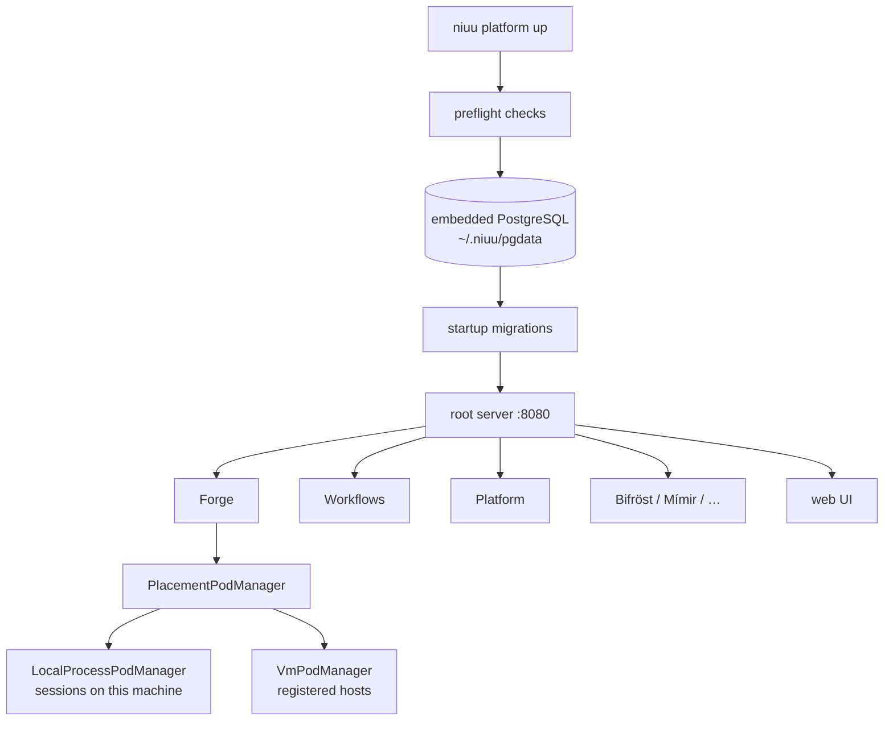

# Mini and Docker mode

Both one-machine shapes run the same root server: mini mode runs it as a process on
your machine, Docker mode runs it inside a container next to its database and
session containers.

## In one minute

- `niuu platform up` starts **one process** on one port (`server.port`, 8080). Every
  service is a plugin mounted as a route domain: Forge (Völundr), Workflows (Ting),
  Platform (Guild), Bifröst, Mímir, Observatory, the shared APIs, the web UI.
- It starts an **embedded PostgreSQL** first, creates one database per service and
  applies the migrations, then serves.
- `./start-dev` is a contributor wrapper: it builds everything from the checkout and
  runs `niuu platform up --skip-preflight` in the background (stop with `./stop-dev`).
- `mode: docker` makes `niuu up` render and start a **Compose bundle** instead. The
  `niuu` container inside it runs mini mode against a PostgreSQL container, and each
  session becomes a sibling container.
- With no identity configured, both modes are **allow-all**: every caller is admin.
  That is an explicit setting (`host_auth.mode: none`), not a fallback.

## How it fits

Read top to bottom: the CLI checks the host, starts the database, migrates, then
serves every API from one ASGI app. Forge's pod manager decides where a session runs.

## Mini mode, step by step

| Step | What happens | Where |
|---|---|---|
| Choose services | Plugin defaults, then `service_overrides.<name>.enabled`, then `--<service>/--no-<service>`, then `--all` | `_resolve_enabled_services` |
| Preflight | Claude binary, ports, workspace dir, database binaries, git, disk, Xcode on macOS | `cli/services/preflight.py` |
| Adapter wiring | The CLI writes env for Forge: pod manager, credential store, identity adapters, Mímir deployment, workload identity off | `_resolve_local_pod_manager_env` |
| Database | `database.mode: embedded` runs bundled `initdb`/`pg_ctl` (found via `NIUU_PG_BIN_DIR`, the binary bundle, or `build/pginstall`); `external` uses `DATABASE__HOST` | `EmbeddedPostgresDatabase`, `RootServer._start_embedded_db` |
| Migrations | `migrations/` and `migrations/ting/` on the Forge database; bootstrap SQL for shared, Platform, Observatory | `RootServer._run_migrations` |
| Serve | Route domains from `--host-profile` (`full`, or `api` without the web UI) or `--mounts` | `niuu.app.HOST_PROFILES` |

Sessions run as **host processes as your user**, in `pod_manager.workspaces_dir`
(`~/.niuu/workspaces`). Residents run as containers on the local Docker Engine
(`residents.runtime: docker`); Docker is contacted only when a resident is created.

## Docker mode, step by step

`niuu up` (or `niuu platform up`) with `mode: docker` runs host checks, writes the
bundle under `docker.compose_dir`, runs `docker compose up -d`, and waits for
`/health`.

| Container | Image (default) | Role |
|---|---|---|
| `postgres` | `pgvector/pgvector:pg17` | All service databases; data in `<data_dir>/postgres` |
| `niuu` | `ghcr.io/niuulabs/niuu:dev` | `niuu platform up` in mini mode, `NIUU_DATABASE_MODE=external`, Docker socket mounted, setup wizard on |
| `niuu-session-<id>` | `ghcr.io/niuulabs/skuld:dev` | One per session, started by `DockerContainerPodManager` on the bundle network |
| `vllm` | `docker.vllm.image` | Only with `docker.vllm.enabled`; registered as a model provider |

| File | Holds |
|---|---|
| `<compose_dir>/docker-compose.yaml`, `.env` | The rendered bundle, non-secret variables |
| `<compose_dir>/secrets.env` (0600) | `NIUU_POSTGRES_PASSWORD`, `NIUU_CREDENTIAL_KEY`, generated on the first run |
| `<data_dir>/credentials/` | Fernet-encrypted credential store |
| `<data_dir>/session-secrets/<id>/` | Only the fields a session's integrations ask for, bind-mounted read-only, removed at stop |

Changes made in the setup wizard land in `stack-overrides.yaml` and win over
`config.yaml` on the next `niuu up`.

## Levers

| Knob | Default | What it changes | Where it is set |
|---|---|---|---|
| `mode` | `mini` | `docker` runs the Compose bundle instead of a host process | `~/.niuu/config.yaml`, `NIUU_MODE`, `niuu up --mode` |
| `server.host` / `server.port` | `127.0.0.1` / `8080` | Bind address and the one published port | config file |
| `server.external_host` | empty | Address in browser URLs, the join address, the Platform instance URL | config file |
| `database.mode` | `embedded` | `external` skips the bundled PostgreSQL and uses `DATABASE__HOST/PORT/USER/PASSWORD` | config file |
| `host_auth.mode` | `none` | `oidc`: every service verifies bearer tokens against `host_auth.oidc.issuers` (JWKS) and authorizes with Cedar; refused while the `bifrost` plugin is enabled | config file |
| `pod_manager.adapter` | `LocalProcessPodManager` | Where sessions run; Docker mode sets `DockerContainerPodManager` | config file |
| `pod_manager.max_concurrent` | unset (no limit) | Refuses a launch over the limit, naming the key | config file |
| `mesh.enabled` | unset (Skuld: off) | Session mesh on nng; `mesh.attestation.required` stays on | config file |
| `hosts.enabled` | on in mini without `compute:` | Registered-hosts pool next to local sessions | config file |
| `--host-profile`, `--mounts`, `--no-web` | `full` | Which route domains the root server mounts | `niuu platform up` flags |
| `docker.data_dir` / `docker.compose_dir` | `~/.niuu/data` / `~/.niuu/docker` | Where state and the bundle live | config file, `NIUU_DOCKER__*` |
| `docker.bind_host` | `0.0.0.0` | `127.0.0.1` keeps the platform to this machine | config file, wizard |
| `docker.vllm.enabled` / `.model` / `.image` | off | Serve a local model on the GPU; an enabled vLLM without an image fails `niuu up` | config file, wizard |
| `docker.model_server.*` | off | Register a model server you already run as the `local` provider | config file |
| `docker.require_gpu` | `false` | Fail preflight without an NVIDIA runtime | config file |

The full schema is `CLISettings`; see the
[configuration reference](../../reference/configuration.md).

## Tradeoffs

| Choice | Gains | Costs |
|---|---|---|
| Mini, embedded database | One command, nothing to install but the binary | Data and sessions die with the machine; credentials are plain files in `~/.niuu/credentials` |
| Mini, `host_auth.mode: none` | No identity provider needed | Anyone who reaches the port is admin; bind to `127.0.0.1` or set `oidc` |
| Docker over mini | Sessions isolated in containers; encrypted credentials; one installer for any Docker host | Docker required; losing `secrets.env` makes every stored credential unreadable |
| Either over Kubernetes | No cluster, no IdP, no secret manager | One machine is the ceiling for the platform itself; workload identity is switched off (no token issuer) |

## Code map

| Concern | Where |
|---|---|
| CLI settings | [`src/cli/config.py`](https://github.com/niuulabs/niuu/blob/dev/src/cli/config.py) |
| `up`, adapter env, init defaults | [`src/cli/commands/platform.py`](https://github.com/niuulabs/niuu/blob/dev/src/cli/commands/platform.py) |
| Root server, database, migrations | [`src/niuu/root_server.py`](https://github.com/niuulabs/niuu/blob/dev/src/niuu/root_server.py), [`src/niuu/adapters/embedded_postgres.py`](https://github.com/niuulabs/niuu/blob/dev/src/niuu/adapters/embedded_postgres.py) |
| Route domains, host profiles | [`src/niuu/app.py`](https://github.com/niuulabs/niuu/blob/dev/src/niuu/app.py) |
| Host checks | [`src/cli/services/preflight.py`](https://github.com/niuulabs/niuu/blob/dev/src/cli/services/preflight.py), [`src/cli/services/docker_host.py`](https://github.com/niuulabs/niuu/blob/dev/src/cli/services/docker_host.py) |
| Docker bundle and `niuu up` | [`src/cli/services/compose_bundle.py`](https://github.com/niuulabs/niuu/blob/dev/src/cli/services/compose_bundle.py), [`src/cli/commands/stack.py`](https://github.com/niuulabs/niuu/blob/dev/src/cli/commands/stack.py) |
| Session runtimes | [`local_process.py`](https://github.com/niuulabs/niuu/blob/dev/src/volundr/adapters/outbound/local_process.py), [`docker_container.py`](https://github.com/niuulabs/niuu/blob/dev/src/volundr/adapters/outbound/docker_container.py), [`placement_pod_manager.py`](https://github.com/niuulabs/niuu/blob/dev/src/volundr/adapters/outbound/placement_pod_manager.py) |
| Contributor stack | [`start-dev`](https://github.com/niuulabs/niuu/blob/dev/start-dev), [`stop-dev`](https://github.com/niuulabs/niuu/blob/dev/stop-dev) |

## Related

- [Deployment modes](index.md) — the full mode matrix
- [Joined machines](joined-machines.md) — the hosts pool mini mode turns on
- [Docker mode guide](../../operations/docker-mode.md) — installer and wizard walkthrough
- [Security](../security/index.md) — edge auth and identity adapters
