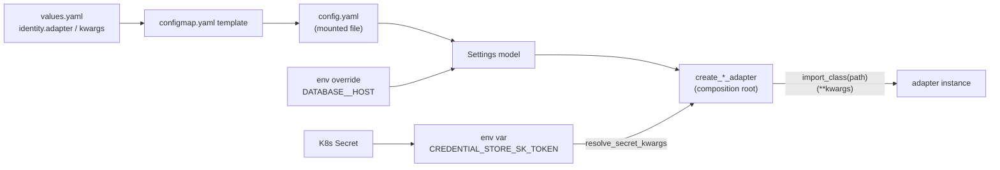

# Config and adapters

Every knob is a typed field on a settings model, and every swappable implementation is picked by a class path in that config.

## In one minute

- Each package has a settings model in `src/<pkg>/config.py` (pydantic-settings). A YAML file is canonical; environment variables override it.
- An adapter block is `adapter:` (a fully-qualified class path), `kwargs:` (constructor arguments) and `secret_kwargs_env:` (kwargs filled from env vars that hold secrets).
- The composition root calls `import_class(adapter)(**kwargs)`. There is no `if/elif` on adapter names, so adding an adapter is one class plus one config change.
- The Helm chart renders `config.yaml` from `values.yaml`; secrets reach adapters as env vars from Kubernetes Secrets, never inline.
- No bare `os.environ` reads for behaviour and no literal timeouts or counts in business logic. A test fails the build on a new environment read.

## How it fits



The chart never puts behaviour in `env:`; environment variables carry only secrets and operator overrides.

## Where settings come from

Forge's `Settings` ([`src/volundr/config.py`](https://github.com/niuulabs/niuu/blob/dev/src/volundr/config.py)) reads, first match wins:

| Order | Source | Example |
|---|---|---|
| 1 | Constructor arguments | Tests, CLI hosts |
| 2 | Environment, `__` for nesting | `DATABASE__HOST=db` → `settings.database.host` |
| 3 | YAML file | `$NIUU_CONFIG`, else `./config.yaml`, else `/etc/volundr/config.yaml` |
| 4 | `/run/secrets` files | Docker secrets |

Legacy env names keep working through aliases:

```python
server_host: str = Field(
    default="127.0.0.1",
    validation_alias=AliasChoices("server_host", "NIUU_SERVER_HOST"),
)
```

Example files in [`examples/`](https://github.com/niuulabs/niuu/tree/dev/examples) are validated against the models, because `extra="ignore"` would otherwise accept a key the code no longer reads.

## The adapter block

```yaml
# config.yaml (Forge)
storage:
  adapter: volundr.adapters.outbound.k8s_storage_adapter.K8sStorageAdapter
  kwargs:
    namespace: skuld
    home_storage_class: longhorn
    home_size_gb: 64
  secret_kwargs_env: {}
```

The builder that consumes it ([`src/niuu/service_runtime.py`](https://github.com/niuulabs/niuu/blob/dev/src/niuu/service_runtime.py)):

```python
def create_storage_adapter(settings):
    config = settings.storage
    cls = import_class(config.adapter)
    kwargs = resolve_secret_kwargs(config.kwargs, config.secret_kwargs_env)
    return cls(**kwargs)
```

| Piece | What it does | Where |
|---|---|---|
| `import_class(path)` | `importlib` the module, `getattr` the class; cached | [`src/niuu/utils/__init__.py`](https://github.com/niuulabs/niuu/blob/dev/src/niuu/utils/__init__.py) |
| `resolve_secret_kwargs` | Overlays kwargs from the env vars named in `secret_kwargs_env` | same file |
| Injected kwargs | The root adds runtime objects users never configure: identity gets `user_repository` and `role_mapping`; tracker adapters get the DB pool | `create_identity_adapter`, `ting/adapters/tracker_factory.py` |
| Short aliases | Mesh transports accept `nng`, `nats`, `in_process` as well as a class path | [`src/niuu/mesh/transport_builder.py`](https://github.com/niuulabs/niuu/blob/dev/src/niuu/mesh/transport_builder.py) |

A builder that cannot import or construct the class raises with the fix in the message. For the mesh: *"mesh transport 'nats' could not be imported from …: Install the package that provides it, or configure a different transport"*. A configured transport that cannot be built is fatal, never a disabled mesh.

### Secrets in the chart

```yaml
credentialStore:
  adapter: "niuu.adapters.openbao_credential_store.OpenBaoCredentialStore"
  kwargs: { url: "http://openbao:8200", mount_path: "volundr" }
  secretKwargs:
    - { kwarg: token, secretName: openbao-token, secretKey: token }
```

The chart turns each `secretKwargs` entry into an env var (`CREDENTIAL_STORE_SK_TOKEN`) from the Secret, and writes `secret_kwargs_env: {token: CREDENTIAL_STORE_SK_TOKEN}` into `config.yaml`. The token never appears in the ConfigMap.

## Adding an adapter

1. Implement the port: `class MyStore(CredentialStorePort)` in your package's `adapters/`.
2. Take plain kwargs in `__init__` (strings, numbers, paths), never a config object, and never read the environment yourself.
3. Point config at it: `adapter: mypkg.adapters.my_store.MyStore` plus its `kwargs`.
4. Test it against the port's contract.

There is no registry or factory branch to update. The class can live outside this repository if it is importable in the image.

## No magic numbers

A timeout, threshold or count in business logic is a config field with a default and a description that says what bounds it. Example from the session gateway ([`src/skuld/config.py`](https://github.com/niuulabs/niuu/blob/dev/src/skuld/config.py)):

```python
class AskConfig(BaseModel):
    wait_max_s: float = Field(
        default=50.0, gt=0,
        description="Longest one ask call waits ... must be shorter than "
        "forge_mcp.broker_request_timeout_s and forge_mcp.tool_timeout_s ...",
    )
```

A model validator on the session gateway's settings (`SkuldSettings`) refuses to start if `ask.wait_max_s` is not shorter than both engine timeouts, naming the knob to lower or raise.

Allowed literals: loop indices, identity values like `0.0` and `1.0`, test fixtures, log text.

## Levers

| Knob | Default | What it changes | Where it is set |
|---|---|---|---|
| `NIUU_CONFIG` | unset (`./config.yaml`, then `/etc/volundr/config.yaml`) | Which config file Forge loads | Process env |
| `<SECTION>__<FIELD>` env | unset | Overrides one nested setting | Process env |
| `<block>.adapter` | per block, see [Design principles](index.md#levers-swapping-an-implementation) | Which implementation runs | `config.yaml` / chart values |
| `<block>.kwargs` | `{}` | Constructor arguments | `config.yaml` / chart values |
| `<block>.secretKwargs` (chart) | `[]` | Constructor arguments sourced from a Secret | Chart values |

## Tradeoffs

| Choice | Gains | Costs |
|---|---|---|
| Class path strings | Zero-code extension; third-party adapters | Errors surface at startup, not in the type checker |
| Plain kwargs | Adapters are testable and portable | The root must translate settings to kwargs |
| Env overrides YAML | Quick operator fix without a chart change | Two places to look; prefer the file for anything durable |

Existing adapters that predate the pattern keep their wiring. One compatibility map remains: the workflow engine rewrites stored Forge tracker class paths to its own (`_resolve_tracker_adapter` in `ting/adapters/tracker_factory.py`).

## Code map

| Concern | Where |
|---|---|
| Import helpers | [`src/niuu/utils/__init__.py`](https://github.com/niuulabs/niuu/blob/dev/src/niuu/utils/__init__.py) |
| Shared builders | [`src/niuu/service_runtime.py`](https://github.com/niuulabs/niuu/blob/dev/src/niuu/service_runtime.py) |
| Forge builders | [`src/volundr/composition_builders.py`](https://github.com/niuulabs/niuu/blob/dev/src/volundr/composition_builders.py) |
| Forge settings | [`src/volundr/config.py`](https://github.com/niuulabs/niuu/blob/dev/src/volundr/config.py) |
| Chart config rendering | [`charts/volundr/templates/configmap.yaml`](https://github.com/niuulabs/niuu/blob/dev/charts/volundr/templates/configmap.yaml), [`deployment.yaml`](https://github.com/niuulabs/niuu/blob/dev/charts/volundr/templates/deployment.yaml) |
| Env-read guard | [`tests/test_infrastructure/test_config_first.py`](https://github.com/niuulabs/niuu/blob/dev/tests/test_infrastructure/test_config_first.py) |
| Example-config guard | [`tests/test_infrastructure/test_example_configs.py`](https://github.com/niuulabs/niuu/blob/dev/tests/test_infrastructure/test_example_configs.py) |
| Rules | [`dynamic-adapters.md`](https://github.com/niuulabs/niuu/blob/dev/.claude/rules/dynamic-adapters.md), [`config-first.md`](https://github.com/niuulabs/niuu/blob/dev/.claude/rules/config-first.md), [`no-magic-numbers.md`](https://github.com/niuulabs/niuu/blob/dev/.claude/rules/no-magic-numbers.md) |

## Related

- [Layers and boundaries](layers.md)
- [Fail loud](fail-loud.md) — what happens when an adapter cannot do what config asked
