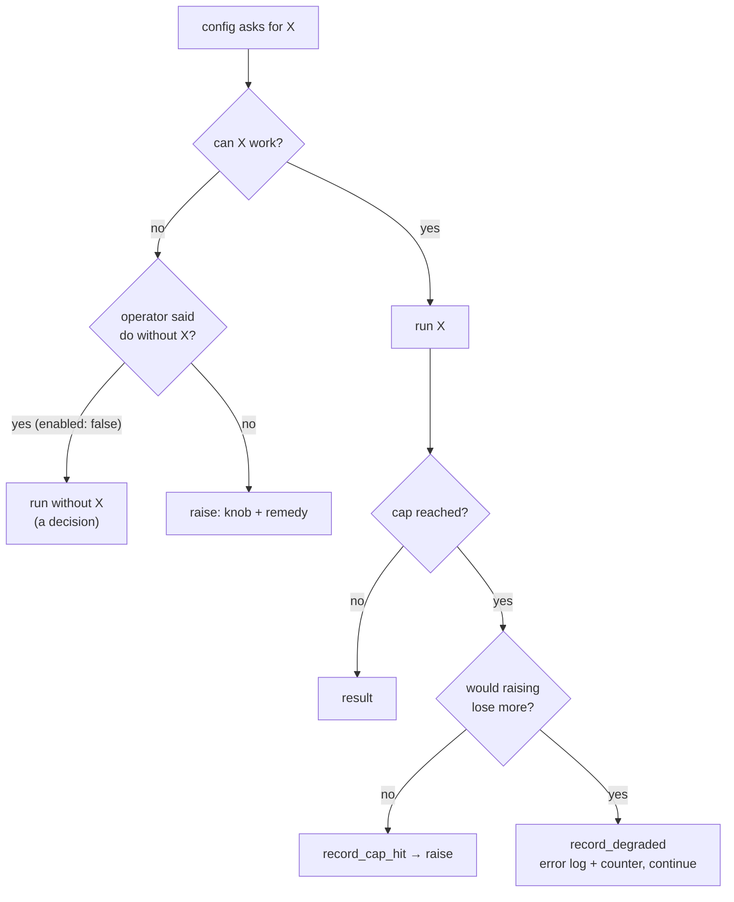

# Fail loud

When something configured cannot be done, Niuu stops and says why. It never switches to a weaker path, and it never lets a limit cut work off without counting it.

## In one minute

- **Configured but impossible is fatal.** The error names the knob and the fix. A degraded path that keeps running is not allowed.
- **Only two escapes:** the operator configured "do without" (`enabled: false`), or an optional read whose absence is normal and reported ("no checkpoint yet"). A second configured implementation is *not* an escape.
- **A cap needs a real bound** (a context window, a provider's message size, a deadline). If you cannot name it, the cap does not go in.
- **A hit is loud and counted** through `niuu.cap_telemetry`: an error log naming the knob, and a counter (`ravn.cap.hits`).
- For an operator: a service that refuses to start or a call that raises is the design working. The message tells you what to change.

## How it fits

There is no edge from "cannot work" to "run something else". Changing provider is a deploy, not a runtime branch.

## Why: the incidents behind the rules

Each was found by an operator, late, never by a signal.

| What was configured | What the fallback did | Found |
|---|---|---|
| `embedding.enabled: true`, no embedding library in the image | One warning, then keyword-only search. Retrieval quality collapsed silently | Much later |
| An embed call with a bare `Bearer ` header | `record_episode` raised, the agent caught it and continued. A resident stopped recording episodes while looking healthy | Weeks |
| A preferred resident-state adapter, unreachable | Nine residents quietly demoted to their local store | Months, when a counter was added |
| A 1024-token reflection budget on a reasoning model | The model spent it thinking; every reflection came back empty and was logged at info as "no learning extracted" | Days |
| A 3-turn cap on case continuations | Stopped a case on the turn it asked the operator a question; the question was never saved and the reply became an unrelated task | Hours |
| A failed memory search returning `None` | Read as "no matching lesson", so the same lesson was recorded again and again | Weeks |

A fallback turns a one-line failure into a data problem that takes weeks to find. Stopping is strictly better.

## What it looks like in the code

| Where | What is refused | The message tells you to |
|---|---|---|
| Forge session credentials ([`composition_builders.py`](https://github.com/niuulabs/niuu/blob/dev/src/volundr/composition_builders.py)) | `forge_mcp.session_tokens.enabled` with no usable signing key → `ForgeSessionCredentialsUnavailableError` at startup | Fix `signing_key_file`, enable workload identity with a key, or set `enabled: false` |
| Identity vs auth mode ([`service_runtime.py`](https://github.com/niuulabs/niuu/blob/dev/src/niuu/service_runtime.py)) | `auth_mode: oidc` or `none` with an adapter that trusts Envoy headers | Pick the mode that matches the adapter |
| Mesh transport ([`transport_builder.py`](https://github.com/niuulabs/niuu/blob/dev/src/niuu/mesh/transport_builder.py)) | A transport that cannot be imported or constructed → `TransportBuildError` | Install the package, or configure another transport |
| Mesh attestation ([`niuu/mesh/config.py`](https://github.com/niuulabs/niuu/blob/dev/src/niuu/mesh/config.py)) | A peer that cannot get a certificate does not start its mesh | Fix identity, or set `mesh.attestation.required: false` (a decision) |
| Session gateway waits ([`skuld/config.py`](https://github.com/niuulabs/niuu/blob/dev/src/skuld/config.py)) | `ask.wait_max_s` not shorter than the engine's MCP timeouts → startup fails | Lower the wait or raise the timeout |

## Recording a hit: `niuu.cap_telemetry`

One module, one set of counters. Do not add a parallel counter or log format.

| Call | When | Log | Counter | Then |
|---|---|---|---|---|
| `require_complete(response, knob=, budget=, model=, purpose=)` | After every model call | error | `ravn.cap.hits` | Raises `OutputTruncatedError` if `stop_reason` is `max_tokens`; a truncated tool call never runs |
| `record_truncation(knob, what=, kept=, total=)` | Content was cut to fit a real limit | error | `ravn.cap.hits` | The cut is still applied; the caller marks it in the output |
| `record_cap_hit(knob, message)` | Any other cap: a deadline, a list limit, a member count | error | `ravn.cap.hits` | The caller raises or holds the work back |
| `record_degraded(path, message)` | Raising would lose more than continuing (an operator reply that could not be saved must still reach the agent) | error | `ravn.degraded` | Continue |
| `record_retry(path, message)` | A transient failure, retried inside its bound | warning | `ravn.retries` | Retry; running out of the bound is a cap hit |

`knob` is the config path an operator would change. The counter names keep their `ravn.` prefix so existing dashboards still read them.

### Real call sites

| Knob / path | Where | What happens on a hit |
|---|---|---|
| `ask.wait_max_s` | `skuld/forge_mcp/host.py` | The ask returns `deadline` / `not_started` / `delivery_unknown` as an error, never an empty answer |
| `openshell.max_peer_workloads` | `volundr/adapters/outbound/openshell_contract.py` | A run with more than 16 members is refused at launch |
| `slack.api.section_text_max_chars` | `niuu/adapters/notifications/slack.py` | Text ends with a visible "…", the message still goes out |
| `skuld.peer_inbox.delivery` | `skuld/peer_inbox.py` | Degraded: messages wait for the next turn boundary |
| tool-build gate review | `ravn/adapters/tool_build/gate_review.py` | `require_complete` raises on a truncated verdict |

## Where a hit shows up

| Signal | Name |
|---|---|
| Error log line | `cap hit [<knob>]: …`, `degraded [<path>]: …` |
| OpenTelemetry counter | `ravn.cap.hits` (attr `ravn.cap.knob`), `ravn.degraded` (attr `ravn.degraded.path`), `ravn.retries` (attr `ravn.retry.path`) |
| Prometheus | `ravn_cap_hits_total` and friends, via the process's OTLP pipeline |
| Health snapshot shape | `health_counts()` → `cap_hits_total`, `cap_hits.<knob>`, `degraded_total`, `degraded.<path>`, `retries_total` |

Not built yet: no service health endpoint serves `health_counts()` today; the resident health surface that carried it goes with the agent runtime rebuild.

Every cap that remains is listed with its real bound and decision in the limits registers: [`docs/operator/limits.md`](https://github.com/niuulabs/niuu/blob/dev/docs/operator/limits.md) (shared and non-Forge) and [`docs/operator/forge-limits.md`](https://github.com/niuulabs/niuu/blob/dev/docs/operator/forge-limits.md). Add a row when you add or keep a cap.

## Deciding whether a cap may exist

| Resource | Real bound | So |
|---|---|---|
| Model output tokens | The model's context window, the request timeout | Send no `max_tokens` where the API allows; where required, derive it from the model catalog |
| Turns, iterations, attempts | A wall-clock deadline, an operator budget, or the agent's own decision | Bound by that; a count only where retrying is pointless past it, and exhausting it raises |
| Retries | Whether a retry can change the outcome | Never retry a deterministic failure (truncation, validation) |
| Lengths, excerpts | A downstream hard limit (prompt budget, column size, Telegram's 4096 UTF-16 units) | Use that limit; mark and count the cut |

## Levers

| Knob | Default | What it changes | Where it is set |
|---|---|---|---|
| `forge_mcp.session_tokens.enabled` | `true` | `false` runs sessions without scoped Forge credentials, by decision | Forge config |
| `mesh.attestation.required` | `true` | `false` runs an unauthenticated mesh, by decision | Forge / session gateway mesh config |
| Each cap's own knob | see the limits registers | The bound itself | Per component config |

## In review: reject on sight

- `except Exception: logger.warning(...)` around anything stateful.
- `return None` / `[]` / `""` on a failure that the caller will read as "nothing there".
- A literal number for tokens, turns, retries, lengths or items; `max_tokens=<small>` on a reasoning model.
- `if count >= N: return` with no error and no counter; `text[:N]` without marking and counting it.
- Tests asserting "does not crash", "continues" or "falls back". Assert the raise.

Known drift the code still has: the CLI plugin registry logs and skips a plugin that fails to load ([`src/cli/registry.py`](https://github.com/niuulabs/niuu/blob/dev/src/cli/registry.py)), and packages without an `auth_mode` field are treated as `envoy` (`_get_auth_mode` in `service_runtime.py`).

## Tradeoffs

| Choice | Gains | Costs |
|---|---|---|
| Fatal on misconfiguration | Diagnosed in minutes, on the day it happens | An optional piece that is misconfigured stops the service until fixed or disabled |
| No guessed caps | Reasoning models are never silently cut off | A runaway call is bounded by deadlines and windows, not a small number |
| Count every hit | Limits show on dashboards, not in data weeks later | Each cap needs a knob, a bound, a row in the register and a test |

## Code map

| Concern | Where |
|---|---|
| Telemetry helpers | [`src/niuu/cap_telemetry.py`](https://github.com/niuulabs/niuu/blob/dev/src/niuu/cap_telemetry.py) |
| Tests that the hit is loud | [`tests/test_niuu/test_cap_telemetry.py`](https://github.com/niuulabs/niuu/blob/dev/tests/test_niuu/test_cap_telemetry.py) |
| Observability pipeline | [`src/niuu/observability.py`](https://github.com/niuulabs/niuu/blob/dev/src/niuu/observability.py) |
| Rules | [`no-fallbacks.md`](https://github.com/niuulabs/niuu/blob/dev/.claude/rules/no-fallbacks.md), [`no-hidden-limits.md`](https://github.com/niuulabs/niuu/blob/dev/.claude/rules/no-hidden-limits.md) |

## Related

- [Design principles](index.md)
- [Config and adapters](config-and-adapters.md) — where the knobs named in these errors live
