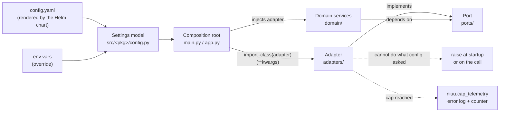

# Design principles

The rules every Niuu package follows.

## In one minute

- **Hexagonal.** Business logic lives in `domain/`, talks to the world only through interfaces in `ports/`, and `adapters/` implement those interfaces. A composition root (`main.py`, `app.py`, a CLI builder) wires them together.
- **Adapters are picked by config.** A config block names a class path in `adapter:` and its constructor arguments in `kwargs:`. Swapping an implementation is a config change, not a code change.
- **Fail loud.** A configured thing that cannot work is fatal: it raises with the remedy in the message. Nothing falls back to a weaker path.
- **No hidden limits.** A cap (tokens, turns, retries, lengths) exists only when something real bounds it, and a hit raises or logs at error level and is counted.
- **Config first, one-way imports.** Every knob is a field on a settings model. `niuu` is shared; Forge and the workflow engine import from it and never from each other.

## How it fits



## The principles

| Principle | The rule in one line | Page |
|---|---|---|
| Hexagonal layout | Domain depends on ports; adapters implement ports; only composition roots import everything | [Layers and boundaries](layers.md) |
| Module boundaries | `niuu` ← `volundr`, `niuu` ← `ting`; the workflow engine never imports Forge; the agent runtime judges, the session gateway transports, Niuu provides mechanics | [Layers and boundaries](layers.md) |
| Dynamic adapters | `adapter:` class path + `kwargs:`; no `if/elif` on adapter names | [Config and adapters](config-and-adapters.md) |
| Config first | No bare `os.environ` reads for behaviour; no magic numbers | [Config and adapters](config-and-adapters.md) |
| No fallbacks | Configured but impossible is fatal, never degraded | [Fail loud](fail-loud.md) |
| No hidden limits | Every cap has a real bound; every hit is loud and counted | [Fail loud](fail-loud.md) |

## What enforces them

| Rule | Enforced by |
|---|---|
| The workflow engine and Forge never import each other; `niuu` imports neither | [`tests/test_infrastructure/test_package_boundaries.py`](https://github.com/niuulabs/niuu/blob/dev/tests/test_infrastructure/test_package_boundaries.py) (AST scan of every import) |
| `niuu`, `personas`, `mimir`, `tracker` never import the agent runtime, nor name a `ravn` module in a string | same file |
| Domain layers never read the process environment | same file (`test_domain_layers_do_not_read_process_environment`) |
| Shared collaboration imports no `ravn`, `skuld` or FastAPI | [`tests/test_niuu/test_collaboration_boundaries.py`](https://github.com/niuulabs/niuu/blob/dev/tests/test_niuu/test_collaboration_boundaries.py) |
| No behavioural `os.environ` read outside an explicit allowlist | [`tests/test_infrastructure/test_config_first.py`](https://github.com/niuulabs/niuu/blob/dev/tests/test_infrastructure/test_config_first.py) |
| Example configs only use keys the settings models define | [`tests/test_infrastructure/test_example_configs.py`](https://github.com/niuulabs/niuu/blob/dev/tests/test_infrastructure/test_example_configs.py) |
| Migrations have one source | [`tests/test_charts/test_migrations_single_source.py`](https://github.com/niuulabs/niuu/blob/dev/tests/test_charts/test_migrations_single_source.py) |
| No fallbacks, no hidden limits, no magic numbers, dynamic adapters | Code review against [`.claude/rules/`](https://github.com/niuulabs/niuu/tree/dev/.claude/rules); tests must assert the raise, never "does not crash" |

## Levers: swapping an implementation

Examples from the Forge chart ([`charts/volundr/values.yaml`](https://github.com/niuulabs/niuu/blob/dev/charts/volundr/values.yaml)):

| Knob | Default (mini / chart) | Production example | What it changes |
|---|---|---|---|
| `identity.adapter` | `volundr.adapters.outbound.identity.AllowAllIdentityAdapter` | `volundr.adapters.outbound.identity.EnvoyHeaderIdentityAdapter` | Who the caller is: allow-all dev principal vs Envoy-verified `x-auth-*` headers |
| `credentialStore.adapter` | `niuu.adapters.memory_credential_store.MemoryCredentialStore` | `niuu.adapters.openbao_credential_store.OpenBaoCredentialStore` | Where user secrets live |
| `storageAdapter.adapter` | `volundr.adapters.outbound.k8s_storage.InMemoryStorageAdapter` | `volundr.adapters.outbound.k8s_storage_adapter.K8sStorageAdapter` | Whether session and home PVCs are really created |
| `resourceProvider.adapter` | `volundr.adapters.outbound.static_resource_provider.StaticResourceProvider` | `volundr.adapters.outbound.k8s_resource_provider.K8sResourceProvider` | Static resource catalog vs cluster discovery (GPUs, node selectors) |
| `sleipnir.adapter` | `sleipnir.adapters.in_process.InProcessBus` | `sleipnir.adapters.nats_transport.NatsTransport` | The event bus transport |

```yaml
# values.yaml — move Forge's secrets from memory to OpenBao
credentialStore:
  adapter: "niuu.adapters.openbao_credential_store.OpenBaoCredentialStore"
  kwargs:
    url: "http://openbao:8200"
    mount_path: "volundr"
    auth_method: "token"
  secretKwargs:
    - kwarg: token
      secretName: openbao-token
      secretKey: token
```

If OpenBao is unreachable, Forge fails; it does not fall back to memory.

## Tradeoffs

| Choice | Gains | Costs |
|---|---|---|
| Ports everywhere | A new backend is one class; tests run against fakes of the port | More files and indirection than a direct call |
| Class paths in config | Zero code to add an adapter; operators can point at their own module | A typo is found at startup, not at type-check time |
| Fail hard | A fault is one log line to diagnose, on the day it happens | A misconfigured optional piece stops the service until fixed (or explicitly disabled) |
| Counted caps | A limit being hit shows on a dashboard, not weeks later in data | Every cap needs a named knob, a real bound and a test |

## Code map

| Concern | Where |
|---|---|
| Rule files (binding conventions) | [`.claude/rules/`](https://github.com/niuulabs/niuu/tree/dev/.claude/rules) |
| Class-path import helper | [`src/niuu/utils/__init__.py`](https://github.com/niuulabs/niuu/blob/dev/src/niuu/utils/__init__.py) (`import_class`, `resolve_secret_kwargs`) |
| Shared adapter builders | [`src/niuu/service_runtime.py`](https://github.com/niuulabs/niuu/blob/dev/src/niuu/service_runtime.py) |
| Cap and degradation telemetry | [`src/niuu/cap_telemetry.py`](https://github.com/niuulabs/niuu/blob/dev/src/niuu/cap_telemetry.py) |
| Limits register | [`docs/operator/limits.md`](https://github.com/niuulabs/niuu/blob/dev/docs/operator/limits.md), [`docs/operator/forge-limits.md`](https://github.com/niuulabs/niuu/blob/dev/docs/operator/forge-limits.md) |
| Architecture tests | [`tests/test_infrastructure/`](https://github.com/niuulabs/niuu/tree/dev/tests/test_infrastructure) |
