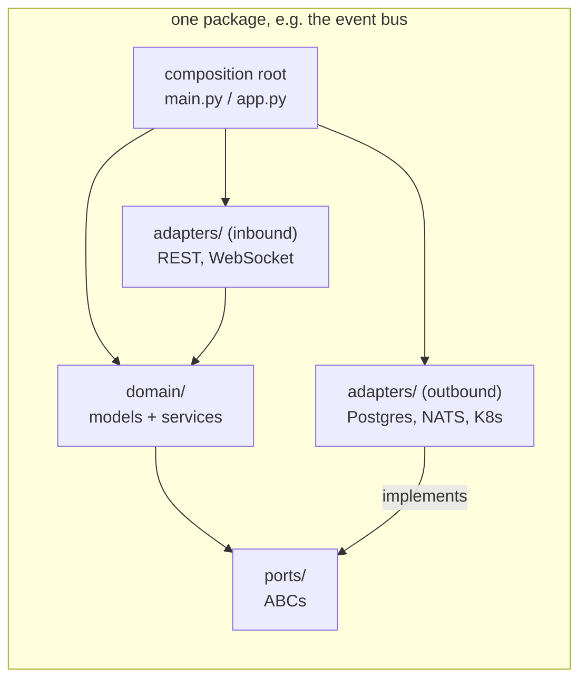
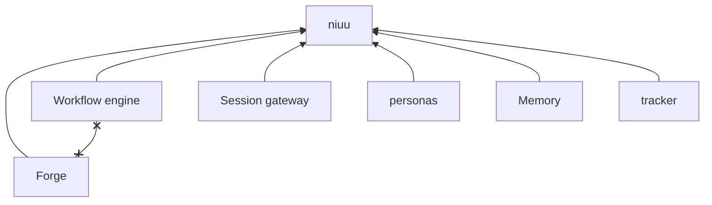

# Layers and boundaries

How a package is laid out inside (domain, ports, adapters, composition root), and which packages may import which.

## In one minute

- `domain/` holds models and services. It knows interfaces (ports), never implementations.
- `ports/` holds abstract base classes. `adapters/` holds the classes that implement them: inbound (REST, WebSocket) and outbound (Postgres, Kubernetes, HTTP, NATS).
- A **composition root** (`main.py`, `app.py`, a CLI builder) is the only place that imports everything and decides which adapter runs.
- Shared code lives in `niuu`. Forge and the workflow engine both import from it and never from each other. `niuu` imports neither.
- The agent runtime judges, the session gateway transports, Niuu provides the mechanics. Tests scan the imports to keep it that way.

## How it fits



Arrows are "imports". Nothing points into `adapters/` except the composition root. That is what lets a test hand the domain a fake and lets an operator hand it a different backend.

## One package, as it really is

The event bus (`src/sleipnir`) is the cleanest small example:

```text
src/sleipnir/
├── domain/
│   ├── events.py        # SleipnirEvent, pattern matching
│   ├── catalog.py       # event-type catalog
│   └── registry.py
├── ports/
│   ├── events.py        # SleipnirPublisher, SleipnirSubscriber (ABCs)
│   └── audit.py
└── adapters/
    ├── in_process.py    # InProcessBus
    ├── nng_transport.py # NngTransport
    ├── nats_transport.py
    ├── rabbitmq.py
    ├── redis_streams.py
    ├── webhook.py
    └── audit_postgres.py, audit_sqlite.py, ...
```

Bigger packages bend the shape a little; the direction rule still holds:

| Package | Where its ports live |
|---|---|
| `sleipnir`, `ting`, `personas`, `bifrost` | `ports/` as above |
| Forge (`volundr`) | Mostly `domain/ports.py` (pod managers, storage, resource providers and ~40 more), plus `ports/` for catalog and execution credentials |
| Shared (`niuu`) | `niuu/ports/` — identity, credentials, mesh, integrations, model catalog and more, used by several packages |

## One port, several adapters

The event bus publisher port is a few lines; every transport implements it.

```python
# src/sleipnir/ports/events.py
class SleipnirPublisher(ABC):
    @abstractmethod
    async def publish(self, event: SleipnirEvent) -> None: ...
    @abstractmethod
    async def publish_batch(self, events: list[SleipnirEvent]) -> None: ...
```

| Adapter | Use it for |
|---|---|
| `sleipnir.adapters.in_process.InProcessBus` | One process (local mini mode, tests) |
| `sleipnir.adapters.nng_transport.NngTransport` | Direct pub/sub between peers, no broker |
| `sleipnir.adapters.nats_transport.NatsTransport` | A shared NATS broker in a cluster |
| `sleipnir.adapters.rabbitmq.RabbitMQTransport`, `redis_streams.RedisStreamsTransport`, `webhook.WebhookTransport` | Those brokers / HTTP delivery |

The same pattern repeats across the stack: `CredentialStorePort` (`niuu/ports/credentials.py`) has `MemoryCredentialStore`, `OpenBaoCredentialStore` and `InfisicalCredentialStore`; the workflow engine's `TrackerPort` (`ting/ports/tracker.py`) has Linear, Jira and the native tracker.

## Composition roots

| Root | What it wires |
|---|---|
| `volundr/main.py` → `create_app` | Forge: identity, storage, credential store, pod managers, routers |
| `volundr/composition_builders.py` | Forge's dynamic adapter and contributor builders, split out of `main.py` |
| `ting/main.py` → `create_app` | Workflow engine: repositories, trackers, workflow execution |
| `niuu/app.py` → `build_root_app` | The local mini-mode host: mounts Forge, the workflow engine, the model gateway, Memory and others as sub-apps of one process |
| `niuu/service_runtime.py` | Shared builders every service uses (`create_identity_adapter`, `create_storage_adapter`, ...) |
| `skuld/broker.py` | Session gateway: transports, mesh, channels |

A domain service never calls `import_class` and never reads settings to choose an implementation. If you find yourself writing `if settings.x == "nats"` in a domain file, the choice belongs in the root.

## Package boundaries



| Rule | Why |
|---|---|
| The workflow engine never imports Forge, and Forge never imports it | The workflow engine runs standalone and calls Forge over its API. What both need moves to `niuu` |
| `niuu` imports neither Forge nor the workflow engine | Shared code with a feature-package import is no longer shared |
| `niuu`, `personas`, `mimir`, `tracker` never import the agent runtime, nor name a `ravn` module in a string | A dotted path inside an `adapter:` string is the same dependency as an import |
| `niuu.collaboration` imports no `ravn`, `skuld` or FastAPI | Room mechanics stay transport- and runtime-neutral |

Extract to `niuu` only when two packages need the same thing. One user keeps it in its own package.

## Who owns what: agent runtime, session gateway, Niuu

| Owner | Owns | Never owns |
|---|---|---|
| **Agent runtime** (`ravn`) | Judgment, the tool loop, durable cases and operator waits, learning, capability building, A2A with external agents | Transport, deployment, identity |
| **Session gateway** (`skuld`) | Runtime process lifecycle, auth, delivery, transcripts, channels and WebSockets | What a message means; continuation or learning |
| **Niuu** (platform) | Identity and lifecycle of residents, flock membership and mesh transport, collaboration mechanics, workload identity, gateways, registries | Deciding what an observation means or what a resident learns |

Three communication paths stay distinct: the **flock mesh** (direct, among a flock's members), the **collaboration room** (shared conversation of agents and humans) and **A2A** (external agents). Do not relabel one as another. The agent runtime is being rebuilt as a small agent; today `src/ravn` holds only the learned-tool runner and tool-build backends.

## Tradeoffs

| Choice | Gains | Costs |
|---|---|---|
| Strict import direction | Packages deploy alone; the boundary tests catch drift on the PR | Some code is duplicated until a second user justifies moving it to `niuu` |
| Ports for every outside call | Domain tests need no Postgres, no cluster | An extra interface even where only one adapter exists today |
| One composition root per package | One place to read to know what runs | `main.py` files grow large; `composition_builders.py` and `service_runtime.py` exist to keep them readable |

## Code map

| Concern | Where |
|---|---|
| Event bus port and adapters | [`src/sleipnir/ports/events.py`](https://github.com/niuulabs/niuu/blob/dev/src/sleipnir/ports/events.py), [`src/sleipnir/adapters/`](https://github.com/niuulabs/niuu/tree/dev/src/sleipnir/adapters) |
| Credential store port | [`src/niuu/ports/credentials.py`](https://github.com/niuulabs/niuu/blob/dev/src/niuu/ports/credentials.py) |
| Forge ports | [`src/volundr/domain/ports.py`](https://github.com/niuulabs/niuu/blob/dev/src/volundr/domain/ports.py) |
| Forge composition | [`src/volundr/main.py`](https://github.com/niuulabs/niuu/blob/dev/src/volundr/main.py), [`src/volundr/composition_builders.py`](https://github.com/niuulabs/niuu/blob/dev/src/volundr/composition_builders.py) |
| Mini-mode root | [`src/niuu/app.py`](https://github.com/niuulabs/niuu/blob/dev/src/niuu/app.py) |
| Boundary tests | [`tests/test_infrastructure/test_package_boundaries.py`](https://github.com/niuulabs/niuu/blob/dev/tests/test_infrastructure/test_package_boundaries.py), [`tests/test_niuu/test_collaboration_boundaries.py`](https://github.com/niuulabs/niuu/blob/dev/tests/test_niuu/test_collaboration_boundaries.py) |
| Rules | [`architecture.md`](https://github.com/niuulabs/niuu/blob/dev/.claude/rules/architecture.md), [`module-boundaries.md`](https://github.com/niuulabs/niuu/blob/dev/.claude/rules/module-boundaries.md), [`ravn-niuu-boundary.md`](https://github.com/niuulabs/niuu/blob/dev/.claude/rules/ravn-niuu-boundary.md) |

## Related

- [Design principles](index.md)
- [Config and adapters](config-and-adapters.md) — how the composition root picks an adapter
- [Fail loud](fail-loud.md)
