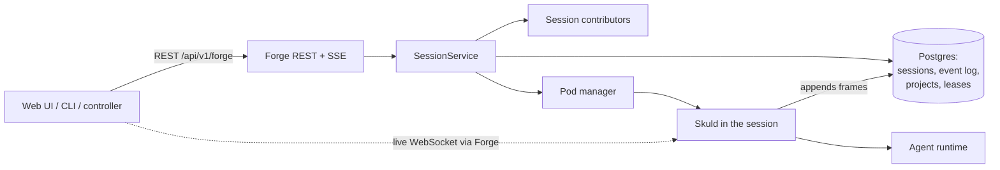
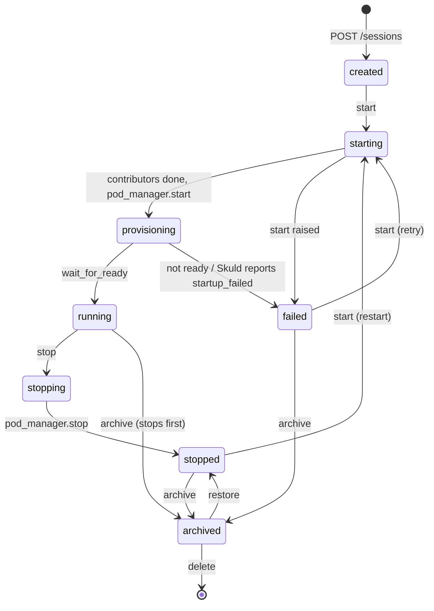

# Forge

Forge (Völundr, `src/volundr/`) is the session control plane: it records every
agent session, starts and stops it on the configured backend, and keeps its
durable history.

## In one minute

- A **session** is one run of an agent runtime (Claude Code, Codex, Ravn, …)
  with its own workspace. Forge owns the row and its lifecycle; Skuld runs
  inside the session and talks to the agent.
- Starting a session is three steps: **contributors** assemble the launch spec
  (git, storage, secrets, persona, MCP, …), the **pod manager** starts it, and a
  **readiness poll** moves it to `running`.
- Every start gets a fresh **launch id**. Credentials bound to the previous
  launch stop working, so a restart revokes what the last run held.
- **Stop** ends execution and keeps the workspace. **Archive** hides the session
  from the active list. **Delete** removes the row and the workspace volume.
- The **event log** is the session's source of truth; Forge serves it as REST
  pages, live WebSocket frames and replay.

## How it fits

Clients only ever talk to Forge. Forge proxies the live chat socket to Skuld at
`/s/{id}/session`, and Skuld writes every frame back to Forge's event log. The
backend behind the pod manager is a configuration choice; see
[where sessions run](where-sessions-run.md).

## Session lifecycle

Delete works from any state: it destroys the compute first and keeps the row
if that fails, so the delete can be retried.

| Transition | What happens | Who |
|---|---|---|
| create | Checks capacity, writes the row as `created`, then starts it | `ForgeService.create_and_start_session` → `SessionService` |
| start | Sets `starting` and returns at once. A background task mints a launch id, runs the contributors, calls `pod_manager.start` and sets `provisioning`. Any error sets `failed` and calls `pod_manager.stop` | `SessionService.start_session` |
| ready | Waits `provisioning.initial_delay_seconds`, then `pod_manager.wait_for_ready` up to `provisioning.timeout_seconds`; publishes `session.started` | `SessionService._poll_readiness` |
| startup failure | Skuld reports `startup_failed` in its activity report while the session is still starting | Skuld → `SessionService` |
| stop | `stopping`, then `pod_manager.stop`, then `stopped`. Clears endpoints, cancels open secret requests, retires the mesh identity, runs contributor cleanup | `SessionService.stop_session` |
| restart | `POST /sessions/{id}/start` on a stopped or failed session. Reuses the stored definition, workspace and project context; mints a new launch id | `SessionService.start_session` |
| archive | Stops a live session first, then sets `archived` and `archived_at` | `SessionService.archive_session` |
| restore | `archived` → `stopped`; the row only | `SessionService.restore_session` |
| delete | Cancels a pending start, `pod_manager.destroy`, deletes the workspace volume, secrets, presented files and spans, then the row | `SessionService.delete_session` |

`status` says where the infrastructure is. What the agent is doing (busy,
idle, waiting on a question) is a separate field, `activity_state`.

Startup progress is recorded as stages (`launch`, `handing_off`, then the
backend's own, such as HelmRelease and pod conditions on Kubernetes) and closed
when the session reaches `running` or `failed`.

## Keeping rows truthful

| Mechanism | Default | What it does |
|---|---|---|
| Pod-status reconcile | on, every 60 s | Compares active sessions with `pod_manager.status()` and corrects the row |
| Startup recovery | always | Re-launches the readiness poll for sessions left in `provisioning` when Forge restarts |
| Heartbeat reaper | off | Marks a session `stopped` after `stale_after_seconds` without activity |

There is no idle auto-stop and no auto-archive: both happen only on request.

## What a session runs against

Projects, sources and workspaces are on their own page:
[workspaces and projects](workspaces-and-projects.md).

## Levers

| Knob | Default | What it changes | Where it is set |
|---|---|---|---|
| `pod_manager.adapter` | `…flux.FluxPodManager` | The backend that runs sessions | Forge config |
| `session_contributors` | built-in set | Extra contributors to the launch spec (`adapter:` + kwargs) | Forge config |
| `provisioning.timeout_seconds` | 300 | How long a start may take before `failed` | Forge config |
| `provisioning.initial_delay_seconds` | 5 | Wait before the first readiness poll | Forge config |
| `provisioning.startup_poll_seconds` | 2 | How often startup stages are polled | Forge config |
| `session_liveness.reconcile_enabled` | true | Pod-status reconcile loop | Forge config |
| `session_liveness.reconcile_interval_seconds` | 60 | Reconcile period | Forge config |
| `session_liveness.enabled` | false | Heartbeat reaper | Forge config |
| `session_liveness.stale_after_seconds` | 600 | Silence before the reaper stops a session | Forge config |
| `forge_mcp.session_tokens.enabled` | true | Mints a `forge_session` credential per launch for the session's broker | Forge config |
| `storage.adapter` | `…k8s_storage.InMemoryStorageAdapter` | Where workspace volumes come from | Forge config |

The `forge_session` credential is bound to one session and one launch; its
scopes and enforcement are on the Security [credentials](../security/credentials.md) page.

## Tradeoffs

| Choice | Gains | Costs |
|---|---|---|
| Start returns at `starting` | API calls never block on infrastructure | Clients must watch SSE or poll to see `running` |
| Pod-status reconcile, not heartbeats | Never reaps a quiet but live session | Only as fast as `reconcile_interval_seconds` |
| Stop keeps the workspace | Restart resumes the checkout | Volumes stay until delete |
| New launch id per start | A restart revokes the last run's credentials | Anything holding the old credential must re-fetch |

## Code map

| Concern | Where |
|---|---|
| Session model, statuses | [domain/models.py](https://github.com/niuulabs/niuu/blob/dev/src/volundr/domain/models.py) |
| Lifecycle | [domain/services/session.py](https://github.com/niuulabs/niuu/blob/dev/src/volundr/domain/services/session.py), [domain/services/forge.py](https://github.com/niuulabs/niuu/blob/dev/src/volundr/domain/services/forge.py) |
| Launch id and session credential | [forge_session_launch.py](https://github.com/niuulabs/niuu/blob/dev/src/volundr/domain/services/forge_session_launch.py), [niuu forge_session_token.py](https://github.com/niuulabs/niuu/blob/dev/src/niuu/domain/services/forge_session_token.py) |
| Startup stages | [domain/services/session_startup.py](https://github.com/niuulabs/niuu/blob/dev/src/volundr/domain/services/session_startup.py), [k8s_startup_stages.py](https://github.com/niuulabs/niuu/blob/dev/src/volundr/adapters/outbound/k8s_startup_stages.py) |
| Contributors | [domain/ports.py](https://github.com/niuulabs/niuu/blob/dev/src/volundr/domain/ports.py) (`SessionContributor`), [adapters/outbound/contributors/](https://github.com/niuulabs/niuu/tree/dev/src/volundr/adapters/outbound/contributors) |
| REST routes | [adapters/inbound/rest.py](https://github.com/niuulabs/niuu/blob/dev/src/volundr/adapters/inbound/rest.py) |
| Settings | [config.py](https://github.com/niuulabs/niuu/blob/dev/src/volundr/config.py) |
| Composition root | [main.py](https://github.com/niuulabs/niuu/blob/dev/src/volundr/main.py), [composition_builders.py](https://github.com/niuulabs/niuu/blob/dev/src/volundr/composition_builders.py) |

## Related

- [Where sessions run](where-sessions-run.md) — pod managers, compute pools, VMs, hosts, slots
- [Workspaces and projects](workspaces-and-projects.md) — sources, checkouts, projects, session nesting
- [State and history](state-and-history.md) — event log, chronicle, SSE, WebSocket, replay
- [Session orchestrator guide](https://github.com/niuulabs/niuu/blob/dev/docs/forge/openclaw-session-orchestrator-guide.md) — the full API contract for a controller
- [Skuld](../skuld/index.md) — what runs inside the session
- [Security: credentials](../security/credentials.md) and [machine identities](../security/machine-identities.md) — `forge_session` tokens, hosts, guests
