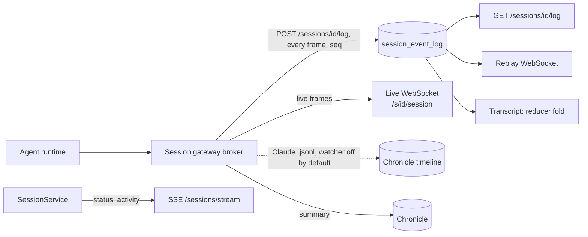

# State and history

Forge keeps one canonical record of everything a session said and did, the
**session event log**, and serves it three ways: REST pages, the live
WebSocket, and replay.

## In one minute

- **Event log** (`session_event_log`): append-only, one row per frame, ordered by
  a per-session `seq`. The session gateway writes every frame a client can see. It is the
  transcript's source of truth.
- **Chronicle**: a derived summary (summary, key changes, cost) plus a timeline
  of notable events. Lossy, Claude-only, and never used to build the transcript.
- **SSE** tells you what sessions are doing at the platform level (created,
  status, activity). The **live WebSocket** tells you what the agent is saying.
- A client resumes by `seq`: take the snapshot's `head_seq`, then read
  `GET …/log?after=<seq>`.

## How it fits

The log and the live socket carry the same frames.

## The stores

| Store | Role | Written by | Read by |
|---|---|---|---|
| `session_event_log` | Source of truth for the transcript | Session gateway, idempotent on `(session_id, seq)` so retries never duplicate | Log REST, replay, transcript rebuild |
| Archive store | A built transcript and manifest, made on demand (download, archive build) | `SessionArchiveService.build_archive` | `get_transcript` reads it first, then falls back to the event log |
| Chronicle | Summary, key changes, unfinished work, cost; `reforge` starts a new session from one | The session gateway's broker report, or `POST /chronicles` | UI history, archive build |
| Chronicle timeline | Curated file, commit, command and token events | The session gateway's `chronicle_watcher` from Claude's on-disk `.jsonl` | UI timeline |
| `session_events` pipeline | Raw events fanned out to sinks (Postgres, RabbitMQ, OTel) | `POST /events`, `/events/batch` | `GET /sessions/{id}/events`, external consumers |

An empty chronicle is not data loss: Codex, Grok and OpenCode sessions never
write Claude's `.jsonl`, and the watcher is off by default
(`chronicle_watcher_enabled` in the session gateway). The full disposition is in
[chronicle vs event log](https://github.com/niuulabs/niuu/blob/dev/docs/forge/forge-chronicle-vs-event-log.md).

## Streaming and replay

| Channel | Path (under `/api/v1/forge`) | Carries |
|---|---|---|
| SSE | `GET /sessions/stream` | `session_created`, `session_updated`, `session_deleted`, `session_activity`, `stats_updated`, `heartbeat`, `session_notification`; scoped like `GET /sessions` |
| Inventory catch-up | `GET /sessions?changed_since=<cursor>` | Sessions changed since a cursor; use it after an SSE reconnect |
| Live chat | `/s/{id}/session` (proxied to the session gateway's `/session`) | Prompts in; assistant, delta, tool, result and room frames out |
| Log pages | `GET /sessions/{id}/log?after=<seq>`, `…/log/head`, `…/log/page` | Durable frames by cursor |
| Replay | WebSocket `/sessions/{id}/replay` | The log re-emitted at recorded pace (`speed`, `max_gap`, `after`) so a live client renders a finished session |
| Fixture replay | WebSocket `/replay/fixtures/{name}` | Checked-in synthetic sessions; unauthenticated, off by default |

On connect, the live socket sends a `conversation_history` snapshot with its
`head_seq`; if the history is too big it sends a gap marker instead and the
client loads the rest from the log pages. Internal tool blocks are hidden on
every read path by default; one `set_internal_visibility` message toggles them.

Full wire contract (frames, payloads, consumer rules): [session orchestrator guide](https://github.com/niuulabs/niuu/blob/dev/docs/forge/openclaw-session-orchestrator-guide.md),
sections 8–10.

## Levers

| Knob | Default | What it changes | Where it is set |
|---|---|---|---|
| `replay.enabled` | true | The authenticated replay socket | Forge config |
| `replay.fixtures_enabled` | false | The unauthenticated fixture replay | Forge config |
| `replay.default_speed` | 1.0 | Replay pace multiplier | Forge config |
| `replay.max_gap_seconds` | 2.0 | Longest pause replay reproduces | Forge config |
| `replay.default_show_internal` | false | Show tool internals by default on every read path | Forge config |
| `replay.page_size` | 500 | Frames read from the log per page | Forge config |
| `archive_store.adapter` | `…archive_store.FileSystemArchiveStore` | Where built archives live | Forge config |
| `event_pipeline.postgres_buffer_size` | 1 | Batching of the Postgres event sink | Forge config |
| `chronicle_watcher_enabled` | false | Claude `.jsonl` timeline feed | Session gateway config |

## Tradeoffs

| Choice | Gains | Costs |
|---|---|---|
| One append-only log for every transport | One transcript fold, any runtime, resumable by `seq` | Every frame is a database row |
| Chronicle as a derived view | A cheap at-a-glance summary | Claude-only and may lag; never authoritative |
| SSE for rows, WebSocket for conversation | A controller can watch many sessions cheaply | Two channels to consume |
| Replay from the log | Finished sessions render with the live client | Replay pace is recorded time, capped by `max_gap_seconds` |

## Code map

| Concern | Where |
|---|---|
| Event log store | [pg_session_event_log.py](https://github.com/niuulabs/niuu/blob/dev/src/volundr/adapters/outbound/pg_session_event_log.py) |
| Log routes | [rest_session_log.py](https://github.com/niuulabs/niuu/blob/dev/src/volundr/adapters/inbound/rest_session_log.py) |
| Transcript fold | [niuu transcript_reducer.py](https://github.com/niuulabs/niuu/blob/dev/src/niuu/domain/transcript_reducer.py), [transcript_rebuild.py](https://github.com/niuulabs/niuu/blob/dev/src/niuu/domain/transcript_rebuild.py) |
| Archive and transcript reads | [domain/services/session_archive.py](https://github.com/niuulabs/niuu/blob/dev/src/volundr/domain/services/session_archive.py), [archive_store.py](https://github.com/niuulabs/niuu/blob/dev/src/volundr/adapters/outbound/archive_store.py) |
| Chronicle and timeline | [domain/services/chronicle.py](https://github.com/niuulabs/niuu/blob/dev/src/volundr/domain/services/chronicle.py), [postgres_chronicles.py](https://github.com/niuulabs/niuu/blob/dev/src/volundr/adapters/outbound/postgres_chronicles.py), [postgres_timeline.py](https://github.com/niuulabs/niuu/blob/dev/src/volundr/adapters/outbound/postgres_timeline.py) |
| Chronicle watcher (session gateway) | [chronicle_watcher.py](https://github.com/niuulabs/niuu/blob/dev/src/skuld/chronicle_watcher.py), [event_mapper.py](https://github.com/niuulabs/niuu/blob/dev/src/skuld/event_mapper.py) |
| Event sinks | [domain/services/event_ingestion.py](https://github.com/niuulabs/niuu/blob/dev/src/volundr/domain/services/event_ingestion.py), [rest_events.py](https://github.com/niuulabs/niuu/blob/dev/src/volundr/adapters/inbound/rest_events.py) |
| SSE stream | [rest.py](https://github.com/niuulabs/niuu/blob/dev/src/volundr/adapters/inbound/rest.py) (`/sessions/stream`) |
| Replay | [ws_session_replay.py](https://github.com/niuulabs/niuu/blob/dev/src/volundr/adapters/inbound/ws_session_replay.py), [replay/](https://github.com/niuulabs/niuu/tree/dev/src/volundr/replay) |
| Live socket history | [session gateway websocket_lifecycle.py](https://github.com/niuulabs/niuu/blob/dev/src/skuld/websocket_lifecycle.py) |

## Related

- [Forge overview](index.md) — the lifecycle behind the SSE events
- [Session gateway: message path](../session-gateway/message-path.md) — the broker that writes the log and serves the live socket
- [Communication area](../communication/index.md) — SSE and WebSocket alongside the event bus and rooms
