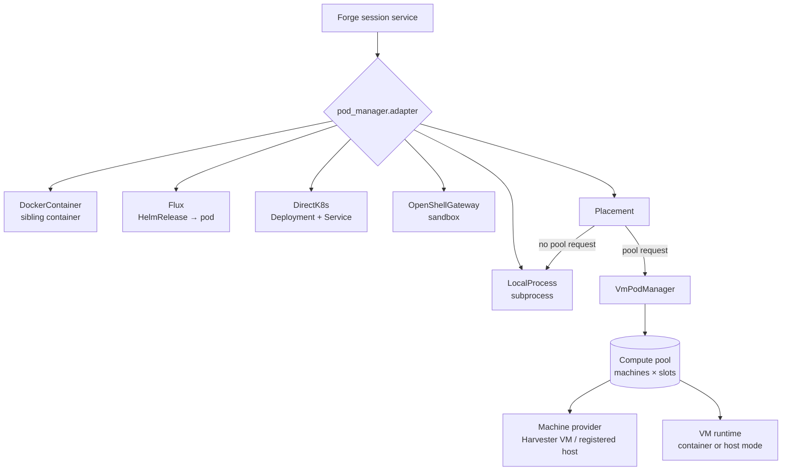

# Where sessions run

Forge starts every session through one configured **pod manager**; the pod
manager decides whether that is a local process, a container, a Kubernetes pod,
a sandbox, or a slot on a machine from a compute pool.

## In one minute

- One pod manager per Forge, picked by class path in `pod_manager.adapter`.
  The server default is Kubernetes through Flux; the `niuu` CLI defaults to a
  local process.
- A **placement** pod manager splits sessions between a local manager and a
  compute pool: a session goes to the pool only when it asks for one (an
  execution profile, a host selector, or runtime grants), and never moves after.
- A **compute pool** is a set of machines (VMs from Harvester, or registered
  bare-metal hosts). Each machine has **slots**; one session holds one slot.
- On a machine, a **VM runtime** starts the session: in a container
  (`SshContainerVmRuntime`) or directly as the slot's user (host mode,
  `SshHostVmRuntime`).
- A registered host is reached by direct SSH or, behind NAT, over a reverse
  tunnel it keeps open to Forge (`ReverseSshConnector`).

## How it fits

Everything left of `Placement` is one session = one unit of the backend.
Everything under `VmPodManager` shares machines: Forge leases a machine, binds
the session to a slot, and the runtime starts Skuld there over SSH.

## Pick a runtime

| Runtime | Isolation | Boot cost | Needs | Pick it when |
|---|---|---|---|---|
| `LocalProcessPodManager` | None: your OS user and filesystem | Lowest (a subprocess) | The runtime CLI on the host | Local mini mode, one trusted user |
| `DockerContainerPodManager` | A container per session on the host daemon | Low (container start) | A Docker daemon Forge can drive | Single-host Docker mode |
| `FluxPodManager` (default) | A pod per session | Pod scheduling and image pull | Kubernetes with Flux and the `skuld` chart | Shared cluster deployments |
| `DirectK8sPodManager` | A pod per session | As Flux, no reconcile hop | Kubernetes (k3s/k3d) without Flux | Small clusters without Flux |
| `OpenShellGatewayPodManager` | An OpenShell sandbox | Sandbox create | An OpenShell gateway and OIDC client credentials | You want the sandbox boundary |
| `VmPodManager` + `SshContainerVmRuntime` | A VM per machine; Skuld in Docker on it | VM boot, unless a warm slot is free | `compute` config, a machine provider, SSH | Sessions that need a whole VM or root in their container |
| `VmPodManager` + `SshHostVmRuntime` | Slot user, network namespace, cgroup, rootless Podman | No container to start; images unpacked once per digest per machine | `slot_isolation`, systemd, SSH | Many sessions per machine, or registered hosts |

Other VM runtimes exist for narrower cases: `SshDarwinHostRuntime` (a Mac host,
one slot), `SshOpenShellVmRuntime` and `OpenShellVmRuntime` (OpenShell on a VM),
`ProfiledVmRuntime` (one child runtime per compute profile) and
`PlatformHostRuntime` (one child per platform, linux or darwin).

## Compute pools

A pool has one `pool_id`, a machine provider, a runtime (or an execution
catalog), and a policy. `ComputePoolService.maintain` runs every
`maintenance_interval_seconds` and keeps the pool at policy.

| Step | What happens |
|---|---|
| Reuse | A session that already holds a lease gets it back |
| Warm claim | Otherwise take a free slot on a ready machine of the same profile, packing the busiest machine first |
| Cold acquire | Otherwise lease a new machine; past `max_provisioning` the start waits in a queue, bounded by the provisioning timeout |
| Keep warm | Keep `warm_min` free slots; boot machines when short |
| Idle expiry | Free capacity above `warm_min` after `idle_timeout_seconds` |
| Replace | A machine drains after `max_sessions_per_machine` sessions or `max_machine_age_seconds` (`reuse_policy: replace`) |

Machine states: provisioning → ready/idle → busy → draining → released (or
quarantined, failed). Capacity is freed only once deletion is confirmed.

The **execution catalog** (`compute.execution_catalog`) is the file-backed list
of approved execution profiles. Each one pins a machine profile, a host recipe,
an access configuration and a runtime profile by id, revision and digest, so a
session records exactly what it ran on.

## Slots

`compute.slots_per_machine` (default 1) sets how many sessions a machine runs
at once. Above 1, startup fails unless the runtime declares `supports_slots`.

| Runtime | Slots |
|---|---|
| `SshHostVmRuntime` | Required: always needs `slot_isolation` |
| `SshContainerVmRuntime` | Only with `slot_isolation` and a credential delivery that serves slots |
| `SshDarwinHostRuntime`, OpenShell VM runtimes | One session per machine |

`slot_isolation` (`compute.runtime.kwargs.slot_isolation`) gives each slot a
user (`niuu-slot-<n>`, from `uid_base` 61000), a subnet share of
`10.249.0.0/16`, and required `cpu`, `memory_mib` and `pids` limits. The guest
program `vm_slot_supervisor` creates and removes those as root over SSH. Why a
host-mode slot never gets root, sudo or a container daemon is on the Security
area's isolation page.

## Registered hosts

A registered host is a machine you already own that joins a pool with a
single-use pairing code (the Security area covers the pairing mechanics). Forge
claims, cleans and audits it instead of creating and deleting it. The admin sets
its pool, execution, connector and slots; the host chooses none of them.

| Connector | How Forge reaches sshd | Needs |
|---|---|---|
| `DirectSshConnector` | Straight to the host's address | Forge can route to the host; `allowed_sources` CIDRs; `ssh_port` (22) |
| `ReverseSshConnector` | The host keeps one outbound SSH connection to Forge's connect endpoint and forwards a loopback port to its sshd | The chart's `hostConnect` sidecar, `endpoint`, `endpoint_host_key`, a `port_range` |

Either way the session is an SSH session from Forge pinned to the host's
registered key; the connect endpoint's limits are a Security area topic.

## Levers

| Knob | Default | What it changes | Where it is set |
|---|---|---|---|
| `pod_manager.adapter` | `…flux.FluxPodManager` | Which backend starts sessions | Forge config |
| `pod_manager.kwargs.local` / `.pool` | — | The two managers under `PlacementPodManager` | Forge config |
| `compute` | unset (no pool) | Turns the compute pool on | Forge config |
| `compute.pool_id`, `max_machines`, `provider` | required | Pool identity, size cap, machine provider adapter | Forge config |
| `compute.runtime` / `execution_catalog` | unset | The VM runtime, or the catalog of execution profiles | Forge config |
| `compute.slots_per_machine` | 1 | Sessions per machine at once | Forge config |
| `compute.warm_min` | 0 | Free slots kept warm | Forge config, or pool policy |
| `compute.max_provisioning` | 1 | Machines booting at once | Forge config |
| `compute.idle_timeout_seconds` | 3600 | When idle capacity above `warm_min` is freed | Forge config |
| `compute.provisioning_timeout_seconds` | 600 | How long a start may wait for a machine | Forge config |
| `compute.reuse_policy` | `replace` | Replace machines, or clean and reuse slots | Forge config |
| `compute.hosts.connectors` | required with hosts | Connector bindings for registered hosts | Forge config |
| `compute.hosts.pairing_code_ttl_seconds` | 600 | Pairing code lifetime | Forge config |

## Tradeoffs

| Choice | Gains | Costs |
|---|---|---|
| Local process | Instant, no infrastructure | No isolation at all |
| Pod per session | Cluster scheduling, a clean pod each time | Pod start and image pull on every session |
| Pool with warm slots | Fast starts from warm machines | Machines you pay for while idle |
| Host mode slots | Many sessions per machine, no container daemon | Sessions share the machine's filesystem and toolchain; no root |
| Container runtime on a VM | Root inside its own container | One heavier unit per session; slots need extra isolation config |
| Reverse SSH connector | Hosts behind NAT join without inbound access | One Forge pod (`replicaCount: 1`) and the sidecar |

## Code map

| Concern | Where |
|---|---|
| `PodManager` port | [domain/ports.py](https://github.com/niuulabs/niuu/blob/dev/src/volundr/domain/ports.py) |
| Pod manager factory | [composition_builders.py](https://github.com/niuulabs/niuu/blob/dev/src/volundr/composition_builders.py) |
| Local process, Docker | [local_process.py](https://github.com/niuulabs/niuu/blob/dev/src/volundr/adapters/outbound/local_process.py), [docker_container.py](https://github.com/niuulabs/niuu/blob/dev/src/volundr/adapters/outbound/docker_container.py) |
| Kubernetes | [flux.py](https://github.com/niuulabs/niuu/blob/dev/src/volundr/adapters/outbound/flux.py), [direct_k8s_pod_manager.py](https://github.com/niuulabs/niuu/blob/dev/src/volundr/adapters/outbound/direct_k8s_pod_manager.py) |
| OpenShell | [openshell_gateway.py](https://github.com/niuulabs/niuu/blob/dev/src/volundr/adapters/outbound/openshell_gateway.py) |
| Placement | [placement_pod_manager.py](https://github.com/niuulabs/niuu/blob/dev/src/volundr/adapters/outbound/placement_pod_manager.py) |
| Pool pod manager | [vm_pod_manager.py](https://github.com/niuulabs/niuu/blob/dev/src/volundr/adapters/outbound/vm_pod_manager.py) |
| Pool model, leases, maintenance | [domain/compute.py](https://github.com/niuulabs/niuu/blob/dev/src/volundr/domain/compute.py), [compute_leases.py](https://github.com/niuulabs/niuu/blob/dev/src/volundr/domain/services/compute_leases.py), [compute_pool.py](https://github.com/niuulabs/niuu/blob/dev/src/volundr/domain/services/compute_pool.py) |
| Compute config | [compute/config.py](https://github.com/niuulabs/niuu/blob/dev/src/volundr/compute/config.py) |
| Execution catalog | [domain/execution_catalog.py](https://github.com/niuulabs/niuu/blob/dev/src/volundr/domain/execution_catalog.py) |
| VM runtimes | [domain/vm_runtime.py](https://github.com/niuulabs/niuu/blob/dev/src/volundr/domain/vm_runtime.py), [ssh_vm_runtime.py](https://github.com/niuulabs/niuu/blob/dev/src/volundr/adapters/outbound/ssh_vm_runtime.py), [ssh_host_vm_runtime.py](https://github.com/niuulabs/niuu/blob/dev/src/volundr/adapters/outbound/ssh_host_vm_runtime.py) |
| Slots | [vm_slot_layout.py](https://github.com/niuulabs/niuu/blob/dev/src/volundr/adapters/outbound/vm_slot_layout.py), [vm_slot_supervisor.py](https://github.com/niuulabs/niuu/blob/dev/src/volundr/adapters/outbound/vm_slot_supervisor.py) |
| Machine providers | [harvester.py](https://github.com/niuulabs/niuu/blob/dev/src/volundr/adapters/outbound/harvester.py), [registered_hosts.py](https://github.com/niuulabs/niuu/blob/dev/src/volundr/adapters/outbound/registered_hosts.py) |
| Registered hosts, connectors | [domain/services/compute_hosts.py](https://github.com/niuulabs/niuu/blob/dev/src/volundr/domain/services/compute_hosts.py), [host_connectors.py](https://github.com/niuulabs/niuu/blob/dev/src/volundr/adapters/outbound/host_connectors.py) |

## Related

- [Forge overview](index.md) — the session lifecycle these backends serve
- Security area — pairing codes, guest metadata identities, the host connect
  endpoint, rootless slots
- Deployment modes area — which pod manager each mode configures
