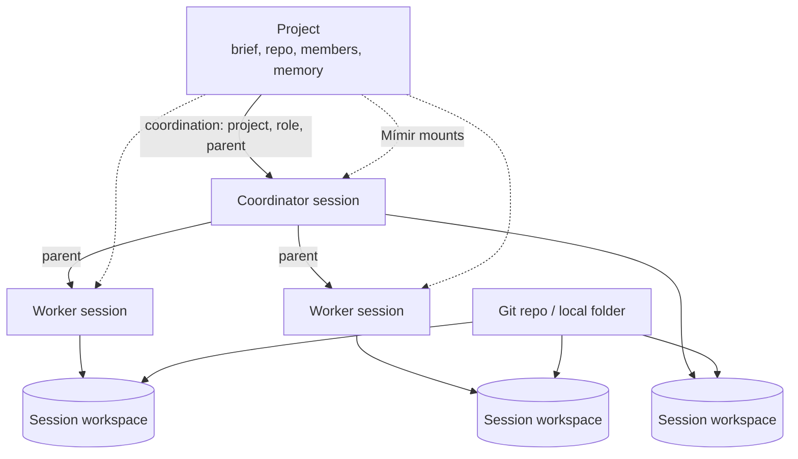

# Workspaces and projects

A session runs against a **source** (a Git repository or a local folder) in its
own **session workspace**, and may belong to a **project** that groups related
sessions and gives them shared context and memory.

## In one minute

- The source is either `GitSource` (repo, branch, base branch) or
  `LocalMountSource` (a host path). A blank session has neither.
- The session workspace is a volume Forge creates per session. Stop keeps it,
  restart reuses it, delete removes it.
- A **project** is a named group of sessions. A repository is optional. Projects
  do not nest; sessions nest inside a project through a parent session.
- At every launch, a project adds its brief, its context revision and its memory
  mounts to the session.
- A session workspace is not the **Workspaces** product (Realms), which is the
  environment a resident keeps.

## How it fits

Each session has its own workspace even when sessions share a project and a
repository. The project carries what they share: context, members, receipts and
memory.

## Sources and checkouts

| Source | How it reaches the session | Notes |
|---|---|---|
| Git | `GitContributor` turns it into repo, branch and base branch values; the session's `git-clone` init step clones, or on restart fetches and checks out | A missing branch is created from the base branch |
| Local mount | `LocalMountContributor` adds the host path as a volume | Off by default (`local_mounts.enabled`); paths must sit under `local_mounts.allowed_prefixes`; read-only by default |
| Blank | Nothing is cloned | — |

In local process mode the session workspace lives under `~/.niuu/workspaces`
and runs as your OS user. On Kubernetes it is a PVC from the storage adapter;
stopping a session labels that PVC archived instead of deleting it.

| Session operation | Workspace |
|---|---|
| Stop | Kept |
| Restart | Reused; the checkout is fetched, not re-cloned |
| Archive | Kept (archive changes the row, not the files) |
| Delete | Always removed, with optional chronicles |

## Projects

| Field | Meaning |
|---|---|
| `name`, `slug`, `brief` | What the project is; the brief (≤ 8192 chars) goes to every session |
| `repo_url`, `workspace_path` | Optional repository and its checkout on this host |
| `status` | `active` or `archived`; an archived project takes no new sessions |
| `revision` | Changes with the context; a dispatch naming a stale revision is refused |
| `home_instance_id` | Empty on the authoritative copy; set on a replica the mesh made for sessions on another Forge |

A session joins a project through `coordination` on create (or
`PUT /sessions/{id}/project` later):

| `coordination` field | Effect |
|---|---|
| `project_id` | The project; the caller needs at least the contributor role |
| `role` | `worker` by default; a worker's parent is its coordinator |
| `parent` | Another session (instance id + session id) it nests under; cycles are refused |
| `objective` | The assignment text in the project briefing |
| `context_revision` | Optional guard against launching on stale context |

`dispatch_id` on create makes a launch idempotent: the same caller-saved id
always maps to the same session, across dropped responses, restarts and
replicas. Workflow runs use the same nesting: a run's members sit under the
run's first session.

**Receipts** are durable handoffs between sessions of a project
(`/projects/{id}/receipts`, acknowledged with `…/ack`). Recording one does not
accept its claims.

**Members** have a role ladder `viewer < contributor < approver < owner`.

**Project memory** is a set of named Mímir mounts. At every launch they are
merged with what the launch spec and the session's own `workload_config.mimir`
add; two sources using one mount name for different targets are refused.

## Levers

| Knob | Default | What it changes | Where it is set |
|---|---|---|---|
| `projects.enabled` | true | Project API and coordination | Forge config |
| `projects.workspace_adapter` | `…project_workspace.GitProjectWorkspace` | How project context and handoff files reach a local checkout | Forge config |
| `projects.context_bytes` | 8192 | Project context read from the checkout | Forge config |
| `projects.git_timeout_seconds` | 15 | Git calls against the project checkout | Forge config |
| `local_mounts.enabled` | false | Allows local-folder sources | Forge config |
| `local_mounts.allowed_prefixes` | `[]` | Host paths a mount may use | Forge config |
| `local_mounts.default_read_only` | true | Mounts are read-only unless asked otherwise | Forge config |
| `local_mounts.allow_root_mount` | false | Allows mounting `/` | Forge config |
| `storage.adapter` | `…k8s_storage.InMemoryStorageAdapter` | Where session workspace volumes come from | Forge config |

## Tradeoffs

| Choice | Gains | Costs |
|---|---|---|
| One workspace per session | Sessions never trample each other's checkout | Disk per session until delete |
| Local mount | Changes land in your real folder | No isolation from the rest of that folder; off by default |
| Optional repository on projects | Projects can group non-code work | Each session still names its own source |
| Nesting by parent session, not by project | One project holds a whole coordinator/worker tree | A worker must name its coordinator at launch |

## Code map

| Concern | Where |
|---|---|
| Sources | [domain/models.py](https://github.com/niuulabs/niuu/blob/dev/src/volundr/domain/models.py) (`GitSource`, `LocalMountSource`) |
| Git and local-mount contributors | [contributors/git.py](https://github.com/niuulabs/niuu/blob/dev/src/volundr/adapters/outbound/contributors/git.py), [contributors/local_mount.py](https://github.com/niuulabs/niuu/blob/dev/src/volundr/adapters/outbound/contributors/local_mount.py) |
| Workspace volumes | [contributors/storage.py](https://github.com/niuulabs/niuu/blob/dev/src/volundr/adapters/outbound/contributors/storage.py), [k8s_storage_adapter.py](https://github.com/niuulabs/niuu/blob/dev/src/volundr/adapters/outbound/k8s_storage_adapter.py), [local_storage_adapter.py](https://github.com/niuulabs/niuu/blob/dev/src/volundr/adapters/outbound/local_storage_adapter.py) |
| Project model, coordination | [domain/projects.py](https://github.com/niuulabs/niuu/blob/dev/src/volundr/domain/projects.py) |
| Project service | [domain/services/projects.py](https://github.com/niuulabs/niuu/blob/dev/src/volundr/domain/services/projects.py) |
| Project checkout files | [project_workspace.py](https://github.com/niuulabs/niuu/blob/dev/src/volundr/adapters/outbound/project_workspace.py) |
| Project memory | [domain/project_memory.py](https://github.com/niuulabs/niuu/blob/dev/src/volundr/domain/project_memory.py) |
| Workflow session keys | [domain/workflow_session.py](https://github.com/niuulabs/niuu/blob/dev/src/volundr/domain/workflow_session.py) |
| Project routes | [rest_projects.py](https://github.com/niuulabs/niuu/blob/dev/src/volundr/adapters/inbound/rest_projects.py), [rest_project_memory.py](https://github.com/niuulabs/niuu/blob/dev/src/volundr/adapters/inbound/rest_project_memory.py) |

## Related

- [Forge overview](index.md) — the lifecycle these workspaces follow
- [Where sessions run](where-sessions-run.md) — what backs the workspace on each runtime
- Workflows area — how runs place their members in a project
- Memory area — Mímir mounts
