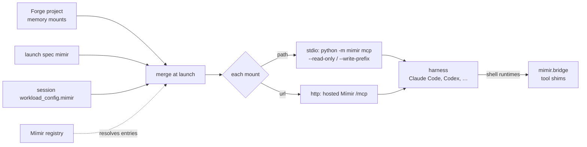

# Agent access

How sessions, residents and workflow runs get Mímir, which tools they call,
and which writes Mímir refuses.

## In one minute

- Every mount reaches a harness as one MCP server named `mimir-<mount>`. Forge
  builds that list at each launch from the **project's memory**, the launch
  spec and the session's own `workload_config.mimir`.
- A mount on a plain path runs as a stdio server inside the session
  (`python -m mimir mcp`); a mount with a URL is the hosted Mímir's `/mcp`
  over HTTP.
- Core tools: `mimir_search`, `mimir_read`, `mimir_write`, `mimir_ingest`,
  `mimir_read_source`, `mimir_related`, `mimir_lint`, `mimir_stats`. Typed
  facts (`mimir_fact_*`) appear only where the mount serves them.
- A refused write comes back as a tool error the model reads. The session's
  instructions tell it to report the refusal, not work around it.

## How it fits

Two sources that give one mount name different targets fail the launch,
naming the mount; neither wins silently.

## Who uses it

| Consumer | How it gets memory |
|---|---|
| Forge session | `mimir-*` MCP servers from project memory, launch spec and `workload_config.mimir`; plus a memory section in the system prompt (fact or wiki variant) |
| Workflow run (Ting) | Its sessions inherit the project's mounts the same way; Ting resolves a workflow's knowledge mounts against `dispatch.mimir.hosted_url` and the registry |
| Skuld retrieval reflex | Before forwarding a user message, prefixes up to 5 pointers to known entity pages (from `GET /mimir/entities/index`, cached 300 s); never page bodies |
| Shell-driven runtimes | Skuld adds `mimir_*` shell shims that call `mimir.bridge` when the session has a Mímir mount |
| Web UI and API clients | The REST routes under `/api/v1/mimir` |

## Project memory

A Forge project owns named mounts: `GET/POST /projects/{id}/memory`,
`PATCH/DELETE /projects/{id}/memory/{name}`.

| Field | Values | Notes |
|---|---|---|
| `name` | `^[a-z0-9][a-z0-9_-]{0,62}$` | Becomes the MCP server `mimir-<name>` |
| `registry_entry_id` | a registry entry | Resolved for the session owner's org at every launch |
| `access` | `read` (default), `read_write` | |
| `write_prefixes` | relative page paths | Only with `read_write`; empty = any path |

A limit (`read`, or prefixes) can only be held on a mount Forge serves itself,
a plain path, by starting the stdio server with `--read-only` or
`--write-prefix`. On a URL or adapter mount the limit **refuses the launch**
(`MemoryMountUnenforceableError`): that Mímir decides what the session may
write. A missing or disabled entry also fails the launch, naming the fix.

Session-local mounts (`ephemeral_locals`) live at `/mimir/local/<mount>`; the
first one also receives writes under `self/`.

## The tools

| Tool | Writes? | Does |
|---|---|---|
| `mimir_search` | no | Ranked pages for a query ([Retrieval](retrieval.md)) |
| `mimir_read` | no | One page, full content |
| `mimir_read_source` | no | One raw source by `source_id` |
| `mimir_related` | no | Pages linked to a page in the wikilink graph |
| `mimir_lint`, `mimir_stats` | no | Health of the store |
| `mimir_write` | yes | Create or replace a page |
| `mimir_ingest` | yes | Store a raw source |

With `facts` configured on the Mímir (default backend gbrain) and the registry
entry marked `facts: true`, seven more tools appear:

| Tool | Writes? | Does |
|---|---|---|
| `mimir_fact_remember` | yes | One fact with its evidence; `replaces` retires an older one, kept in history |
| `mimir_fact_recall` | no | Facts valid at a time, at or above a trust level; lists what was omitted and why |
| `mimir_fact_forget` | yes | Retire a fact at or below your own trust |
| `mimir_fact_entity` | no | Everything about one entity, history included |
| `mimir_fact_context_pack` | no | Ranked facts for a task, packed to a token budget, naming what was left out |
| `mimir_fact_share` / `mimir_fact_receive` | receive writes | Pass a fact to a peer; received trust never exceeds the receiver's |

**Trust comes from who is calling, never from the request.** Levels:
`agent` < `tool` < `operator` < `person`. A workload (session, resident) is
`agent` unless `facts.trust.scope_levels` maps its scope to `tool`; mapping a
workload above `tool` fails startup. People get a level from
`facts.trust.role_levels` (`volundr:admin`, `admin`, `volundr:developer` →
`person`; `mimir:curator` → `operator`); a person with none of those roles is
refused. A fact derived from others takes the lowest trust among them.

## What is refused

| Attempt | Answer | Where |
|---|---|---|
| Ingest a `tool_output` or `diagnostic` source | `422` over REST, a tool error from `mimir_ingest`, an error from the CLI: "write run output to logs or a thread" | `niuu/domain/mimir.py` (`refuse_operational_source_type`), used by `router.py`, `tools.py`, `__main__.py` |
| Write to a read-only mount, or outside its prefixes | Tool error naming the mount and what it allows; counted | `adapters/composite.py` |
| Ingest or lint fix on a prefix-limited mount | Refused: cannot be confined to a path | same |
| A page path that escapes `wiki/` (`../`) | `PathSecurityError` | `adapters/markdown.py` |
| Write without a write role (`oidc` mode) | `403` | `router.py`, `mcp.py` |
| Scoped workload token or scoped PAT (`oidc` mode) | `403` on every route | `app.py` |
| Another org on a host-only route or another tenant's instance | `403` | `router.py` |
| Forgetting or replacing a fact above the caller's trust | Tool error naming both levels | `niuu/domain/mimir_facts.py` |
| Lint on a gbrain mount | Raises: that backend cannot lint | `adapters/gbrain.py` |

Not refused, only reported: editing a page's Timeline instead of appending
(lint `L09`).

**Write roles are checked only in `oidc` mode.** Under `envoy` any caller Envoy
authenticated may write, and Mímir's chart has no Cedar `ext_authz` in front of it to
check roles instead. This is a known gap, not a design choice. Enforcing
`WRITE_ROLES` under `envoy` as the code stands would refuse every session broker,
because Forge session and scoped workload credentials carry no roles, and every web
user, because Mímir's Envoy identity adapter is given no `role_mapping`, so Keycloak's
raw `developer` never becomes `volundr:developer`. Closing it needs a scope for
knowledge writes on those credentials and the role mapping on the chart. Under
`none` there is no authorization, by the operator's choice.

## Levers

| Knob | Default | What it changes | Where it is set |
|---|---|---|---|
| Project memory mounts | none | Mounts every session and run of the project gets | Forge `/projects/{id}/memory` |
| `workload_config.mimir` | none | Per-session or per-launch-spec mounts (`registry_refs`, `instances`, `ephemeral_locals`, `bindings`, `write_routing`, `default_mounts`, `hosted_url`) | Session / launch spec |
| `facts` | unset | Serve the `mimir_fact_*` tools | `MimirServiceConfig.facts` |
| `facts.trust.role_levels` / `scope_levels` | see above / `{}` | Who earns which trust | same |
| `facts.chars_per_token` | `4` | How context packs count a token budget | same |
| Skuld `reflex.enabled` | `true` | Entity pointers on forwarded messages | `SkuldSettings.reflex` |
| `reflex.max_pointers` / `cache_ttl_seconds` | `5` / `300` | Pointers per message; entity index cache | same |
| `dispatch.mimir.hosted_url` | `""` | Where Ting resolves workflow knowledge mounts | Ting config |

## Tradeoffs

| Choice | Gains | Costs |
|---|---|---|
| One MCP server per mount | The model sees which store it reads and writes | More servers in the harness; search across mounts is the model's job |
| Limits held by the server Forge starts | Holds whatever the model tries | Only on path mounts; a hosted mount needs its own Mímir's rules |
| Trust from identity | An agent cannot launder its claims into "confirmed" | A person must curate to raise trust |
| Reflex pointers, not bodies | Cheap, no prompt bloat | The agent still has to call `mimir_read` |

If the reflex is enabled but no Mímir URL resolves, Skuld logs a warning and
runs without it.

## Code map

| Concern | Where |
|---|---|
| MCP server and tool definitions | [`src/mimir/mcp.py`](https://github.com/niuulabs/niuu/blob/dev/src/mimir/mcp.py), [`fact_tools.py`](https://github.com/niuulabs/niuu/blob/dev/src/mimir/fact_tools.py) |
| stdio server, `--read-only` / `--write-prefix` | [`src/mimir/__main__.py`](https://github.com/niuulabs/niuu/blob/dev/src/mimir/__main__.py) |
| Fact trust | [`src/mimir/facts.py`](https://github.com/niuulabs/niuu/blob/dev/src/mimir/facts.py), [`src/niuu/domain/mimir_facts.py`](https://github.com/niuulabs/niuu/blob/dev/src/niuu/domain/mimir_facts.py) |
| Project memory, merge, instructions | [`src/volundr/domain/project_memory.py`](https://github.com/niuulabs/niuu/blob/dev/src/volundr/domain/project_memory.py) |
| Mounts → MCP servers at launch | [`src/volundr/adapters/outbound/contributors/session_mcp.py`](https://github.com/niuulabs/niuu/blob/dev/src/volundr/adapters/outbound/contributors/session_mcp.py) |
| Project memory routes | [`src/volundr/adapters/inbound/rest_project_memory.py`](https://github.com/niuulabs/niuu/blob/dev/src/volundr/adapters/inbound/rest_project_memory.py) |
| Shell shims and bridge | [`src/skuld/transports/tool_shims.py`](https://github.com/niuulabs/niuu/blob/dev/src/skuld/transports/tool_shims.py), [`src/mimir/bridge.py`](https://github.com/niuulabs/niuu/blob/dev/src/mimir/bridge.py) |
| Retrieval reflex | [`src/mimir/reflex.py`](https://github.com/niuulabs/niuu/blob/dev/src/mimir/reflex.py) |
| gbrain backends | [`src/mimir/adapters/gbrain.py`](https://github.com/niuulabs/niuu/blob/dev/src/mimir/adapters/gbrain.py), [`gbrain_facts.py`](https://github.com/niuulabs/niuu/blob/dev/src/mimir/adapters/gbrain_facts.py) |

## Related

- [Memory overview](index.md)
- [Mounts, tenants and hosting](mounts-and-tenants.md)
- [Channels, rooms and Forge tools](../skuld/channels-and-tools.md) — the other tools a session gets
