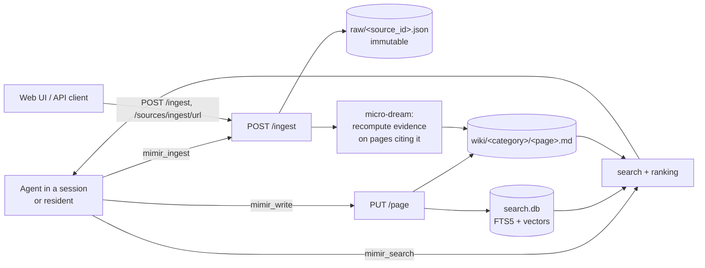

# Memory

Memory is Niuu's knowledge service: a file-backed wiki of **sources** (what was
read) and **pages** (what is known), searchable by every session, resident and
workflow that mounts it.

## In one minute

- A Memory store is a directory: immutable raw **sources** in `raw/`, rewritable
  markdown **pages** in `wiki/`. The files are the durable data; the search
  index next to them is rebuilt from them.
- Memory does no thinking. Ingest stores a source; an agent reads it and writes
  pages with `mimir_write`. Nothing turns sources into pages on its own.
- A page keeps **Compiled Truth** (current belief, rewritten) apart from a
  **Timeline** (evidence, append-only).
- Agents reach Memory through MCP tools (`mimir_search`, `mimir_read`,
  `mimir_write`, `mimir_ingest`, …). A session can mount several stores; each
  one is a **mount** with its own write rules.
- One process serves one store. It runs inside the Platform host, as its own
  Helm release, or as a stdio MCP server Forge starts inside a session.

## How it fits



## What a store holds

| Path (under the store root) | What it is | Rebuildable? |
|---|---|---|
| `raw/<source_id>.json` | One ingested source: title, content, type, origin URL, content hash | No — back it up |
| `wiki/<category>/<page>.md` | A page: YAML frontmatter + Compiled Truth + Timeline | No — back it up |
| `wiki/index.md`, `wiki/log.md` | Content catalogue and append-only activity log, kept by Memory | Index: yes (lint fix) |
| `threads/` | Thread pages (queued work items with state, weight, owner) | No |
| `MIMIR.md` | Schema and conventions, seeded on first run | Yes |
| `search.db` | SQLite FTS5 index, plus embeddings when configured | Yes — rebuilt at start when empty |
| `.mimir-registry.json` | The mount registry this instance serves | No |
| `evals/queries-YYYY-Www.jsonl` | Captured search queries and results (`eval_capture`) | Not needed |

The default root is `~/.ravn/mimir`; the Helm chart uses `/data/mimir` on a PVC.

## Sources

- `source_id` is derived from the content, so the same text ingests to the same id.
- `source_type` is free text (`web`, `document`, `research`, …). `POST /ingest`
  **refuses** two types with `422`: `tool_output` and `diagnostic`. They record
  the system's own activity, nothing will ever turn them into a page, and they
  would sit in the backlog forever. The MCP `mimir_ingest` tool does not check
  this yet; such sources are stored but never counted as unprocessed.
- A source no page cites is **unprocessed**. `GET /mimir/sources?unprocessed=true`
  lists them (operational types excluded); the doctor reports them as work
  to do.
- After each ingest, a write-time pass (the "micro-dream") recomputes fact
  evidence on the pages the source bears on. `evidence.consolidate_on_ingest`
  turns it off.

## Pages

```markdown
---
type: entity            # directive | decision | goal | preference | observation | entity | topic
confidence: medium
entity_type: technology
related_entities: [postgres, forge]
source_ids: [src_abc123]
---
# Event bus
## Compiled Truth
### Key Facts
- ...
## Timeline
- 2026-11-01 — ... [src_abc123]
```

- `entity`, `directive` and `decision` pages must have both zones; other types
  get warnings. `[[wikilinks]]` and `related_entities` form the link graph.
- The Timeline is append-only **by convention, checked after the fact**: lint
  `L09` reports a timeline that was edited rather than appended to. A write is
  not refused for it.
- Lint (`GET /mimir/lint`, checks `L01`–`L12`; `L03` stale sources is not run)
  finds orphans, broken links, missing attribution, thin pages and invalid
  frontmatter; `POST /mimir/lint/fix` auto-fixes `L05`, `L11` and `L12`. The doctor (`D01`–`D08`) is the health summary.

## Levers

| Knob | Default | What it changes | Where it is set |
|---|---|---|---|
| `path` | `~/.ravn/mimir` | Store root | `MimirServiceConfig` (`mimir.yaml`, `MIMIR__PATH`, `--path`); chart `config.dataPath` |
| `name` / `role` | `local` / `local` | How the instance lists itself in the registry (`shared`, `local`, `domain`) | same; chart `config.name`, `config.role` |
| `categories` | all | Category filter for a domain-scoped instance | same; chart `config.categories` |
| `evidence.consolidate_on_ingest` | `true` | Run the micro-dream after every ingest | `MimirServiceConfig.evidence` |
| `evidence.stale_after_days` / `weakening_after_days` | `90` / `60` | When a fact's trend becomes `stale` / `weakening` | same |
| `eval_capture` | `true` | Record every search for replay and analytics | same; chart `config.evalCapture` |
| `facts` | unset (off) | Typed facts tools; see [agent access](agent-access.md) | same |

## Tradeoffs

| Choice | Gains | Costs |
|---|---|---|
| Plain files, no database for pages | Readable, diffable, easy to back up and move | One writer per store; one process per directory |
| LLM-free service | Deterministic, cheap, no model needed to host it | Pages exist only when an agent writes them; unprocessed sources pile up |
| Timeline append-only by lint, not by refusal | Agents can fix typos and reshape pages | An edited timeline is found later, not stopped |

## Code map

| Concern | Where |
|---|---|
| Store layout, ingest, page writes, lint | [`src/mimir/adapters/markdown.py`](https://github.com/niuulabs/niuu/blob/dev/src/mimir/adapters/markdown.py) |
| Page format spec | [`src/mimir/FORMAT.md`](https://github.com/niuulabs/niuu/blob/dev/src/mimir/FORMAT.md) |
| Compiled Truth / Timeline parser | [`src/mimir/compiled_truth.py`](https://github.com/niuulabs/niuu/blob/dev/src/mimir/compiled_truth.py) |
| Micro-dream (evidence on ingest) | [`src/mimir/learning.py`](https://github.com/niuulabs/niuu/blob/dev/src/mimir/learning.py) |
| Wire models, `OPERATIONAL_SOURCE_TYPES` | [`src/niuu/domain/mimir.py`](https://github.com/niuulabs/niuu/blob/dev/src/niuu/domain/mimir.py) |
| Port every backend implements | [`src/niuu/ports/mimir.py`](https://github.com/niuulabs/niuu/blob/dev/src/niuu/ports/mimir.py) |
| Service config | [`src/mimir/config.py`](https://github.com/niuulabs/niuu/blob/dev/src/mimir/config.py) |
| HTTP routes | [`src/mimir/router.py`](https://github.com/niuulabs/niuu/blob/dev/src/mimir/router.py) |
| Doctor | [`src/mimir/doctor.py`](https://github.com/niuulabs/niuu/blob/dev/src/mimir/doctor.py) |

## Related

- [Retrieval](retrieval.md) — how search finds pages, and embeddings
- [Mounts, tenants and hosting](mounts-and-tenants.md) — where Memory runs and who may read what
- [Agent access](agent-access.md) — tools, project memory, and what is refused

Not built yet: nothing synthesises pages from sources on its own; the agent
runtime that did is being rebuilt.
