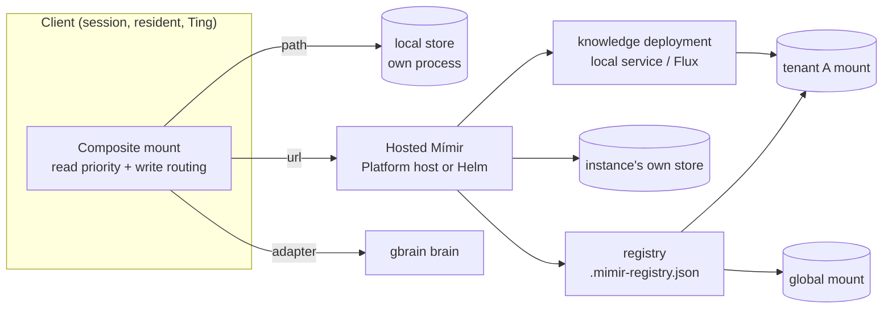

# Mounts, tenants and hosting

Where Mímir runs, how one client reads several stores as one, and how an
instance decides which org may see which store.

## In one minute

- One Mímir process serves one store directory. Three ways to run it: inside
  the **Platform host** (default on), as its **own Helm release**, or as a
  **stdio MCP server** Forge starts in a session for a local mount.
- A **mount** is a named store a client can reach: a local path, a remote URL,
  or a custom adapter (`gbrain`). The **registry** lists the mounts an
  instance knows about.
- A client with several mounts reads them in `read_priority` order and routes
  each write by page-path prefix. A mount can be **read-only** or limited to
  **write prefixes**; a write outside them is refused, not redirected.
- Tenancy: the **platform org** (`platform_tenant_id`) sees the instance's own
  store and global mounts; any other org sees only mounts registered to it.
  A `tenant_id` pins an instance to exactly one org.
- **Knowledge deployments** create new named stores on demand: a local
  service on a laptop, a Flux HelmRelease on a cluster.

## How it fits

The hosted instance answers for its own store and for every registry entry the
caller's org may see; a deployment adds entries to that registry.

## Hosting modes

| Mode | How it starts | Store | Search |
|---|---|---|---|
| Platform host plugin | `niuu platform up`; `mimir` service, on by default; routes `/api/v1/mimir`, `/mimir`, `/mcp` | `MimirServiceConfig` defaults or `mimir.yaml` / `MIMIR__*` | Full pipeline ([Retrieval](retrieval.md)) |
| Standalone | `python -m mimir serve --path … --port 7477` | `--path` | Full pipeline |
| Helm (`charts/mimir`) | One Deployment, one PVC (`5Gi` default, `ReadWriteOnce`), `replicaCount: 1`, optional Envoy sidecar | `/data/mimir` | Full pipeline |
| Session-local | Forge adds `python -m mimir mcp --path /mimir/local/<mount>` as a stdio MCP server | That directory | **Keyword counting only**, no FTS or embeddings |
| Local knowledge deployment | Mini mode creates `python -m mimir serve` under launchd/systemd on `127.0.0.1:<free port>` | `<knowledge root>/<name>/data` | Full pipeline |

Mímir is one uvicorn worker. Keep the Helm release at one replica unless the
PVC is `ReadWriteMany`: the files and `search.db` assume one writer.

## Reading and writing across mounts

The composite adapter is the client side of "several stores as one".

| Operation | Rule |
|---|---|
| `search`, `query` | Ask every mount in `read_priority` order (lower first); keep the first copy of each path |
| `read` a page | First mount that has it. "Not found" moves to the next mount; any other error **raises**, because that mount might have held it |
| Read a source | Same, retried while no mount can answer, with backoff `1s` doubling to `10s`, for up to `read_retry.max_seconds` (`90`), to outlast a restart. Then it raises `MimirUnavailableError` |
| `write`, `delete` | `mimir=` named by the agent wins; else the first `write_routing.rules` prefix that matches; else `write_routing.default` (`["local"]`) |
| `ingest` | Named mount; else `write_routing.default`; else every mount |
| Write to a restricted mount | Refused with `MimirWriteRefusedError` naming the mount and what it allows; logged at error and counted per mount |

A read-only or prefix-limited mount refuses an operation it cannot confine to
a path (ingest, lint fix).

## The registry

Each instance keeps `.mimir-registry.json` in its store root. An entry is a
mount others can be pointed at:

| Field | Meaning |
|---|---|
| `name`, `role` | Mount name; `shared`, `local` or `domain` |
| `kind` | `local` (a `path` on this host) or `remote` (a `url`) |
| `adapter`, `kwargs` | A custom backend instead of path/url |
| `tenant_id` | Empty = global; set = belongs to that org |
| `default_read_priority` | `10` |
| `facts` | This mount serves the `mimir_fact_*` tools |
| `enabled` | Off entries are not served |

Registry routes: `GET/POST /mimir/registry/mounts`, `PUT/DELETE …/{id}`. A
tenant's own entries may only be `remote` HTTP mounts with `base_url`, `mount`
and `timeout`: no host paths, no environment secrets, no native adapters
(`422`). Native backends come from a deployment target.

## Tenants and auth

| Setting | Effect |
|---|---|
| `auth_mode: envoy` (default) | Trusts `x-auth-*` headers from Envoy or the Platform host |
| `auth_mode: oidc` | Verifies the bearer itself (JWKS). Missing or invalid → `401`. Scoped workload tokens and scoped PATs → `403` |
| `auth_mode: none` | Every caller is the host operator. Combining it with `tenant_id` is refused at startup |
| `platform_tenant_id` | The org that runs the deployment. Other orgs get `403` on host-only routes (`/doctor`, `/related`, `/evidence`, `/eval/`, `/entities/index`, `/routing/rules`, …) and do not see global mounts |
| `tenant_id` | The instance belongs to one org; any other caller gets `403` |
| Deployment routes | Need `admin` or `volundr:admin` with a tenant, in every mode |
| Writes (pages, ingest, registry) | Under `oidc`, need `admin`, `volundr:admin` or `volundr:developer` (`403` otherwise). Under `envoy` and `none` no role is checked; an authenticated caller with no tenant is refused |

Clients authenticate to a remote mount with `auth.type`: `bearer` (token,
`token_file` or `token_env`), `workload` (exchanged at
`/api/v1/tokens/workload/exchange` for audience `mimir`), or `spiffe`.

## Knowledge deployments

`POST /mimir/deployments {name, backend: mimir|gbrain, target}` creates a named
store; `/deployments/{name}/{action}` controls it. The target is configured,
never chosen at runtime:

| Adapter | Where it runs |
|---|---|
| `LocalKnowledgeDeploymentAdapter` | A launchd/systemd service on the host; mini mode configures it for Workspaces |
| `FluxKnowledgeDeploymentAdapter` | A Flux HelmRelease of `charts/mimir` (or gbrain) in a namespace |
| `KnowledgeDeploymentTargets` | Several named targets of the above |

The Platform (Guild) forwards deployment calls to a registered Mímir with the
caller's own bearer only.

## Levers

| Knob | Default | What it changes | Where it is set |
|---|---|---|---|
| `mimir.instances[]` | `[]` (single local store) | The mounts a client composes | Client `MimirConfig` (session/launch spec `mimir`) |
| `instances[].read_priority` | `0` | Read order | same |
| `mimir.write_routing` | `rules: []`, `default: [local]` | Where writes land | same |
| `mimir.read_retry.max_seconds` | `90` | How long a source read waits out an outage; `0` disables | same |
| `auth_mode` | `envoy` | How the instance trusts identity | `AUTH_MODE` (one host-wide value) |
| `tenant_id` | `""` | Pin instance to one org | `MimirServiceConfig`; chart `niuu.tenantId` |
| `platform_tenant_id` | platform default tenant | Which org owns the host's store | `MimirServiceConfig` |
| `announce_url` | unset | Registers this instance as a remote mount at that URL | same; chart `config.announceUrl` |
| `deployment` | unset | Knowledge deployment target | `MIMIR__DEPLOYMENT`; chart `knowledgeDeployment` |
| `persistence.size` | `5Gi` | PVC size | chart |

## Tradeoffs

| Choice | Gains | Costs |
|---|---|---|
| Hosted shared Mímir | One place every session and resident learns into | A restart is a gap for everyone (the read retry exists for it); one worker serialises requests |
| Session-local mount | Private, no network, gone with the session | Keyword search only; nothing survives unless written to another mount |
| Many mounts per client | Separate ownership, per-mount write limits | Search fans out serially; one failing mount fails the whole read |
| Write limits held by the Mímir server | The limit holds whatever the agent tries | Only enforceable on a mount Forge serves itself (a path); see [agent access](agent-access.md) |

## Code map

| Concern | Where |
|---|---|
| Composite reads, routing, refusals, retry | [`src/mimir/adapters/composite.py`](https://github.com/niuulabs/niuu/blob/dev/src/mimir/adapters/composite.py) |
| Mount and routing models | [`src/mimir/domain.py`](https://github.com/niuulabs/niuu/blob/dev/src/mimir/domain.py), [`src/mimir/client_config.py`](https://github.com/niuulabs/niuu/blob/dev/src/mimir/client_config.py) |
| Building a client from config | [`src/mimir/builders.py`](https://github.com/niuulabs/niuu/blob/dev/src/mimir/builders.py), [`connections.py`](https://github.com/niuulabs/niuu/blob/dev/src/mimir/connections.py) |
| Remote client | [`src/mimir/adapters/http.py`](https://github.com/niuulabs/niuu/blob/dev/src/mimir/adapters/http.py) |
| Registry | [`src/mimir/registry.py`](https://github.com/niuulabs/niuu/blob/dev/src/mimir/registry.py) |
| Tenant scoping, host-only routes, write roles | [`src/mimir/router.py`](https://github.com/niuulabs/niuu/blob/dev/src/mimir/router.py) (`_request_scope`, `_require_write_auth`) |
| App-wide identity middleware | [`src/mimir/app.py`](https://github.com/niuulabs/niuu/blob/dev/src/mimir/app.py) (`enforce_identity`) |
| Platform plugin | [`src/mimir/plugin.py`](https://github.com/niuulabs/niuu/blob/dev/src/mimir/plugin.py) |
| Deployments | [`src/mimir/adapters/local.py`](https://github.com/niuulabs/niuu/blob/dev/src/mimir/adapters/local.py), [`flux.py`](https://github.com/niuulabs/niuu/blob/dev/src/mimir/adapters/flux.py), [`deployment_targets.py`](https://github.com/niuulabs/niuu/blob/dev/src/mimir/adapters/deployment_targets.py) |
| Helm chart | [`charts/mimir/values.yaml`](https://github.com/niuulabs/niuu/blob/dev/charts/mimir/values.yaml) |

## Related

- [Memory overview](index.md)
- [Agent access](agent-access.md)
