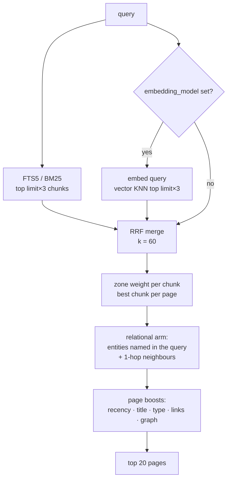

# Retrieval

How `mimir_search` turns a question into a ranked list of pages: keyword
search, optional embeddings, fused, then re-ranked with what Mímir knows about
each page.

## In one minute

- Every page is split into chunks (one per `##` section, ≤ 2,000 characters)
  and indexed in a SQLite file, `search.db`, next to the store.
- Without embeddings, search is **FTS5 keyword search** (BM25). This is a
  supported mode, not a degraded one: `embedding_model: null` means "FTS-only".
- With `embedding_model` set, search is **hybrid**: keyword and vector
  candidates merged with Reciprocal Rank Fusion (RRF).
- A ranking layer then re-scores each page (recency, title match, page type,
  links, timeline vs compiled truth) and returns at most **20 pages**.
- Embeddings configured but unavailable is **fatal at startup**, never a quiet
  drop to keyword search.

## How it fits

`limit` is the number of candidates the ranking layer asks for:
20 × `ranking.overfetch_factor` (4) = 80 chunks. With `ranking.enabled: false`
the RRF scores go straight to the top 20.

## The two arms

| Arm | Engine | When it runs | Notes |
|---|---|---|---|
| Keyword | SQLite FTS5, BM25 | Always | Query is sanitised for FTS syntax; implicit AND, so long natural-language questions often match nothing |
| Semantic | Embedding of the query vs embeddings of every chunk | `embedding_model` set | Native KNN over **all** chunks with `sqlite-vec`; without the package, Python cosine over the **200 most recent** embedded chunks, with a warning at start |
| Merge | Reciprocal Rank Fusion, `k = 60`, scores normalised to 0–1 | Both arms ran | A page that only one arm found still scores |

Chunks are embedded when a page is written. The startup step re-indexes all
pages only when `search.db` is empty; otherwise the persisted index is used.

## Embeddings: what `embedding_model` changes

| `embedding_model` | `embedding_base_url` | Result |
|---|---|---|
| `null` (default) | — | FTS-only, by decision |
| set | set | Vectors from an OpenAI-compatible `/v1/embeddings` endpoint (vLLM, TGI, Ollama, OpenAI); needs only `httpx` |
| set | empty | `sentence-transformers` model loaded in-process (`uv sync --extra embeddings`) |
| set | empty, library missing | **Startup fails** naming three fixes: set `embedding_base_url`, install the library, or set `embedding_model: null` |

At query time an embedding call that fails raises, so the search request fails
instead of answering from the keyword arm alone.

## Ranking

All boosts multiply the fused score. `GET /mimir/search?q=…&debug=true` returns
each page's `score_breakdown`, so a ranking decision can be read, not guessed.

| Factor | Default | Effect |
|---|---|---|
| Zone | timeline `0.9`, compiled truth `1.0` | Current belief outranks the evidence trail |
| Recency | half-life `90` days, floor `0.5` | Older pages fade but never below half |
| Title match | `1.25` | All query tokens in the title |
| Page type | `directive` and `decision` `1.1` | Rules and decisions outrank topics |
| Confidence | none (neutral) | Opt-in per deployment; `high/low` presets cost 7 points of P@5 in evaluation |
| Backlinks | `alpha 0.0` (neutral) | Opt-in; hub pages crowded out answers |
| Entity named in the query | `1.5` | Relational arm, see below |
| 1-hop neighbour of that entity | `1.0` (neutral) | |
| Injected page (missed by both arms) | base score `0.3` | `0` turns the relational arm off |

The **relational arm** reads the wikilink graph: when a query names an entity
page, that page and its 1-hop neighbours join the candidates even if neither
search arm found them. This is what rescues natural-language questions that
FTS's implicit AND drops.

## Measuring it

- `python -m mimir eval` scores a golden set (P@5, recall@10, MRR) against a
  corpus; `--against baseline.json --fail-on-regression` gates a change.
- With `eval_capture` on, every `/mimir/search` call appends the query and
  result paths to `evals/queries-YYYY-Www.jsonl`;
  `python -m mimir eval replay --capture …` re-runs real traffic.

## Levers

| Knob | Default | What it changes | Where it is set |
|---|---|---|---|
| `embedding_model` | `null` | FTS-only vs hybrid | `MimirServiceConfig` (`mimir.yaml`, `MIMIR__EMBEDDING_MODEL`, `serve --embedding-model`) |
| `embedding_base_url` | `""` | Remote embedding endpoint instead of an in-process model | same |
| `embedding_api_key` | `""` | Bearer token for that endpoint | same (keep it in env, not YAML) |
| `search_db` | `<path>/search.db` | Index location | same; `serve --search-db` |
| `ranking.enabled` | `true` | Whole ranking layer on/off | `MimirServiceConfig.ranking` |
| `ranking.overfetch_factor` | `4` | Candidates per returned result | same |
| `ranking.*` boosts | see table above | Individual multipliers | same; `MIMIR__RANKING__TITLE_MATCH_BOOST=…` |
| `eval_capture` | `true` | Query capture for replay | same; chart `config.evalCapture` |

The Mímir Helm chart has no named value for the embedding settings; set them
with `MIMIR__EMBEDDING_*` variables through the chart's `envFrom`.

## Tradeoffs

| Choice | Gains | Costs |
|---|---|---|
| FTS-only | No model, no GPU, instant start | Misses paraphrases; long questions match little without the relational arm |
| Remote embedding endpoint | Same model as production, light image | A network dependency on every write and every search |
| In-process `sentence-transformers` | No external service | Heavy image (torch); first query loads the model |
| No `sqlite-vec` | One fewer native dependency | Semantic arm sees only the 200 most recent chunks |
| SQLite index per store | Zero ops, rebuildable from files | One process per store; not shared across replicas |

## Code map

| Concern | Where |
|---|---|
| Search pipeline, chunking, relational arm | [`src/mimir/adapters/markdown.py`](https://github.com/niuulabs/niuu/blob/dev/src/mimir/adapters/markdown.py) |
| Boost functions | [`src/mimir/ranking.py`](https://github.com/niuulabs/niuu/blob/dev/src/mimir/ranking.py) |
| FTS5 + vectors + RRF | [`src/niuu/adapters/search/sqlite.py`](https://github.com/niuulabs/niuu/blob/dev/src/niuu/adapters/search/sqlite.py), [`rrf.py`](https://github.com/niuulabs/niuu/blob/dev/src/niuu/adapters/search/rrf.py) |
| Embedding backends, fail-loud check | [`src/mimir/app.py`](https://github.com/niuulabs/niuu/blob/dev/src/mimir/app.py) (`_build_embed_fn`) |
| Ranking and embedding config | [`src/mimir/config.py`](https://github.com/niuulabs/niuu/blob/dev/src/mimir/config.py) |
| Eval harness and replay | [`src/mimir/eval.py`](https://github.com/niuulabs/niuu/blob/dev/src/mimir/eval.py) |

## Related

- [Memory overview](index.md)
- [Agent access](agent-access.md) — a session's local mount searches differently (see there)
