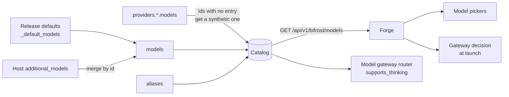

# Model catalog

The model catalog is the model gateway's list of every model the platform offers: what it
is called, who serves it, whether it is hosted or self-hosted, and what a session
can ask of it.

## In one minute

- One catalog, owned by the model gateway's config (`models` + `additional_models`). Forge,
  the setup wizard and every model picker read it over HTTP.
- The release ships a default catalog; a host adds or replaces entries with
  `additional_models`, matched by `id`.
- `provider: local` versus `cloud` is the switch that decides whether a session's
  traffic goes through the gateway ([Models](index.md)).
- The catalog does **not** store context windows or output limits. A missing
  output cap is read from the provider itself, never guessed.
- Prices live in a separate table (`pricing`), used for cost accounting.

## How it fits

Forge re-reads the catalog every `catalog_refresh_interval_seconds`. A failed read
is retried with doubling backoff and logged; the last good catalog stays in use
until a read succeeds.

## What an entry records

| Field | Default | Used for |
|---|---|---|
| `id` | required | The model name sessions and requests use |
| `name`, `description`, `color`, `tier` | `tier: balanced` | Display; tiers are `frontier`, `balanced`, `execution`, `reasoning` |
| `vendor` | `""` | Runtime family (`anthropic`, `openai`, `xai`, `local`, …) |
| `provider` | `cloud` | `local` routes sessions through the gateway |
| `session_definition` | none | Preferred runtime for the model |
| `supports_tools` | `true` | Whether tool use is expected to work |
| `supports_thinking` | `true` | `false` makes the router drop `thinking` and `reasoning_effort` before sending |
| `effort_levels`, `default_effort`, `effort_note` | from `MODEL_EFFORTS` | The effort selector at launch; `default_effort` must be one of the levels |
| `cost_per_million_tokens` | none | Approximate blended price for display |
| `vram_required` | none | Hint for local models |
| `enabled` | `true` | Whether operators and consumers see the model |

Each catalog response also carries `aliases` (names that point at the model) and
`provider_keys` (the model gateway providers that serve it).

**Synthetic entries.** A model a provider lists without a catalog entry still
appears, with defaults: tier `balanced`, tools and thinking on, and `provider:
local` when the provider key is `local`, `ollama` or `vllm`, or the id contains
`:` (as Ollama tags do).

## Output limits and context windows

The no-hidden-limits rule says an output cap comes from the model, not from a
number in code. The model gateway follows it per provider, not through the catalog:

| Provider adapter | Request sent without `max_tokens` |
|---|---|
| Anthropic | Reads `max_tokens` from the Models API (`GET /v1/models/{model}`) once per model and sends it; a failed or empty read raises, naming the model |
| OpenAI-compatible, Ollama, ChatGPT subscription | Omits `max_tokens`; the server bounds output by the remaining context |

Context windows are only in the descriptions (for example "1M-token context").
The runtimes learn the window from their vendor (Codex reports
`model_context_window`).

## Adding a model

| Step | Where | Needed when |
|---|---|---|
| 1. Add a `ManagedModelConfig` | `_default_models()` in `src/bifrost/config.py` for every install, or `additional_models` in one host's model gateway config | Always |
| 2. List the id under a provider's `models` | `providers.<name>.models` | The gateway should serve it (self-hosted models, platform callers) |
| 3. Add effort levels | `MODEL_EFFORTS` in `src/niuu/domain/reasoning.py` | The model has native effort levels |
| 4. Add a price | `BUILTIN_PRICING` in `src/bifrost/pricing.py`, or `pricing` / `pricing_file` | Cost accounting should be right |
| 5. Optional alias | `aliases: {fast: <id>}` | Clients should use a stable name |

A cloud model that sessions call directly needs only step 1; the runtime must
also support it (a new Claude model may need a newer Claude Code). The catalog
says what exists, not that a provider accepts it: test with a real request.

## Levers

| Knob | Default | What it changes | Where it is set |
|---|---|---|---|
| `models` | release defaults | Replaces the whole catalog | Model gateway config |
| `additional_models` | `[]` | Adds or replaces entries by `id` | Model gateway config |
| `aliases` | `{}` | Alias → canonical model id | Model gateway config |
| `pricing` | `{}` | Per-model USD per million tokens; beats `pricing_file` and the built-in table | Model gateway config |
| `pricing_file` | `""` | YAML price table merged over the built-in one | Model gateway config |
| `bifrost.catalog_refresh_interval_seconds` | `60` | Forge re-read interval | Forge config |
| `bifrost.catalog_retry_initial_seconds` / `_max_seconds` | `0.1` / `5.0` | Retry backoff for a failed read | Forge config |

## Tradeoffs

| Choice | Gains | Costs |
|---|---|---|
| Entry in `_default_models` | Every install gets it; one review | Needs a release |
| Entry in `additional_models` | Per host, no release | Drifts from the shared defaults if left there |
| Relying on a synthetic entry | Zero config for a local server's models | Generic display and capability defaults (tools and thinking assumed on) |

## Code map

| Concern | Where |
|---|---|
| Entry schema and defaults | [`src/bifrost/config.py`](https://github.com/niuulabs/niuu/blob/dev/src/bifrost/config.py) (`ManagedModelConfig`, `_default_models`) |
| Catalog projection | [`src/bifrost/catalog.py`](https://github.com/niuulabs/niuu/blob/dev/src/bifrost/catalog.py) |
| Shared model types | [`src/niuu/domain/model_catalog.py`](https://github.com/niuulabs/niuu/blob/dev/src/niuu/domain/model_catalog.py) |
| Effort levels | [`src/niuu/domain/reasoning.py`](https://github.com/niuulabs/niuu/blob/dev/src/niuu/domain/reasoning.py) |
| Prices | [`src/bifrost/pricing.py`](https://github.com/niuulabs/niuu/blob/dev/src/bifrost/pricing.py) |
| Output cap from the Models API | [`src/bifrost/adapters/anthropic.py`](https://github.com/niuulabs/niuu/blob/dev/src/bifrost/adapters/anthropic.py) (`_output_cap`) |
| Thinking controls dropped | [`src/bifrost/router.py`](https://github.com/niuulabs/niuu/blob/dev/src/bifrost/router.py) (`_honour_model_thinking`) |
| Forge's catalog refresh | [`src/volundr/main.py`](https://github.com/niuulabs/niuu/blob/dev/src/volundr/main.py) (`_refresh_bifrost_catalog`), [`bifrost_catalog_http.py`](https://github.com/niuulabs/niuu/blob/dev/src/volundr/adapters/outbound/bifrost_catalog_http.py) |

## Related

- [Models](index.md): what goes through the gateway
- [Routing](routing.md): how a catalog id becomes a provider call
- [Provider connections](connections.md)
- [Fail loud](../design/fail-loud.md): why an output cap is read, never guessed
