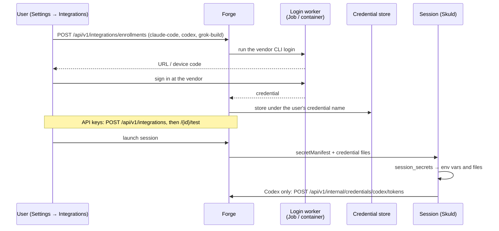

# Provider connections

A model Connection is a user's own sign-in or key for a model vendor, stored by
Forge and handed to that user's sessions at launch. It is how a session's runtime
is authenticated to its model.

## In one minute

- Model access is **per user**: each person connects their own Claude
  subscription, ChatGPT sign-in or API key. There is no shared platform key for
  sessions.
- A Connection is an integration of type `ai_provider`; its secret lives in the
  credential store (OpenBao in a cluster), never in Forge's database.
- Subscription sign-ins run the vendor's official CLI login in a short-lived,
  isolated worker; API keys are pasted and probed against the vendor.
- At launch Forge writes a **secret manifest**: which env vars and files the
  session gets from which credential. Skuld turns it into the runtime's
  environment at boot.
- Codex is the exception: its ChatGPT refresh token never leaves Forge. The
  session asks Forge's broker for short-lived access tokens.

## How it fits

## The model Connections

| Slug | Sign-in | Delivered to the session as |
|---|---|---|
| `claude-code` | Browser login (`claude_setup`) | `CLAUDE_CODE_OAUTH_TOKEN`, and `SKULD__CLAUDE_AUTH=subscription` |
| `anthropic` | API key, probed at `api.anthropic.com/v1/models` | `ANTHROPIC_API_KEY`, and `SKULD__CLAUDE_AUTH=api_key` when no subscription is attached |
| `codex` | Device code (`codex_device`) | Short-lived access tokens from Forge's broker; no file |
| `openai` | API key, probed | `OPENAI_API_KEY` |
| `grok-build` | Device code (`grok_device`) | File `~/.grok/auth.json` |
| `xai` | API key, probed | `XAI_API_KEY` |
| `deepseek` | API key, probed | `DEEPSEEK_API_KEY` |
| `meta` | API key | `META_API_KEY` |
| `model-server` | None (registered from Settings → Runtime) | `SKULD__MODEL_GATEWAY__URL` and `__TOKEN` from the Connection's config |

The definitions are the integration catalog in Forge's config; adding one is a
config entry (`env_from_credentials`, `file_mounts`, `credential_enrollment`),
not code.

## Enrollment: subscription sign-ins

| Step | What happens |
|---|---|
| Start | `POST /api/v1/integrations/enrollments` creates an enrollment for the caller; it expires after 900 s |
| Login | A runner starts the vendor's CLI login with a memory-backed home and no platform environment |
| Code | Device flows show a code; browser flows may need `POST …/enrollments/{id}/code` |
| Store | Forge reads the credential, writes it to the credential store and creates the Connection |
| Expiry | Claude and Grok tokens cannot be refreshed; the worker reports when they run out and the wizard asks for a new sign-in |

| Runner | Used by |
|---|---|
| `KubernetesLoginRunner` | Clusters: a bounded Job in namespace `niuu-logins` |
| `DockerLoginRunner` | Docker mode: a sibling container removed after the read |
| `LocalLoginRunner` | Local mini mode: a process on this host, in a private temporary directory, with the host's own CLIs |
| `OpenShellCredentialEnrollmentRunner` | OpenShell sandboxes |
| `UnsupportedCredentialEnrollmentRunner` | The default: sign-ins are refused, keys still work |

`CompositeCredentialEnrollmentRunner` combines several (for example with the OAuth
device-flow runner); each enrollment goes to the first that implements its method.

## Delivery at launch

1. **Which Connections.** The ones the launch names (`integration_ids`), else every
   enabled Connection of the session owner. A Connection owned by someone else, or
   disabled, refuses the launch.
2. **Manifest.** `IntegrationContributor` maps each Connection to env vars
   (`credential file + key`) and file targets. Forge does not read the secret
   values to do this.
3. **Boot.** Secret delivery renders the credential files and `manifest.json` into
   `/run/secrets`; `python -m skuld.session_secrets` exports the variables and
   links the files. Anything it cannot do stops the boot.
4. **Spawn.** The Claude transports default to the subscription login and strip
   `ANTHROPIC_API_KEY` / `ANTHROPIC_AUTH_TOKEN` from the CLI's environment, unless
   `SKULD__CLAUDE_AUTH=api_key`.

## Codex: brokered tokens

| Piece | Behaviour |
|---|---|
| Broker | `POST /api/v1/internal/credentials/codex/tokens` refreshes the stored ChatGPT credential and returns an access token, account id, plan and expiry |
| Session side | `skuld.codex_auth.VolundrCodexAuthProvider`, set by the Kubernetes, Flux, Docker and OpenShell pod managers |
| Host side | `HostCodexAuthProvider` (Skuld's default) keeps the machine's own Codex login |
| Bifröst side | The `ChatGPTSubscriptionAdapter` uses the same broker with Bifröst's workload identity, to serve GPT models over a subscription to platform callers |

## Levers

| Knob | Default | What it changes | Where it is set |
|---|---|---|---|
| `credential_store.adapter` | `MemoryCredentialStore` | Where secrets live: OpenBao, Infisical, file or memory | Forge config |
| `credential_enrollment_runner` | `UnsupportedCredentialEnrollmentRunner` (`LocalLoginRunner` in local mini mode) | Which runner performs sign-ins | Forge config |
| `codex_auth.adapter` (Skuld) | `HostCodexAuthProvider` | Host login versus Forge broker | Set per session by the pod manager |
| `claude_auth` (env `SKULD__CLAUDE_AUTH`) | `subscription` | Subscription login or API key for Claude; any other value is refused at startup | Skuld settings; the env var is set by `IntegrationContributor` |
| Integration definitions | built in | Which vendors can be connected and how they are delivered | Forge config (integration catalog) |

## Tradeoffs

| Choice | Gains | Costs |
|---|---|---|
| Subscription sign-in | Usage billed to the user's plan; models gated to the plan work | Claude and Grok tokens expire and need a new sign-in |
| API key | No expiry; works without a login runner | Pay-per-token; one key's org settings apply (data retention can gate models) |
| Brokered Codex tokens | Refresh token never enters a pod | Sessions need Forge reachable to refresh |

## Code map

| Concern | Where |
|---|---|
| Model integration definitions | [`src/volundr/config.py`](https://github.com/niuulabs/niuu/blob/dev/src/volundr/config.py) (`ai_provider` entries) |
| REST: connections and enrollments | [`src/volundr/adapters/inbound/rest_integrations.py`](https://github.com/niuulabs/niuu/blob/dev/src/volundr/adapters/inbound/rest_integrations.py) |
| Enrollment service | [`src/volundr/domain/services/credential_enrollment.py`](https://github.com/niuulabs/niuu/blob/dev/src/volundr/domain/services/credential_enrollment.py) |
| Login runners | [`k8s_login_runner.py`](https://github.com/niuulabs/niuu/blob/dev/src/volundr/adapters/outbound/k8s_login_runner.py), [`docker_login_runner.py`](https://github.com/niuulabs/niuu/blob/dev/src/volundr/adapters/outbound/docker_login_runner.py), [`local_login_runner.py`](https://github.com/niuulabs/niuu/blob/dev/src/volundr/adapters/outbound/local_login_runner.py) |
| Which Connections a launch gets | [`src/volundr/domain/services/session.py`](https://github.com/niuulabs/niuu/blob/dev/src/volundr/domain/services/session.py) (`_resolve_connections`) |
| Secret manifest | [`src/volundr/adapters/outbound/contributors/integrations.py`](https://github.com/niuulabs/niuu/blob/dev/src/volundr/adapters/outbound/contributors/integrations.py) |
| Boot-time env and files | [`src/skuld/session_secrets.py`](https://github.com/niuulabs/niuu/blob/dev/src/skuld/session_secrets.py) |
| Claude auth selection | [`src/skuld/transports/claude_env.py`](https://github.com/niuulabs/niuu/blob/dev/src/skuld/transports/claude_env.py) |
| Codex broker | [`rest_codex_credentials.py`](https://github.com/niuulabs/niuu/blob/dev/src/volundr/adapters/inbound/rest_codex_credentials.py), [`src/skuld/codex_auth.py`](https://github.com/niuulabs/niuu/blob/dev/src/skuld/codex_auth.py), [`brokered_credentials.py`](https://github.com/niuulabs/niuu/blob/dev/src/volundr/adapters/outbound/brokered_credentials.py) |
| Bifröst over a ChatGPT subscription | [`src/bifrost/adapters/chatgpt_subscription.py`](https://github.com/niuulabs/niuu/blob/dev/src/bifrost/adapters/chatgpt_subscription.py) |

## Related

- [Models](index.md): which sessions go through the gateway
- [Model catalog](catalog.md)
- [Routing](routing.md)
- [Isolation and secrets](../security/isolation-and-secrets.md): how secret files reach a session
- [Credentials](../security/credentials.md): every credential kind the platform accepts
- [Skuld runtimes](../skuld/runtimes.md)
