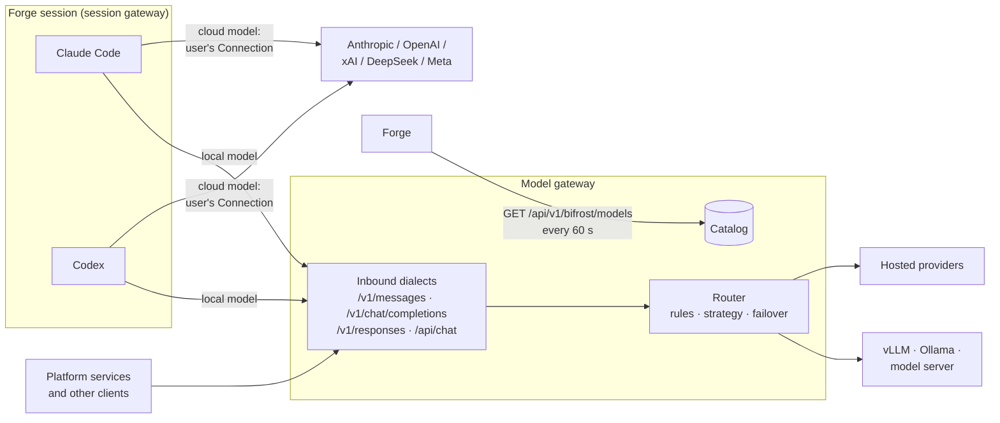

# Models

The model gateway (AI models in the UI) holds the platform's model catalog: one place
that knows which models exist, and one endpoint that can serve them in the API
dialect a caller speaks.

## In one minute

- **The model gateway owns the catalog.** Forge, the setup wizard and the model
  pickers read the model list from it; nothing else keeps its own.
- **Sessions on hosted models skip the gateway.** A Claude Code or Codex session
  on a cloud model calls the vendor directly, with the user's own
  [Connection](connections.md) (a subscription sign-in or an API key).
- **Sessions on self-hosted models go through it.** When the catalog marks a model
  `provider: local` (vLLM, Ollama, your own server), the session's CLI is pointed
  at the model gateway, which translates to the server's protocol.
- **Platform services may call it directly.** Anything that speaks the Anthropic,
  OpenAI Chat Completions, OpenAI Responses or Ollama API can use the model gateway for
  routing, quotas, usage and cost.
- **Translated by default, native when asked.** The model gateway normalises requests to the
  Anthropic Messages format; `passthrough: true` forwards a provider's own
  protocol unchanged ([routing](routing.md)).

## How it fits

Solid lines are inference traffic. Forge only reads the catalog; it never proxies
inference. Whether a session's traffic reaches the model gateway is decided at launch from
the catalog entry of the session's model, not by the model picker.

## What goes through the gateway

| Caller | Model | Path | Credential used |
|---|---|---|---|
| Claude Code session | Cloud (`provider: cloud`) | Direct to Anthropic | User's Claude subscription or Anthropic API key Connection |
| Codex session | Cloud | Direct to OpenAI | User's ChatGPT sign-in (short-lived tokens from Forge's broker) or OpenAI API key |
| Grok Build, DeepSeek, Muse sessions | Cloud | Direct to the vendor | User's Connection for that vendor |
| Claude Code session | Local | Model gateway `/v1/messages` (`ANTHROPIC_BASE_URL`) | Gateway token |
| Codex session | Local | Model gateway `/v1/responses` (a `model_providers` entry) | Gateway token |
| Platform service (e.g. the workflow engine's spec decomposition) | Any configured | Model gateway, when its base URL points there | The service's own auth to the model gateway |

Two launch-time contributors in Forge decide the local-model rows:

- `ModelGatewayContributor` (wired when `bifrost.session_gateway_url` is set) adds
  `SKULD__MODEL_GATEWAY__URL` for a session whose model is catalog-local.
- A **Model server** Connection carries the gateway URL and token in its own
  config; the CLI seeds one per self-hosted provider in mini and Docker mode.

The session gateway then rewrites the CLI's environment: Claude Code gets `ANTHROPIC_BASE_URL`
and `ANTHROPIC_AUTH_TOKEN` (the platform API key is removed), Codex gets a
`niuu` model provider with `wire_api = "responses"` and web search and
multi-agent tools off, since the translation carries function tools only.
A gateway URL with a blank token refuses the launch.

## Inbound surface

Mounted on the host at `/api/v1/bifrost` (standalone on port `8088`).

| Route | Dialect |
|---|---|
| `POST /v1/messages` | Anthropic Messages |
| `POST /v1/chat/completions` | OpenAI Chat Completions |
| `POST /v1/responses` | OpenAI Responses |
| `POST /api/chat`, `/api/generate`, `GET /api/tags` | Ollama |
| `GET /v1/models` | Model list for clients |
| `GET /models`, `/models/{id}`, `/aliases`, `/providers`, `/providers/health` | Catalog for the platform |
| `GET /v1/usage`, `/v1/cache/stats` | Usage and cache |
| `POST /admin/reload-keys` | Re-read provider keys (also `SIGHUP`) |

## Levers

| Knob | Default | What it changes | Where it is set |
|---|---|---|---|
| `bifrost.session_gateway_url` (Forge) | empty (off) | Sessions on local models are pointed at this URL | Forge config |
| `bifrost.url` (Forge) | `http://localhost:8080` | Where Forge reads the catalog | Forge config |
| `bifrost.catalog_refresh_interval_seconds` (Forge) | `60` | How often Forge re-reads the catalog | Forge config |
| `auth_mode` | `open` | `open`, `pat`, `mesh` (Envoy headers) or `oidc` | Model gateway config |
| `model_gateway.url` / `.token` (session gateway) | empty | Gateway a session's CLIs use | Set by Forge per session |
| `port` | `8088` | Standalone listen port | Model gateway config |
| `config` (chart) | — | Rendered verbatim as `bifrost.yaml` | `charts/bifrost/values.yaml` |

## Tradeoffs

| Choice | Gains | Costs |
|---|---|---|
| Hosted model, session calls the vendor directly | The vendor's full feature set (hosted tools, server compaction); billed to the user's own subscription | No gateway quotas, rules or usage records for that traffic |
| Self-hosted model through the model gateway | One endpoint for every CLI; usage and cost recorded; inference stays on your hardware | Only what the translation carries: function tools, no hosted tools |
| Platform service through the model gateway | Routing, quotas, audit and cost in one place | One more hop; the gateway's auth mode must suit the caller |

## Not built yet

A per-session credential for the gateway: under `oidc` host auth the CLI refuses
to start with the model gateway plugin enabled; other modes send a named open-gateway
token that carries no authority.

## Code map

| Concern | Where |
|---|---|
| App and wiring | [`src/bifrost/app.py`](https://github.com/niuulabs/niuu/blob/dev/src/bifrost/app.py) |
| Inbound routes | [`src/bifrost/inbound/routes.py`](https://github.com/niuulabs/niuu/blob/dev/src/bifrost/inbound/routes.py) |
| Host mount | [`src/bifrost/plugin.py`](https://github.com/niuulabs/niuu/blob/dev/src/bifrost/plugin.py) |
| Local models → gateway | [`src/volundr/adapters/outbound/contributors/model_gateway.py`](https://github.com/niuulabs/niuu/blob/dev/src/volundr/adapters/outbound/contributors/model_gateway.py) |
| Model server seed connections | [`src/cli/commands/platform.py`](https://github.com/niuulabs/niuu/blob/dev/src/cli/commands/platform.py) (`model_server_seed_connections`) |
| Claude Code env | [`src/skuld/transports/claude_env.py`](https://github.com/niuulabs/niuu/blob/dev/src/skuld/transports/claude_env.py) |
| Codex gateway overrides | [`src/skuld/transports/codex_ws.py`](https://github.com/niuulabs/niuu/blob/dev/src/skuld/transports/codex_ws.py) (`codex_gateway_overrides`) |
| Forge catalog client | [`src/volundr/adapters/outbound/bifrost_catalog_http.py`](https://github.com/niuulabs/niuu/blob/dev/src/volundr/adapters/outbound/bifrost_catalog_http.py) |
| Chart | [`charts/bifrost/`](https://github.com/niuulabs/niuu/blob/dev/charts/bifrost/values.yaml) |

## Related

- [Model catalog](catalog.md): what an entry records and how to add one
- [Provider connections](connections.md): how a user's model sign-in reaches a session
- [Routing](routing.md): rules, strategies, passthrough and compaction
- [Session gateway runtimes](../session-gateway/runtimes.md): how each runtime is spawned
- [Mini and Docker mode](../deployment/single-host.md): where the seeded Model server Connection comes from
