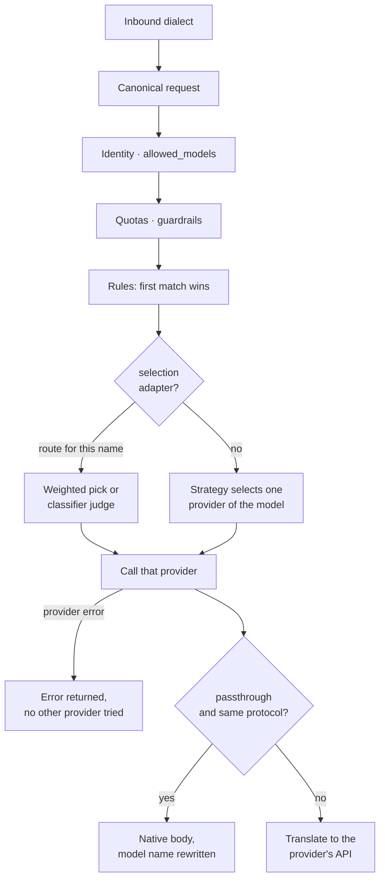

# Routing

How Bifröst turns one request for a model name into a call to one provider:
access and quota checks, rules, model selection, provider selection, and the
protocol the call is made in.

## In one minute

- Every request is read into one canonical shape (Anthropic Messages), whatever
  dialect it arrived in, so rules, quotas and usage work the same for all.
- The model name is resolved through `aliases`, then to the providers that list
  it under `models`. No provider for the model is an error, not a guess.
- The routing strategy selects one of those providers; the default is `direct`.
  Bifröst serves each request from exactly one provider: strategies select, they
  do not fall back. When the selected provider fails, its error is the answer and
  no other provider is tried.
- `passthrough: true` on a provider skips the translation for callers that already
  speak its protocol. Bifröst still authenticates, routes, meters and audits.
- Bifröst does not compact context itself. It carries a provider's own compaction
  where the path allows it, and refuses the request where it does not.

## How it fits

Usage, cost, audit and events are recorded on both paths; on the native path they
are read from the provider's own stream.

## Picking the provider

| Strategy | Provider selected |
|---|---|
| `direct` (default) | The first provider listed for the model |
| `cost_optimised` | The cheapest `cost_per_token` |
| `round_robin` | The next provider in rotation, one per request |
| `latency_optimised` | The lowest EWMA latency; providers with no data rank last |

- `model_routing_strategies` overrides the strategy per model or alias.
- There is no failover. `failover` was removed as a strategy and a config that
  still names it, globally or in `model_routing_strategies`, is refused at load.
  A failing provider fails the request with an error naming the provider and
  model; changing provider is a configuration change, not a runtime branch.
- The adapter is `adapter` (a class path) when set, otherwise by provider key:
  `anthropic`, `openai`, `ollama`, anything else OpenAI-compatible.

## Rules, guardrails and selection

| Mechanism | What it does | Default |
|---|---|---|
| `rules` | Conditions on model, tools, images, thinking, budget, content, agent; actions `route_to`, `reject`, `log`, `tag`, `strip_images`. First match wins | none |
| `guardrails.budget` | At `warn_at_pct` of the daily budget, route to `warn_target` or down `degradation_chain`; at 100 % reject | off |
| `guardrails.context_window` | Reject a request with more than `max_messages` messages | off |
| `agent_permissions` | `allowed_models` and a quota per agent id (globs allowed) | unrestricted |
| `default_quota`, `tenant_quotas` | Tokens per day, cost per day, requests per hour; `0` means none | none |
| `selection` | A dynamic adapter that picks the target itself (below) | none |

`selection` takes an adapter class and kwargs:

- `bifrost.adapters.switchyard.SwitchyardSelection`: weighted random choice among a
  model's providers, `weights` keyed by provider.
- `bifrost.adapters.switchyard_models.SwitchyardModelSelection`: named routes (the
  request's model name) over explicit `targets` (provider + model + weight). A route
  with a `judge` and `prompt` asks the judge model which target fits. The judge's
  `max_tokens` (`routes.<name>.max_tokens`) is required and has no default: it is
  set to what the judge's answer, reasoning included, needs. A judge answer cut
  off at it raises and is counted on `ravn.cap.hits` (knob
  `bifrost.selection.routes.<name>.max_tokens`); the target is never chosen by
  the classifier's default.

A rejected request is a 400 naming the rule; nothing is sent to a provider.

## Translated or native

| Provider adapter | Native protocol | Passthrough serves |
|---|---|---|
| `ChatGPTSubscriptionAdapter` | OpenAI Responses | `POST /v1/responses` callers |
| `OpenAICompatAdapter` (and Ollama) | OpenAI Chat Completions | `POST /v1/chat/completions` callers |
| `AnthropicAdapter` | none (the canonical format is Anthropic's) | n/a |

Startup refuses `passthrough: true` when the adapter cannot serve natively, when
the response cache is on (it stores canonical responses only), or when one model's
providers disagree on the path (the protocol of a request must not depend on which
provider is selected).

## Compaction

| Request carries | Served when | Otherwise |
|---|---|---|
| Anthropic `context_management` / `compaction` blocks | The selected provider is an Anthropic adapter (forwarded with the beta header; compaction tokens added to usage) | 400: route to Anthropic, or compact in the client |
| Responses `context_management` | Passthrough to an adapter with native compaction (ChatGPT subscription) | 400 |

Runtimes that compact on their own (Claude Code, Codex) need neither.

## Per-runtime paths

| Runtime | Calls | Path through Bifröst |
|---|---|---|
| Claude Code | `/v1/messages` | Canonical; translated to the self-hosted server's Chat Completions |
| Codex | `/v1/responses` | Translated to canonical and on to the server; Codex's hosted tools are turned off |
| OpenAI SDK clients | `/v1/chat/completions` | Native to an OpenAI-compatible provider with passthrough, else translated |
| Ollama clients | `/api/chat`, `/api/generate` | Translated |

## Levers

| Knob | Default | What it changes |
|---|---|---|
| `routing_strategy` | `direct` | Which provider serves every model |
| `model_routing_strategies` | `{}` | Per model or alias strategy |
| `providers.<name>.models` | `[]` | Which models a provider serves |
| `providers.<name>.passthrough` | `false` | Native protocol for matching callers |
| `providers.<name>.cost_per_token` | `0.0` | Selection under `cost_optimised` |
| `providers.<name>.timeout` | `120` s | Per-request timeout |
| `providers.<name>.chat_template_kwargs` | `{}` | Forced chat-template arguments (OpenAI-compatible) |
| `providers.<name>.api_key_env` / `api_key_file` | `""` | Provider key; re-read on `SIGHUP` or `POST /admin/reload-keys` |
| `latency_ewma_alpha` | `0.2` | Weight of recent latency |
| `cache.mode` | `disabled` | `memory` or `redis` exact-response cache (non-streaming); `default_ttl` 300 s |

All are keys of Bifröst's config (`bifrost.yaml`; the chart's `config` value).

## Tradeoffs

| Choice | Gains | Costs |
|---|---|---|
| Translated (default) | One rule, quota and usage model for every dialect; any caller to any provider | Only what the canonical format carries; hosted tools and provider state are refused |
| Passthrough | Reasoning items, compaction and hosted tools reach the provider unchanged | Only callers already on that protocol; no response cache; all providers of a model must match |
| Self-hosted model | Inference on your hardware; zero per-token price | You size, serve and keep it up; capability depends on the model |
| Hosted model | Frontier capability, nothing to run | Per-token cost or plan limits; data leaves your network |
| One provider per request | The provider that answered is always the one selected; a failure is visible, not absorbed | A provider outage fails the requests routed to it until the configuration changes |

## Code map

| Concern | Where |
|---|---|
| Router and strategies | [`src/bifrost/router.py`](https://github.com/niuulabs/niuu/blob/dev/src/bifrost/router.py) |
| Rule actions | [`src/bifrost/domain/routing.py`](https://github.com/niuulabs/niuu/blob/dev/src/bifrost/domain/routing.py), [`adapters/rules/yaml_engine.py`](https://github.com/niuulabs/niuu/blob/dev/src/bifrost/adapters/rules/yaml_engine.py) |
| Quotas, guardrails, handlers | [`src/bifrost/inbound/routes.py`](https://github.com/niuulabs/niuu/blob/dev/src/bifrost/inbound/routes.py) |
| Selection adapters | [`switchyard.py`](https://github.com/niuulabs/niuu/blob/dev/src/bifrost/adapters/switchyard.py), [`switchyard_models.py`](https://github.com/niuulabs/niuu/blob/dev/src/bifrost/adapters/switchyard_models.py) |
| Passthrough port and helpers | [`src/bifrost/ports/native.py`](https://github.com/niuulabs/niuu/blob/dev/src/bifrost/ports/native.py), [`inbound/native.py`](https://github.com/niuulabs/niuu/blob/dev/src/bifrost/inbound/native.py) |
| Translation | [`src/bifrost/translation/`](https://github.com/niuulabs/niuu/blob/dev/src/bifrost/translation/models.py) |
| Provider adapters | [`src/bifrost/adapters/`](https://github.com/niuulabs/niuu/blob/dev/src/bifrost/adapters/anthropic.py) |
| Config | [`src/bifrost/config.py`](https://github.com/niuulabs/niuu/blob/dev/src/bifrost/config.py) |

## Related

- [Models](index.md)
- [Model catalog](catalog.md)
- [Provider connections](connections.md)
- [Fail loud](../design/fail-loud.md)
