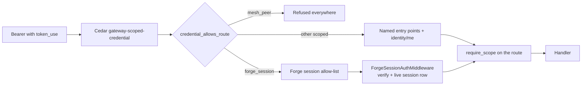

# Credentials

Every bearer credential the platform accepts, who holds it, who signs it, how far it
reaches and how it dies.

## In one minute

- A **human** holds an OIDC token from the configured identity provider. Everything else
  is a narrower credential derived from a human or bound to one workload.
- **Scoped credentials** carry a `token_use` claim and a `scopes` claim. They are
  **fail-closed**: admitted only at the routes their scopes name. Unscoped tokens (humans,
  unscoped PATs, plain workload tokens) pass the scope layer untouched.
- The scope allowlist is a **constant in code** (`KNOWN_WORKLOAD_SCOPES`), not config:
  whoever could edit it could mint authority.
- A scope means something only where a route calls `require_scope(...)`. A test fails if
  the allowlist and the enforcement points drift apart.
- Personal access tokens (PATs) are a sanctioned exception for automation with no browser
  session. Workloads get authority through workload identity, not PATs.

## The matrix

| Credential | Held by | Issued / signed by | Lifetime | Carries | Revoked by |
|---|---|---|---|---|---|
| OIDC user token | A person (browser, CLI, app) | The configured identity provider | The provider's setting | Roles, mapped by `identity.roleMapping` | The provider (logout, expiry) |
| Personal access token (PAT) | A person's automation, e.g. the workflow engine's dispatcher acting as that person | `pat.token_issuer_adapter`: `MemoryTokenIssuer` (HS256, default) or `KeycloakTokenIssuer` (token exchange) | `pat.ttl_days`, default 365 | The owner's full authority, unless minted with scopes | Revoking the PAT (table `personal_access_tokens`) |
| Scoped workload token (`valkyrie_build`) | A workload that must do one named thing | The workload-identity exchange, `POST /api/v1/tokens/workload/exchange` | `workload_identity.token_ttl_seconds`, default 900 s (60–3600) | `scopes` from the exchange-grantable family | Expiry |
| Plain workload token | A workload without requested scopes | The same exchange | The same | The mapping's `roles` (default `volundr:developer`) | Expiry |
| Session credential (`forge_session`) | One session's broker, for the Forge MCP | Forge, at every launch | Bound to the launch; `exp` backstop `forge_mcp.session_tokens.ttl_seconds`, default 30 days | `FORGE_SESSION_SCOPES`, role `volundr:developer`, never admin | Restarting, stopping or archiving the session |
| OpenShell sandbox token (`openshell_session` / `openshell_resident`) | An OpenShell sandbox's credential broker | Forge, through the workload issuer | The issuer's TTL | The owner's workload roles, bound to one session or resident | Expiry; refused on any other session's routes |
| Push-delivery reader (`notification_delivery`) | The push gateway only | The exchange, only for a mapping listing it in `privileged_scopes` | Exchange TTL | `forge:notifications:deliver`; never mixed with another family | Expiry |
| Host pairing code (`compute_host_join`) | An admin, pasted into one host's join command | Forge in process (workload issuer, or its own key file in mini mode) | `compute.hosts.pairing_code_ttl_seconds`, default 600 s | One scope, no roles, single use | Consumption, or expiry |
| Node pairing code (`node_join`) | An admin, pasted into `niuu join` | The Platform's workload issuer | `niuu.node_join.pairing_code_ttl_seconds`, default 300 s | One scope | Consumption, or expiry |
| Mesh certificate (`mesh_peer`) | A mesh peer, shown to other peers | Forge, `POST /api/v1/forge/sessions/{id}/mesh-identity` | `forge_mcp.mesh_identity.ttl_seconds`, default 900 s | No scopes, no roles; audience `niuu-mesh` | A signed "session stopped" event, then expiry |

Machines that hold no bearer at all (joined nodes, VM guests, registered hosts) are on
[Machine identities](machine-identities.md).

## Scope families

Each scoped `token_use` draws from its own family, so one kind can never carry another
kind's scopes (`SCOPES_BY_TOKEN_USE`).

| Family | Scopes | Who may grant |
|---|---|---|
| `valkyrie_build` (and scoped PATs) | `forge:session:create`, `forge:session:room-role`, `ting:workflow:launch`, `ting:workflow:coordinate`, `observatory:topology:push`, `node_join`, `forge:push:call` | The exchange, or a PAT mint |
| `valkyrie_build`, issuer-only | `compute_host_join`, `forge:session:preview` | Only an in-process issuer; the exchange drops them |
| `forge_session` | `forge:notify`, `forge:session:read`, `forge:session:secret`, `forge:mesh:identity` for every session; `forge:session:message`, `forge:session:lifecycle` only by operator grant | Forge at launch |
| `notification_delivery` | `forge:notifications:deliver` | The exchange, for one exact subject |
| `mesh_peer` | none | Forge |

The value `valkyrie_build` is historical: it means "this credential is scoped", not
"this credential builds".

## Where a scoped credential is checked

| Layer | What it does | Unscoped token |
|---|---|---|
| Cedar `gateway-scoped-credential` (Envoy `ext_authz`) | Forbids a scoped token unless it holds the route's `required_scope` | Passes |
| `credential_allows_route` (each service's `PATRevocationMiddleware` and request principal resolution) | Admits a scoped credential only on the routes its scopes name, plus `GET /api/v1/identity/me`. Skipped with the allow-all identity adapter | Passes |
| Forge session allow-list (`forge_session_policy.ROUTE_POLICIES`) | Each route names a scope and a binding: `OWN` (the session itself), `OWNED` (any of the owner's sessions), `PEER` (another of the owner's sessions). Every route not listed is closed | — |
| `ForgeSessionAuthMiddleware` | Verifies signature, expiry, issuer and audience, then the live row: the session exists, has the same owner, is on the same launch, and is not stopped or archived. Runs in every identity mode, mini mode included | — |
| `require_scope("x", ...)` (route) | 403 unless the token holds one named scope of its own family. A check naming none of its family admits `valkyrie_build` but denies `forge_session` | Passes |

## PATs

A PAT is a long-lived JWT for automation that must call as a person with no browser
session. It is an exception to "no custom tokens":

| Fact | Detail |
|---|---|
| Authority | Unscoped: the owner's full authority. Scoped: only `valkyrie_build`-family scopes, validated at mint (`validate_pat_scopes`) |
| Narrowing | A PAT minted from a scoped credential cannot widen it ("PAT delegation cannot expand credential scopes") |
| Forcing scopes | `PATService(require_scopes=True)` refuses an unscoped mint |
| Revocation | `PATRevocationMiddleware` checks each request (valid lookups cached `pat.revocation_cache_ttl` 300 s, revoked ones `pat.revoked_cache_ttl` 60 s) and re-checks open WebSockets every `pat.websocket_check_interval` (30 s) |
| Host `oidc` mode | A `MemoryTokenIssuer` PAT (HS256) cannot be checked against a JWKS, so `host_auth.mode: oidc` refuses to start with it |

A leaked unscoped PAT keeps its owner's full authority until it is revoked or expires.

## Delivering the session credential

| Pod manager | How the broker gets it |
|---|---|
| Local process (mini mode) | In the broker's environment |
| OpenShell | A private file, `.volundr/forge-session/token` under the sandbox home (`/sandbox` by default), mode 0600, written before the broker starts; the env names only the path |
| Flux / Kubernetes | `KubernetesExecutionCredentialProjection` writes one Secret per session, mounted read-only at `/var/run/secrets/niuu-forge-session`; deleted when the session stops |
| VM guests | Pulled from the guest metadata endpoint or pushed over SSH ([Machine identities](machine-identities.md)) |

## Levers

| Knob | Default | What it changes | Where it is set |
|---|---|---|---|
| `workload_identity.enabled` | `false` | Turns on the exchange | Forge / Platform config, chart `workloadIdentity` |
| `workload_identity.signing_key_env` | `NIUU_WORKLOAD_IDENTITY_SIGNING_KEY` | The RSA key that signs workload, session and pairing tokens | Chart `workloadIdentity.signingKey.existingSecret` |
| `workload_identity.token_ttl_seconds` | `900` | Lifetime of exchanged tokens | Config |
| `workload_identity.mappings[]` | none | Which proofs map to which owner, tenant, roles; `privileged_scopes` | Config |
| `forge_mcp.session_tokens.enabled` | `true` | Mint session credentials at launch | Forge config |
| `forge_mcp.session_tokens.signing_key_file` | `~/.niuu/forge-session-signing-key.pem` | Forge's own key when workload identity has none (mini mode) | Forge config |
| `forge_mcp.session_tokens.projection_adapter` | empty | How Kubernetes session pods receive it | Chart `sessionCredentialProjection` |
| `pat.ttl_days` | `365` | PAT lifetime | Config |
| `pat.token_issuer_adapter` | `MemoryTokenIssuer` | Who signs PATs | Config |
| `compute.hosts.pairing_code_ttl_seconds` | `600` | Host pairing code lifetime | Forge config |
| `niuu.node_join.pairing_code_ttl_seconds` | `300` | Node pairing code lifetime | Platform config |

Session credentials enabled with no usable signing key is a startup error, never "mint
nothing". The chart refuses to render the projection without a key.

## Tradeoffs

| Choice | Gains | Costs |
|---|---|---|
| Scope allowlist as a constant | Nobody with config access can mint privilege | A new scope is a code change |
| Session credential checked against the live row | Restart revokes at once; no revocation list | One database read per presented token |
| Long `exp` backstop on session credentials | Long sessions never need refreshes | A leaked token lives as long as its launch |
| PATs as JWTs the edge already verifies | Automation needs no new auth path | Unscoped PATs carry full authority for up to `pat.ttl_days` |

## Code map

| Concern | Where |
|---|---|
| Scope families, edge and route checks | [`niuu/domain/services/token_scope.py`](https://github.com/niuulabs/niuu/blob/dev/src/niuu/domain/services/token_scope.py) |
| Session allow-list | [`niuu/domain/services/forge_session_policy.py`](https://github.com/niuulabs/niuu/blob/dev/src/niuu/domain/services/forge_session_policy.py) |
| Session credential minting | [`niuu/domain/services/forge_session_token.py`](https://github.com/niuulabs/niuu/blob/dev/src/niuu/domain/services/forge_session_token.py) |
| Session credential verification | [`volundr/adapters/inbound/forge_session_auth.py`](https://github.com/niuulabs/niuu/blob/dev/src/volundr/adapters/inbound/forge_session_auth.py) |
| Workload exchange | [`niuu/domain/services/workload_identity.py`](https://github.com/niuulabs/niuu/blob/dev/src/niuu/domain/services/workload_identity.py), config in [`niuu/config_models.py`](https://github.com/niuulabs/niuu/blob/dev/src/niuu/config_models.py) |
| PATs | [`niuu/domain/services/pat.py`](https://github.com/niuulabs/niuu/blob/dev/src/niuu/domain/services/pat.py), [`niuu/adapters/pat_revocation_middleware.py`](https://github.com/niuulabs/niuu/blob/dev/src/niuu/adapters/pat_revocation_middleware.py) |
| Host pairing codes | [`volundr/domain/services/compute_hosts.py`](https://github.com/niuulabs/niuu/blob/dev/src/volundr/domain/services/compute_hosts.py), signer in [`volundr/composition_builders.py`](https://github.com/niuulabs/niuu/blob/dev/src/volundr/composition_builders.py) |
| Node pairing codes | [`niuu/domain/services/guild_join.py`](https://github.com/niuulabs/niuu/blob/dev/src/niuu/domain/services/guild_join.py) |
| Kubernetes projection | [`volundr/adapters/outbound/execution_credential_k8s.py`](https://github.com/niuulabs/niuu/blob/dev/src/volundr/adapters/outbound/execution_credential_k8s.py) |
| Drift test | [`tests/test_niuu/test_token_scope.py`](https://github.com/niuulabs/niuu/blob/dev/tests/test_niuu/test_token_scope.py) |

## Related

- [Security overview](index.md) — where each check sits
- [Machine identities](machine-identities.md) — callers with no bearer token
- The rule text: [`.claude/rules/architecture.md`](https://github.com/niuulabs/niuu/blob/dev/.claude/rules/architecture.md)
