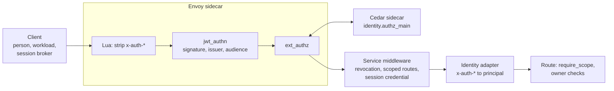

# Security

Who may call what, how the platform knows who is calling, and where each check happens.

## In one minute

- **People sign in with your identity provider.** The platform speaks standard OIDC and
  is not tied to any one provider; it never runs its own login.
- **At the edge, Envoy checks the token and Cedar decides admission.** Services behind it
  trust only the identity headers Envoy wrote, never ones a client sent.
- **Everything that is not a person gets a narrower credential**: a short-lived workload
  token, a session-bound token, or a key that never leaves the machine. Narrow
  credentials are refused everywhere except the routes they name.
- **Local mini mode turns all of this off on purpose** (`host_auth.mode: none`): every
  caller is the local admin. It says so in the log at startup. Session credentials are
  still verified.
- **Configured but impossible is fatal.** A missing signing key or an unverifiable issuer
  stops startup; nothing falls back to "no auth".

## How it fits

Read it left to right: Envoy proves the token is genuine, Cedar decides whether that
principal may enter this route, and the service narrows further (revoked PATs, scoped
credentials, the session a credential is bound to). Machine routes skip the JWT step and
authenticate inside the route; see [Machine identities](machine-identities.md).

## Principals

| Principal | Example | Proves itself with | Page |
|---|---|---|---|
| Person | You, in the web app or the `niuu` CLI | OIDC token from the identity provider | [Credentials](credentials.md) |
| Person's automation | Ting's dispatcher acting as you | Personal access token (a sanctioned exception) | [Credentials](credentials.md) |
| Workload | A resident, a Skuld gateway, a workflow step | A provider proof (e.g. a Kubernetes ServiceAccount token) exchanged for a short-lived workload token | [Credentials](credentials.md) |
| Session | One Forge session's broker, calling the Forge MCP | `forge_session` token bound to that session's launch | [Credentials](credentials.md) |
| Platform service | Forge, Ting signing bus events | A `service` mesh certificate signed with the platform key | Communication area |
| Machine | A joined node, a VM guest, a registered host | Ed25519 key, provider attestation or SPIFFE SVID | [Machine identities](machine-identities.md) |

## The edge

| Step | What it checks | Where |
|---|---|---|
| Lua filter | Removes every `x-auth-*` header (and extra claim headers) a client sent, so identity cannot be spoofed | Forge and shared-host chart Envoy configmaps |
| `jwt_authn` | Signature against the provider's JWKS (`keycloak` provider) or the workload issuer (`workload` provider); writes `x-auth-user-id` ← `sub`, `x-auth-email` ← `email`, `x-auth-tenant` ← `tenant_id`, `x-auth-roles` ← `resource_access.volundr.roles` | `_envoy_jwt.tpl` |
| `ext_authz` → Cedar | Re-checks issuer, audience, expiry, subject, tenant and roles; refuses odd paths (`%`, `\`, `//`, dot segments); denies any route not in `envoy.authorization.routes`; then evaluates Cedar. Fails closed (`failure_mode_allow: false`, 503) | `identity/adapters/envoy_authz.py`, policies in `identity/policies/authorization.cedar` |

Cedar's top rules: **tenant isolation** forbids crossing tenants (except system workflows
and instances); **scoped credentials** are forbidden unless they hold the route's required
scope; **admission** lets developers and admins use any method and viewers only GET/HEAD.
The rest are owner and role grants per resource (sessions, secrets, PATs, runs, workflows,
instances, Workspaces).

Bypassed by `jwt_authn` (exact matches only): `OPTIONS`, the OAuth callbacks,
`/api/v1/identity/auth/config`, the workload exchange and its JWKS, health checks, and the
two machine routes (node heartbeat/leave, guest metadata).

## Identity adapters

Every service resolves the principal through one configured adapter (dynamic `adapter:`
config), so no service code knows which identity provider is in use.

| Adapter | Use | Trusts |
|---|---|---|
| `EnvoyHeaderIdentityAdapter` | Behind Envoy (Kubernetes) | The `x-auth-*` headers Envoy wrote; provisions users just in time |
| `JwksIdentityAdapter` / `JwksBearerAuthenticationAdapter` | A host with no Envoy, `host_auth.mode: oidc` | The bearer, verified in process against the issuer's JWKS; asymmetric keys only |
| `RemoteHeaderAuthenticationAdapter` | Optional central identity check from `ext_authz` | A TLS identity authority |
| `AllowAllIdentityAdapter` | Mini mode, `host_auth.mode: none` | Nothing: every caller is `dev-user`, role `volundr:admin`, tenant `default` |

## Modes

| | Kubernetes | Host, `oidc` | Host, `none` (mini mode default) |
|---|---|---|---|
| Token verified by | Envoy `jwt_authn` | The service, in process | Nobody |
| Admission | Cedar sidecar | `CedarAuthorizationAdapter` | Allow-all |
| PAT revocation, scoped-route checks | Yes | Yes | Skipped (`PATRevocationMiddleware` is off with allow-all) |
| Session credentials | Verified | Verified | Verified |
| Startup refusals | Missing keys | Bifröst plugin enabled; HS256 PAT issuer | — |

The Forge chart's defaults are the permissive ones (`envoy.enabled`, `envoy.jwt.enabled`,
`envoy.authorization.enabled` all `false`, allow-all identity and authorization adapters).
A cluster deployment turns them on in its values.

## Levers

| Knob | Default | What it changes | Where it is set |
|---|---|---|---|
| `host_auth.mode` | `none` | `none`: everyone is admin. `oidc`: verify bearers in process | `~/.niuu/config.yaml` |
| `host_auth.oidc.issuers[]` | none | Trusted issuers and audiences (`oidc` needs at least one) | `~/.niuu/config.yaml` |
| `host_auth.oidc.clock_leeway_seconds` | `60` | Allowed `exp`/`nbf` skew | `~/.niuu/config.yaml` |
| `host_auth.oidc.jwks_cache_ttl_seconds` | `300` | Routine JWKS re-fetch | `~/.niuu/config.yaml` |
| `host_auth.oidc.min_refresh_interval_seconds` | `5` | Throttle for unknown-`kid` refreshes | `~/.niuu/config.yaml` |
| `envoy.jwt.enabled` | `false` | Envoy verifies JWTs | Forge chart |
| `envoy.jwt.tenantClaim` / `rolesClaim` | `tenant_id` / `resource_access.volundr.roles` | Which claims become tenant and roles | Forge chart |
| `envoy.jwt.bypassPrefixes` | callbacks, auth config, exchange, JWKS, health | Paths Envoy does not authenticate | Forge chart |
| `envoy.authorization.enabled` | `false` | Cedar admission sidecar | Forge chart |
| `envoy.authorization.routes` | — | The only routes Cedar admits | Forge chart |
| `identity.adapter` | `AllowAllIdentityAdapter` | How a service turns a request into a principal | Forge chart / config |
| `identity.roleMapping` | `admin`/`developer`/`viewer` → `volundr:*` | Provider roles to platform roles | Forge chart |

## Adding a new entry point

1. Decide who calls it. A person or workload: an ordinary route behind Envoy. Nothing new.
2. A narrow credential must reach it: add its scope to `KNOWN_WORKLOAD_SCOPES` and a
   `require_scope(...)` on the route, and add the route to `credential_allows_route`.
   `test_token_scope.py` fails if they drift.
3. A session broker must reach it: add it to `forge_session_policy.ROUTE_POLICIES` with a
   `forge:*` scope and a binding, and a `require_scope(...)` naming that scope.
4. A machine must reach it with no bearer: do not, unless every enforcement point in
   [Machine identities](machine-identities.md) changes with it.
5. Add the route to `envoy.authorization.routes`, or Cedar denies it.

## Tradeoffs

| Choice | Gains | Costs |
|---|---|---|
| Envoy and Cedar at the edge | One verified identity for every service; services stay simple | Behind Envoy, services trust headers; anything that reaches a pod around Envoy is trusted |
| Mini mode allow-all | Zero setup on one machine | Anyone who can reach the port is admin |
| Scoped credentials fail closed | A new route is closed to them by default | Every new automation path needs an explicit allow-list entry |

## Code map

| Concern | Where |
|---|---|
| Envoy filters and bypasses | [`charts/volundr/templates/envoy-configmap.yaml`](https://github.com/niuulabs/niuu/blob/dev/charts/volundr/templates/envoy-configmap.yaml), [`_envoy_jwt.tpl`](https://github.com/niuulabs/niuu/blob/dev/charts/volundr/templates/_envoy_jwt.tpl) |
| Cedar admission server | [`identity/authz_main.py`](https://github.com/niuulabs/niuu/blob/dev/src/identity/authz_main.py), [`identity/adapters/envoy_authz.py`](https://github.com/niuulabs/niuu/blob/dev/src/identity/adapters/envoy_authz.py) |
| Cedar policies | [`identity/policies/authorization.cedar`](https://github.com/niuulabs/niuu/blob/dev/src/identity/policies/authorization.cedar) |
| Identity adapters | [`identity/adapters/identity.py`](https://github.com/niuulabs/niuu/blob/dev/src/identity/adapters/identity.py), [`identity/adapters/jwks.py`](https://github.com/niuulabs/niuu/blob/dev/src/identity/adapters/jwks.py), [`identity/adapters/remote.py`](https://github.com/niuulabs/niuu/blob/dev/src/identity/adapters/remote.py) |
| Host auth modes | [`cli/config.py`](https://github.com/niuulabs/niuu/blob/dev/src/cli/config.py) (`AuthConfig`, `AuthOidcConfig`), startup log in [`niuu/service_runtime.py`](https://github.com/niuulabs/niuu/blob/dev/src/niuu/service_runtime.py) |
| Revocation and scoped-route middleware | [`niuu/adapters/pat_revocation_middleware.py`](https://github.com/niuulabs/niuu/blob/dev/src/niuu/adapters/pat_revocation_middleware.py) |

## Related

- [Credentials](credentials.md) — every credential kind in one matrix
- [Machine identities](machine-identities.md) — nodes, VM guests, registered hosts
- [Isolation and secrets](isolation-and-secrets.md) — what a session can reach once it runs
- Rule text: [`.claude/rules/architecture.md`](https://github.com/niuulabs/niuu/blob/dev/.claude/rules/architecture.md)
