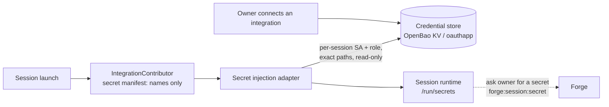

# Isolation and secrets

What a running session can touch, and how integration secrets reach it.

## In one minute

- **The runtime is the isolation boundary.** A local process has none; a Kubernetes pod,
  an OpenShell sandbox, a VM container and a host-mode slot each have their own.
- **Host-mode slots are never root.** No container daemon, no sudo, rootless Podman
  inside the slot, the machine's own credentials hidden from view. A session that needs
  root runs on the container runtime, where root is its container's.
- **Secrets live in a credential store** (OpenBao in production). A session gets only the
  credentials its owner selected, read-only, rendered as files or env at start.
- **Provider refresh tokens never enter a session.** OpenBao's `oauthapp` engine refreshes
  them; the session reads current access tokens.

## How it fits

The launch path never copies a secret value into Forge's own records.

## Runtimes compared

| Runtime | Runs as | Boundary | Pick it when |
|---|---|---|---|
| Local process (`LocalProcessPodManager`, mini mode) | The host OS user; inherits the platform's environment | None. A workspace directory is not an access boundary | You trust the code with your own account |
| Kubernetes pod | The pod's user and ServiceAccount | Pod, namespace, mounted Secrets | The normal cluster path |
| OpenShell sandbox (`OpenShellGatewayPodManager`) | The sandbox user (`/sandbox` home) | Required `sandbox_policy`: filesystem, Landlock, process and `network_policies`; egress checked against it | You want a policy-enforced sandbox per session |
| VM, container mode (`SshContainerVmRuntime`) | Root inside its container, under the guest's root Docker | The VM; with slots, a holder's network and PID namespaces, `--cgroup-parent`, `--cap-drop NET_RAW`, `--user <slot uid>` | The session needs root or Docker |
| VM or registered host, host mode (`SshHostVmRuntime`) | The slot's own user | Slot user, network namespace, cgroup slice, PID namespace | Many sessions share one machine and none needs root |

## Host-mode slots

Sessions on one machine are kept apart by the slot boundary alone, so nothing a slot is
given may be root on the machine. There is no grant that lifts this.

| Rule | How it holds |
|---|---|
| No container daemon | The slot is a named network namespace and a systemd slice; init and sidecar containers run as systemd units on overlay roots of unpacked images. `docker` in the slot is a shim for `podman` |
| No root group | The session drops to the slot uid with only its own group; no slot user joins `docker`, and no daemon socket is mounted |
| No sudo | None for slot users, nor any root-equivalent capability, privileged container or host mount |
| Rootless Podman | Subordinate ids per slot (`base + n × per_slot`), refused if they overlap another slot or a VM account; cgroup delegated from the slot's own; the slot's network namespace; the session's PID namespace |
| Machine credentials hidden | An empty read-only tmpfs over `/etc/niuu` in the session's view |
| Separate slots need a runtime that says so | `VmRuntime.supports_slots`; `compute.slots_per_machine` above 1 fails startup when the runtime does not declare it |

The slot supervisor (`vm_slot_supervisor`) creates each slot (`niuu-slot-<n>` user,
0700 directories, namespace, veth and NAT rules, slice) and checks on teardown that
nothing is left.

## Credential stores

One `CredentialStorePort`, selected by `credential_store.adapter`.

| Adapter | Stores | Use |
|---|---|---|
| `OpenBaoCredentialStore` | KV v2 at `<mount>/data/{owner_type}s/{owner_id}/{name}`; token, AppRole or JWT auth | Production |
| `OpenBaoOAuthCredentialStore` | OAuth grants in OpenBao's `oauthapp` engine (it owns refresh), other secrets in KV | Production, renewable integrations |
| `InfisicalCredentialStore` | Infisical | Where Infisical is the vault |
| `FileCredentialStore` | JSON per owner under a base directory, optional Fernet encryption | Docker / mini mode |
| `MemoryCredentialStore` | Process memory | Default; tests and throwaway runs |

## Getting secrets into a session

One `SecretInjectionPort`, selected by `secret_injection.adapter`.

| Adapter | How the session receives secrets |
|---|---|
| `OpenBaoAgentInjectionAdapter` | Per session: a ServiceAccount, an OpenBao JWT role with read-only access to exactly the mapped paths, and an Agent config; the OpenBao injector renders them into the pod. All four are deleted at cleanup |
| `InfisicalAgentInjectionAdapter` | The same shape for Infisical |
| `SessionFileSecretInjectionAdapter` | Docker mode: `/run/secrets/env.sh` plus bound files |
| `FileSecretInjectionAdapter`, `InMemorySecretInjectionAdapter` | Local and test use (in-memory is the default) |
| OpenShell | Provider grants passed when the sandbox is created; credential files written 0600 in 0700 directories |

A session that discovers it needs a secret mid-run asks its owner through Forge
(`forge:session:secret`); only the owner can supply or decline it.

## OAuth renewal

| Path | Who refreshes | Session sees |
|---|---|---|
| OpenBao `oauthapp` grants | OpenBao | Current access tokens, never the refresh token or client secret |
| Codex subscriptions, production | OpenBao, through `OpenBaoCodexCredentialBroker` | Access token and account metadata |
| Codex, Docker mini mode | `MiniModeCodexCredentialBroker`, on request, under a database lock; refuses outside mini mode | The same |
| Legacy mini-mode scan | The shared host, every five minutes, across all users | — |

The legacy scan runs only when both `local_mounts.mini_mode` and
`oauth.mini_mode_refresh_enabled` are true. It uses the host's store permissions, so that
host is privileged; it is not a per-tenant boundary.

## Levers

| Knob | Default | What it changes | Where it is set |
|---|---|---|---|
| `credential_store.adapter` | `MemoryCredentialStore` | Where secrets live | Forge config, chart `credentialStore` |
| `secret_injection.adapter` | `InMemorySecretInjectionAdapter` | How secrets reach a session | Forge config |
| `oauth.mini_mode_refresh_enabled` | `true` (chart: `false`) | Legacy refresh scan, mini mode only | Shared host config |
| `codex_credential_broker.adapter` | `DisabledCodexCredentialBroker` | Which broker serves Codex subscription tokens: OpenBao or mini mode | Forge config |
| `slot_isolation` (`uid_base`, `subnet`, `cpu`, `memory_mib`, `pids`) | `uid_base` 61000, `subnet` 10.249.0.0/16; limits must be set | Slot users, addressing and limits; required for host mode | `compute.runtime.kwargs` |
| `containers.subordinate_id_base` / `subordinate_ids_per_slot` | 1 000 000 / 65 536 | Rootless Podman id ranges; `containers: null` turns containers off | `compute.runtime.kwargs` |
| `compute.slots_per_machine` | `1` | Sessions one machine serves at once | Forge compute config |
| OpenShell `sandbox_policy` | required | The sandbox's filesystem, process and network policy | Pod manager kwargs |

## Tradeoffs

| Choice | Gains | Costs |
|---|---|---|
| Host mode over container mode | Dense, cheap slots; no root anywhere | No root, no Docker daemon for the session |
| Container mode | Root and Docker inside the session | Root is the container's under the guest's root Docker; one VM is the real boundary |
| Per-session OpenBao role | A session reads exactly its owner's selected paths | A ServiceAccount, role and ConfigMap per session |
| Engine-owned refresh | Refresh tokens stay out of every session | Needs the `oauthapp` engine; existing KV grants need a migration |

## Code map

| Concern | Where |
|---|---|
| Host-mode runtime | [`ssh_host_vm_runtime.py`](https://github.com/niuulabs/niuu/blob/dev/src/volundr/adapters/outbound/ssh_host_vm_runtime.py) |
| Container runtime, `supports_slots` | [`ssh_vm_runtime.py`](https://github.com/niuulabs/niuu/blob/dev/src/volundr/adapters/outbound/ssh_vm_runtime.py) |
| Slot supervisor | [`vm_slot_supervisor.py`](https://github.com/niuulabs/niuu/blob/dev/src/volundr/adapters/outbound/vm_slot_supervisor.py), [`vm_slot_layout.py`](https://github.com/niuulabs/niuu/blob/dev/src/volundr/adapters/outbound/vm_slot_layout.py) |
| OpenShell pod manager | [`openshell_gateway.py`](https://github.com/niuulabs/niuu/blob/dev/src/volundr/adapters/outbound/openshell_gateway.py) |
| Local processes | [`local_process.py`](https://github.com/niuulabs/niuu/blob/dev/src/volundr/adapters/outbound/local_process.py) |
| Credential store port and adapters | [`niuu/ports/credentials.py`](https://github.com/niuulabs/niuu/blob/dev/src/niuu/ports/credentials.py), [`openbao_credential_store.py`](https://github.com/niuulabs/niuu/blob/dev/src/niuu/adapters/openbao_credential_store.py), [`openbao_oauth_credential_store.py`](https://github.com/niuulabs/niuu/blob/dev/src/niuu/adapters/openbao_oauth_credential_store.py) |
| Secret injection | [`openbao_secret_injection.py`](https://github.com/niuulabs/niuu/blob/dev/src/volundr/adapters/outbound/openbao_secret_injection.py), [`session_file_secret_injection.py`](https://github.com/niuulabs/niuu/blob/dev/src/volundr/adapters/outbound/session_file_secret_injection.py) |
| Secret manifest | [`contributors/integrations.py`](https://github.com/niuulabs/niuu/blob/dev/src/volundr/adapters/outbound/contributors/integrations.py) |
| Codex brokers | [`codex_credential_broker.py`](https://github.com/niuulabs/niuu/blob/dev/src/volundr/adapters/outbound/codex_credential_broker.py), [`mini_codex_credential_broker.py`](https://github.com/niuulabs/niuu/blob/dev/src/volundr/adapters/outbound/mini_codex_credential_broker.py) |
| OpenBao operations | [`docs/operations/openbao-oauth.md`](https://github.com/niuulabs/niuu/blob/dev/docs/operations/openbao-oauth.md) |

## Related

- [Security overview](index.md)
- [Credentials](credentials.md) — the session credential and how each pod manager delivers it
- [Machine identities](machine-identities.md) — how VM guests pull credentials
