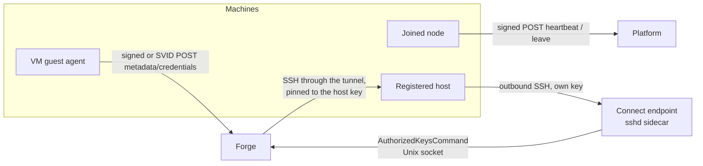

# Machine identities

How a machine with no person behind it proves who it is: by a key it holds, never by a
long-lived bearer token copied onto it.

## In one minute

- Three kinds of machine call the platform: **joined nodes** (`niuu join`), **VM guests**
  (a VM session's guest agent) and **registered hosts** (bare metal in a Forge compute
  pool, often behind NAT).
- Each proves itself with an **Ed25519 key that never leaves it** (or a provider-signed
  proof). Only the public half is stored.
- Each mechanism is allowed on **exactly one or two routes**, bypassed at Envoy by an exact
  regex, never a prefix.
- Signed requests carry a **millisecond timestamp** that must strictly increase per caller,
  advanced by one atomic SQL statement, inside a bounded clock-skew window.
- **Every rejection looks the same** (one 401 body), so a caller cannot probe which ids exist.

## How it fits

A node and a guest call *in* over HTTPS with a signature instead of a bearer. A
registered host calls nothing over HTTP: it keeps an SSH tunnel open, and Forge reaches
back through it.

## Joined nodes (`niuu join`)

| Aspect | Rule |
|---|---|
| Joining | `POST /api/v1/niuu/guild/join` with a `node_join` pairing code, an ordinary scoped credential minted by an admin ([Credentials](credentials.md)) |
| Key | Ed25519, generated on first `niuu join` (`NodeIdentity`); only the public key is uploaded |
| Routes | `POST /api/v1/niuu/guild/nodes/{id}/heartbeat` and `.../leave` only |
| Signed bytes | `METHOD\nPATH\ntimestamp_ms\nsha256(body).hexdigest()` (`signing_message`) |
| Headers | `x-niuu-node-id`, `x-niuu-timestamp`, `x-niuu-signature` |
| Replay | `UPDATE … WHERE last_request_at IS NULL OR last_request_at < $ts` (`try_advance_watermark`): one atomic statement |
| Skew | `niuu.node_join.clock_skew_seconds`, default 30 s |
| Rejection | The same 401 for unknown or malformed id, missing headers, bad signature, stale timestamp or replay |
| Enforcement points | The route dependency; `PATRevocationMiddleware`'s exemption; the Platform chart's (`charts/guild`) Envoy `jwt_authn` bypass, an exact `safe_regex` |

## VM guests (metadata credentials)

A VM session has no kubelet. Its guest agent pulls the session's ServiceAccount tokens
and Forge session credential from one Forge route,
`POST /api/v1/internal/compute/metadata/credentials`. The pool configures **one**
`GuestIdentity`; Forge never tries another.

| Identity | Proof | Verified against | Replay / freshness |
|---|---|---|---|
| Host-key signing (`HostKeyGuestIdentity`) | Signature with the allocation's Ed25519 SSH host key, same bytes as `niuu join`; headers `Niuu-Guest-Allocation`, `Niuu-Guest-Timestamp`, `Niuu-Guest-Signature` | The public key in the allocation's machine bootstrap; for a registered host (`key_source: registered`), its own sshd key from the `compute_hosts` row | Per-allocation watermark (`compute_guest_request_watermarks`), advanced only after signature and skew pass; `clock_skew_seconds` default 30 s |
| Provider attestation (`ProviderAttestedGuestIdentity`, the Harvester default) | The virt-launcher pod's ServiceAccount token, shared into the VM over virtiofs | A TokenReview, and the pod being an active pod of the allocation's VMI | The token's own expiry |
| SPIFFE (`SpiffeGuestIdentity`) | `Authorization: Bearer <JWT-SVID>` from the VM's SPIRE agent | Issuer, signature against SPIRE's OIDC keys, audience, expiry; subject must match `spiffe://{trust_domain}/forge-vm/{pool_id}/{allocation_id}` | The SVID's expiry; Forge registers one SPIRE entry per allocation |

What the endpoint will answer, in order:

1. Authenticate. Any failure is `401 {"error": "unauthorized"}`, including a body naming
   another allocation than the one proven.
2. The body names a `slot` (optional on a single-slot machine). Malformed: 400.
3. The machine must be in the pool and `ready` or `idle`; the slot must hold a `starting`
   or `busy` session with no stop requested. Otherwise 409 with the reason.
4. Answer with that session's credentials. A workflow run's unit may name a
   `session_id` listed in the unit's own launch payload; it gets that member's Forge
   credential only.

The Forge credential carries the session's *current* launch id, so a restart revokes
what the previous launch held. Responses are `Cache-Control: no-store`.

## Registered hosts (connect endpoint)

A host behind NAT keeps one outbound SSH connection to an OpenSSH sidecar of the Forge
pod (`hostConnect` in the Forge chart) and forwards a loopback port on the pod to its own
sshd.

| Limit | How it is enforced |
|---|---|
| Only live, registered hosts | `AuthorizedKeysFile none`; `AuthorizedKeysCommand` asks Forge on a Unix socket (`HostConnectKeyServer`) on every connection. Forge answers only for a not-removed host of this pool whose connector is the reverse SSH connector, and only for the connect user (`AllowUsers`) |
| One port, nothing else | Key line `restrict,port-forwarding,permitlisten="127.0.0.1:<port>",command="/usr/sbin/nologin"`; sshd `AllowTcpForwarding remote`, `PermitOpen none` |
| Unique ports | From the connector's `port_range`, unique per Forge (`idx_compute_hosts_tunnel_port`); a full range refuses the join |
| Revocation is immediate | The connector stops answering for the host first, then the sidecar's reaper kills the live connection's monitor process. A revoke that cannot end it is an error |
| No trust of its own | Forge's SSH session through the tunnel is pinned to the host's registered key; anything else on the port fails the pin |
| One pod | `replicaCount: 1`, `Recreate`, no autoscaling; the chart refuses anything else. Its own Ed25519 host key from a Secret |

A host joins with a single-use `compute_host_join` pairing code that fixes its pool,
connector, tags and slots. It calls only `GET …/compute/hosts/join.sh` and
`POST …/compute/hosts/join`; after that Forge reads its health over SSH.

## Levers

| Knob | Default | What it changes | Where it is set |
|---|---|---|---|
| `niuu.node_join.clock_skew_seconds` | `30` | Skew window for node requests | Platform config |
| `HostKeyGuestIdentity` `clock_skew_seconds` | `30` | Skew window for guest requests | `compute…guest_identity.kwargs` |
| `compute…guest_identity` | none | Which guest identity; setting it enables the endpoint | Forge compute config |
| `compute…credential_delivery` | none | `MetadataCredentialDelivery` (pull) or `SshPushCredentialDelivery` (Forge writes over SSH) | Forge compute config |
| `guestMetadata.enabled` | `false` | Renders the Envoy bypass (`POST`, exact regex) and the token-request Role | Forge chart |
| `spiffe_id_template` | `spiffe://{trust_domain}/forge-vm/{pool_id}/{allocation_id}` | Binds an SVID to one allocation | `SpiffeGuestIdentity` kwargs |
| `hostConnect.enabled` | `false` | Runs the connect endpoint sidecar | Forge chart |
| `hostConnect.keyLookupTimeoutSeconds` | `5` | Bound on one key lookup; past it the connection is refused | Forge chart |
| Connector `port_range` | none | Tunnel ports hosts may listen on | `compute.hosts.connectors[]` |

## Tradeoffs

| Choice | Gains | Costs |
|---|---|---|
| Key per machine, not a bearer | Nothing reusable sits on disk for a thief to replay elsewhere | A custom signing scheme per route, kept to two routes |
| Timestamp watermark | No nonce store; one row per caller | Clocks must be within the skew window |
| Identical 401 | No id probing | Harder diagnosis; Forge's log has the reason |
| SPIFFE over host-key signing | Standard tokens, verified like any OIDC token | Needs SPIRE and its controller manager |
| Reverse SSH | Hosts behind NAT, no inbound port | One Forge pod; an sshd sidecar that runs as root |

## Adding a machine route

Do not extend either scheme to a new route without touching every enforcement point
together: the route dependency, `PATRevocationMiddleware`'s exempt list, the chart's Envoy
`jwt_authn` bypass and `ext_authz` skip (exact `safe_regex` and method, never a prefix).
For the connect endpoint: the connector's `endpoint_key_options`, the service's
`endpoint_key` and the chart's `sshd_config`.

## Code map

| Concern | Where |
|---|---|
| Node signing bytes and verifier | [`niuu/adapters/node_signature.py`](https://github.com/niuulabs/niuu/blob/dev/src/niuu/adapters/node_signature.py) |
| Node routes and headers | [`niuu/adapters/inbound/rest_guild_join.py`](https://github.com/niuulabs/niuu/blob/dev/src/niuu/adapters/inbound/rest_guild_join.py) |
| Metadata route | [`volundr/adapters/inbound/rest_compute_metadata.py`](https://github.com/niuulabs/niuu/blob/dev/src/volundr/adapters/inbound/rest_compute_metadata.py), [`volundr/domain/services/guest_metadata.py`](https://github.com/niuulabs/niuu/blob/dev/src/volundr/domain/services/guest_metadata.py) |
| Guest identities | [`guest_identity_host_key.py`](https://github.com/niuulabs/niuu/blob/dev/src/volundr/adapters/outbound/guest_identity_host_key.py), [`guest_identity_provider.py`](https://github.com/niuulabs/niuu/blob/dev/src/volundr/adapters/outbound/guest_identity_provider.py), [`guest_identity_spiffe.py`](https://github.com/niuulabs/niuu/blob/dev/src/volundr/adapters/outbound/guest_identity_spiffe.py) |
| Guest watermarks | [`postgres_guest_request_watermarks.py`](https://github.com/niuulabs/niuu/blob/dev/src/volundr/adapters/outbound/postgres_guest_request_watermarks.py) |
| Connect endpoint key lookup | [`volundr/adapters/inbound/host_connect_keys.py`](https://github.com/niuulabs/niuu/blob/dev/src/volundr/adapters/inbound/host_connect_keys.py) |
| Reverse SSH connector | [`volundr/adapters/outbound/host_connectors.py`](https://github.com/niuulabs/niuu/blob/dev/src/volundr/adapters/outbound/host_connectors.py) |
| Endpoint sshd config | [`charts/volundr/templates/host-connect-configmap.yaml`](https://github.com/niuulabs/niuu/blob/dev/charts/volundr/templates/host-connect-configmap.yaml) |
| Envoy bypasses | [`charts/volundr/templates/envoy-configmap.yaml`](https://github.com/niuulabs/niuu/blob/dev/charts/volundr/templates/envoy-configmap.yaml), [`charts/guild/templates/envoy-configmap.yaml`](https://github.com/niuulabs/niuu/blob/dev/charts/guild/templates/envoy-configmap.yaml) |

## Related

- [Security overview](index.md)
- [Credentials](credentials.md) — the pairing codes these machines join with
- [Isolation and secrets](isolation-and-secrets.md) — what a session on these machines can reach
