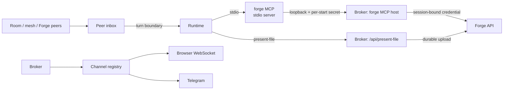

# Channels, rooms and Forge tools

How a session reaches people and other agents, and what Forge gives the agent
to act with. The session gateway *adapts* each surface to the session; the room and mesh
mechanics themselves live in `niuu`.

## In one minute

- **Channels** are output fan-out: every runtime frame goes to every registered
  channel. Today there are two, the browser WebSocket and Telegram.
- **Rooms** let several people and agents share one conversation. The session
  gateway hosts a room over the shared `niuu.collaboration` library; an agent
  runtime joins as a participant.
- **Other agents' messages** (a Forge session, a room, a mesh peer) land in the
  **peer inbox** and reach the runtime only at a turn boundary.
- The **`forge` MCP server** gives the runtime Forge's tools. The session gateway hosts it
  and calls Forge with a credential bound to this one session.
- **Presented files** (`present-file`) are staged by the broker and uploaded to
  Forge's durable store, so they outlive the session.

## How it fits

The runtime never holds a Forge credential. The stdio server it spawns knows
only the broker's loopback secret; the broker adds the session's own
credential when it calls Forge.

## Channels

| Channel | What it does | Turn on with |
|---|---|---|
| Browser WebSocket (`WebSocketChannel`) | One per connection on `/session`; gets frames, snapshots and acks | Always on |
| Telegram (`TelegramChannel`) | Streams replies into a chat (buffered, split at Telegram's message size); replies come back as chat | `telegram.enabled`, a bot token or a named credential |

Telegram can post into one shared chat, a fixed topic, or a topic per session
(`telegram.topic_mode`), and can be notify-only.

## Rooms

| Knob | Effect |
|---|---|
| `room.enabled` | This broker hosts a collaboration room: participants, presence, directed messages, replay |
| `room.default_target_peer_id` | Untargeted chat goes to this participant. Forge sets it for resident sessions, so any client can talk to the one resident behind the room |
| `room.routed` | The broker owns **no runtime** of its own and only hosts the room. A workflow run's root session runs this way |
| `room.realm_room` | The room shows everything its mesh realm publishes, so a run's room shows every member |

Participants join, beat and leave over `/api/room/*`; a participant past its
heartbeat with no live WebSocket shows as away but stays a member. Room
semantics (membership, routing, opaque reply context) belong to the
[Communication area](../communication/index.md); the session gateway never reads a reply to decide what it means.

## Messages from other agents

| Rule | Detail |
|---|---|
| Accepted | Written to the session's event log and confirmed by Forge. That is all "delivered" means to the sender |
| Delivered | At the next turn boundary, oldest first, as one turn. A pending workflow step goes in first. `urgent` skips the wait |
| Asked | While the `ask` tool waits for a reply, that reply goes to the tool, not to the next turn |
| Restart | The inbox is rebuilt from the log; nothing already handed over is handed over again |

The session gateway does not read these messages and puts no limit on how many wait.

With `mesh.enabled`, the session is also a flock mesh peer (transport `nng`
by default) and every message is signed with a Forge-issued peer certificate. With
`workflow_steps.enabled`, a session takes step offers from its run's mesh and closes
them with `workflow_step_close` ([Workflows area](../workflows/index.md)).

## The `forge` MCP tools

Claude transports get the server through a 0600 `--mcp-config` file, Codex
through `-c mcp_servers.forge.*`, Grok through ACP `mcpServers`. OpenCode,
Muse, PI, dsh and Remote Control get none.

| Group | Tools | Needs |
|---|---|---|
| This session | `environment`, `describe_session`, `notify`, `report_artifact`, `request_secret`, `list_notifications` | nothing |
| People | `find_people`, `ask_person` | nothing |
| Read other sessions | `list_sessions`, `get_session`, `session_transcript` | nothing |
| Talk to other sessions | `send_message`, `ask`, `message_status`, `room_post` | `message` grant |
| Lifecycle | `create_session`, `start_session`, `stop_session` | `lifecycle` grant |
| Mesh | `mesh_peers`, `mesh_send`, `mesh_ask`, `mesh_publish`, `mesh_subscribe`, `mesh_unsubscribe` | `mesh.enabled` |
| Workflow step | `workflow_step_close` | the session is a step host |

A tool the session lacks a grant for is still listed; calling it returns an
error that names the grant. Grants come from the scopes on the session's
credential. `forge_mcp.grants` can only narrow them, and with no session
credential no grant is offered.

**The credential.** Forge mints a token bound to this session and launch
(`token_use: forge_session`) and hands it to the broker. Pod managers mount it
as a file named by `forge_mcp.token_file`. A restart revokes the previous
launch's token. Details: [Credentials](../security/credentials.md).

## Presented files

`present-file <path>` is a shell command on the runtime's `PATH`, for Claude
and Codex alike. It posts to the broker's loopback `/api/present-file`. The
broker stages a copy outside the workspace (`presented_files_dir`, default
`{home}/.forge-presented`) and serves it at `/api/files/presented/{id}`. It
then uploads the copy to Forge (`PUT /sessions/{id}/files/presented/{file_id}`).
A slow or failed upload retries in the background and never fails the command.
A quota refusal is logged as an error.

## Levers

| Knob | Default | What it changes | Where it is set |
|---|---|---|---|
| `forge_mcp.enabled` | `true` | Offer the `forge` MCP server | Session gateway config |
| `forge_mcp.grants` | unset (token's grants) | Narrow the grants | Session create / launch spec |
| `forge_mcp.token_file` | empty | Path of the session credential | Pod manager |
| `forge_mcp.tool_timeout_s` | `120` | Engine-side tool call timeout (Codex) | Session gateway config |
| `forge_mcp.output_max_chars` | `24000` | Largest tool result text | Session gateway config |
| `ask.wait_max_s` / `secret_requests.wait_max_s` | `50` | How long one call waits for an answer; must be below the tool timeouts (checked at start) | Session gateway config |
| `room.enabled` / `room.routed` | `false` / `false` | Host a room; host it with no runtime | Forge, per session kind |
| `room.presence_sweep_interval_s` | `30` | Away detection (0 turns it off) | Session gateway config |
| `mesh.enabled` / `mesh.transport` | `false` / `nng` | Be a mesh peer | Forge, per session kind |
| `telegram.enabled` / `telegram.topic_mode` | `false` / `topic_per_session` | Telegram channel | Session gateway config |
| `max_presented_file_bytes` | `52428800` (50 MiB) | Largest presented file | Session gateway config |
| `presented_durable.retry_attempts` | `6` | Background upload retries | Session gateway config |

## Tradeoffs

| Choice | Gains | Costs |
|---|---|---|
| Tools proxied through the broker, not called by the runtime | The runtime holds no Forge credential; one place to scope and audit | Runtimes without MCP config get no Forge tools |
| Peer messages wait for a turn boundary | No agent is cut off mid-thought by another agent | A busy session answers late unless the sender marks it `urgent` |
| Ungranted tools stay listed | The model learns why a call fails instead of inventing workarounds | Slightly longer tool list |

## Code map

| Concern | Where |
|---|---|
| Channels | [`src/skuld/channels.py`](https://github.com/niuulabs/niuu/blob/dev/src/skuld/channels.py) |
| Room adapter | [`src/skuld/collaboration_adapter.py`](https://github.com/niuulabs/niuu/blob/dev/src/skuld/collaboration_adapter.py), [`src/niuu/collaboration/`](https://github.com/niuulabs/niuu/blob/dev/src/niuu/collaboration) |
| Peer inbox | [`src/skuld/peer_inbox.py`](https://github.com/niuulabs/niuu/blob/dev/src/skuld/peer_inbox.py) |
| Mesh peer | [`src/skuld/mesh_adapter.py`](https://github.com/niuulabs/niuu/blob/dev/src/skuld/mesh_adapter.py), [`src/skuld/mesh_attestation.py`](https://github.com/niuulabs/niuu/blob/dev/src/skuld/mesh_attestation.py) |
| Workflow steps | [`src/skuld/workflow_steps.py`](https://github.com/niuulabs/niuu/blob/dev/src/skuld/workflow_steps.py) |
| Forge MCP wiring per engine | [`src/skuld/forge_mcp/integration.py`](https://github.com/niuulabs/niuu/blob/dev/src/skuld/forge_mcp/integration.py) |
| Forge MCP stdio server and host | [`src/skuld/forge_mcp/stdio.py`](https://github.com/niuulabs/niuu/blob/dev/src/skuld/forge_mcp/stdio.py), [`src/skuld/forge_mcp/host.py`](https://github.com/niuulabs/niuu/blob/dev/src/skuld/forge_mcp/host.py) |
| Tool definitions and grants | [`src/niuu/forge_mcp/tools.py`](https://github.com/niuulabs/niuu/blob/dev/src/niuu/forge_mcp/tools.py), [`src/niuu/forge_mcp/credentials.py`](https://github.com/niuulabs/niuu/blob/dev/src/niuu/forge_mcp/credentials.py) |
| Presented files | [`src/skuld/presented_durable.py`](https://github.com/niuulabs/niuu/blob/dev/src/skuld/presented_durable.py), [`src/skuld/transports/tool_shims.py`](https://github.com/niuulabs/niuu/blob/dev/src/skuld/transports/tool_shims.py) |

## Related

- [Communication area](../communication/index.md): rooms, the flock mesh, the event bus.
- [Credentials](../security/credentials.md): the `forge_session` credential. Mesh signing: [the rules](https://github.com/niuulabs/niuu/blob/dev/.claude/rules/architecture.md).
- [Workflows area](../workflows/index.md): how a run hands steps to sessions.
