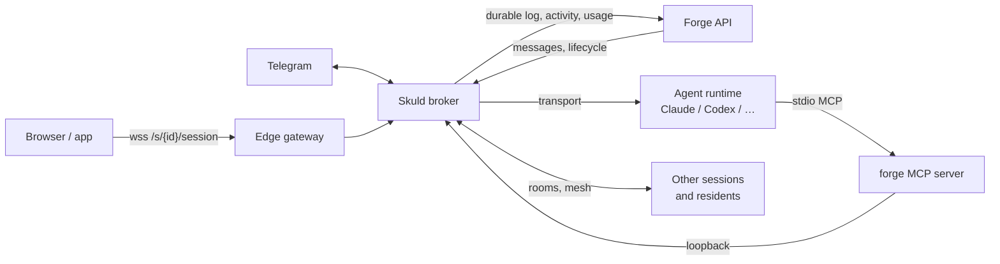

# Skuld — the session gateway

Skuld is the broker process inside every Forge session: it starts the agent
runtime (Claude Code, Codex, …), carries messages in and out of it, records
everything it says, and exposes it to browsers, Telegram and other agents.

## In one minute

- One Skuld broker runs per session, next to the workspace. It is a FastAPI
  app (`python -m skuld`, port `8081`) that the session's clients reach over
  one WebSocket, `/session`.
- It drives exactly **one runtime** per session through a *transport*: an
  adapter class named in config (`transport_adapter`). Forge picks it from the
  session definition the user chose.
- Every frame the runtime emits goes to Forge's durable event log first, then
  to whichever clients are connected. A session with no browser open loses
  nothing.
- Skuld is plumbing. It owns process lifecycle, runtime auth, delivery,
  transcripts and channels. It does **not** judge what the agent should do,
  decide continuations, or own room semantics.
- Each session also gets Forge's tools through a built-in `forge` MCP server
  that Skuld hosts, authenticated with a credential bound to that one session.

## How it fits

Read it from the middle: the broker sits between one runtime process and
everything else. Clients and Forge talk only to the broker; the runtime talks
only to the broker (its transport) and to the `forge` MCP server, which
forwards back to the broker over loopback.

## What Skuld owns, and what it does not

| Skuld owns | Not Skuld's (who owns it) |
|---|---|
| Starting, stopping and restarting the runtime process | Session scheduling, pods, compute (Forge) |
| Authenticating the runtime to its model (subscription login, gateway token, Codex tokens) | Model routing and the catalog (Bifröst) |
| Turning client input into runtime input, with retries and a visible outcome | What the agent should do next (the agent, or Ravn for a resident) |
| Capturing every runtime frame into Forge's event log | Storage and replay APIs of that log (Forge) |
| Browser WebSocket, Telegram, room and mesh *adapters* | Room membership, routing, replay mechanics (`niuu.collaboration`) |
| Hosting the `forge` MCP tools for its session | The Forge routes those tools call (Forge) |

This split is the [Ravn/Niuu boundary](https://github.com/niuulabs/niuu/blob/dev/.claude/rules/ravn-niuu-boundary.md):
a Ravn decides that input is needed and how an answer changes its case; Skuld
only carries the question and routes the reply back to the exact case.

## Pages in this area

| Page | Answers |
|---|---|
| [Runtimes](runtimes.md) | Which agent runtimes exist, how each is driven and authenticated, what each cannot do |
| [A message's path](message-path.md) | What happens between "send" and the reply: delivery, turn state, steering, interrupts, approvals, transcripts |
| [Channels, rooms and Forge tools](channels-and-tools.md) | Browser and Telegram channels, rooms and mesh, the `forge` MCP tools, presented files |

## Inside the broker

The broker is one class (`Broker`) composed from mixins, one per concern:

| Concern | Module |
|---|---|
| Build the transport, start and stop it, startup readiness | `transport_lifecycle.py` |
| WebSocket accept, identity, room role, snapshot on connect | `websocket_lifecycle.py`, `websocket_auth.py` |
| Durable event log, usage, tracing, activity reports | `event_log.py`, `activity_reporting.py` |
| Rebuild history from Forge's log on start | `history_hydration.py` |
| Channels (browser, Telegram) | `channels.py` |
| Rooms, peer inbox, mesh | `collaboration_adapter.py`, `peer_inbox.py`, `mesh_adapter.py` |
| Workflow steps on this session | `workflow_steps.py` |
| `forge` MCP host | `forge_mcp/` |

## Levers

Skuld reads `./config.yaml` or `/etc/skuld/config.yaml`; any field can be
overridden as `SKULD__<FIELD>` with `__` for nesting
(`SKULD__SESSION__MODEL=opus`). Forge's pod managers render this config per
session; operators rarely set it by hand.

| Knob | Default | What it changes | Where it is set |
|---|---|---|---|
| `transport_adapter` | `skuld.transports.sdk.SDKTransport` | Which runtime the session drives (see [Runtimes](runtimes.md)) | Session definition `broker.transportAdapter` |
| `cli_type` | `claude` | Legacy shorthand mapped to an adapter when `transport_adapter` is the default | Session definition `broker.cliType` |
| `port` | `8081` | Broker listen port | Skuld config |
| `volundr_api_url` | empty | Forge base URL; empty turns off durable log, activity and Forge tools | Pod manager |
| `event_log_enabled` | `true` | Ship every runtime frame to Forge's durable log | Skuld config |
| `exit_when_transport_stops` | `true` | Broker exits when the runtime dies, so Forge marks the session stopped | Skuld config |
| `skip_permissions` | `true` | Run the runtime without interactive tool approvals | Session definition |
| `claude_permission_mode` | `auto` | Claude `--permission-mode` used when `skip_permissions` is on | Forge node config |
| `forge_mcp.enabled` | `true` | Give the runtime the built-in `forge` MCP server | Skuld config |
| `room.enabled` / `mesh.enabled` / `telegram.enabled` | `false` | Turn on room hosting, the mesh peer, the Telegram channel | Forge, per session kind |

Channel, delivery and Forge-tool knobs are on the pages that use them.

## Tradeoffs

| Choice | Gains | Costs |
|---|---|---|
| One broker per session, in the session's pod or slot | Crash and credential isolation; the broker can read the workspace | A process per session even when idle |
| Runtime chosen by class path, not a code switch | A new runtime is a class plus a session definition | Each transport must translate its runtime's events to the Claude-shaped frames the rest of Skuld expects |
| Durable log before live clients | Nothing is lost when no one is watching; restarts rebuild history | Forge must be reachable; a permanent log rejection stops the broker (`EventLogRejectedError`) |
| Shared collaboration mechanics live in `niuu`, not Skuld | Ravn and Skuld use the same room code | Skuld carries adapter code for each channel |

## Code map

| Concern | Where |
|---|---|
| Entrypoint and broker class | [`src/skuld/broker.py`](https://github.com/niuulabs/niuu/blob/dev/src/skuld/broker.py) |
| HTTP and WebSocket routes | [`src/skuld/broker_api.py`](https://github.com/niuulabs/niuu/blob/dev/src/skuld/broker_api.py), [`src/skuld/file_routes.py`](https://github.com/niuulabs/niuu/blob/dev/src/skuld/file_routes.py) |
| All config | [`src/skuld/config.py`](https://github.com/niuulabs/niuu/blob/dev/src/skuld/config.py) |
| Transport port | [`src/niuu/ports/cli/transport.py`](https://github.com/niuulabs/niuu/blob/dev/src/niuu/ports/cli/transport.py) |
| Session definitions Forge offers | [`src/niuu/config_models.py`](https://github.com/niuulabs/niuu/blob/dev/src/niuu/config_models.py) |

## Related

- Forge area: how a session's pod or slot is started and where Skuld runs in it.
- Communication area: room mechanics, the Flokk mesh and Sleipnir.
- Security area: the session-bound Forge credential and mesh attestation.
- [Ravn, Skuld and collaboration ownership](https://github.com/niuulabs/niuu/blob/dev/docs/architecture/ravn-skuld-collaboration.md)
