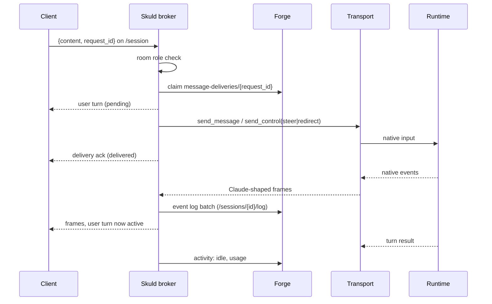
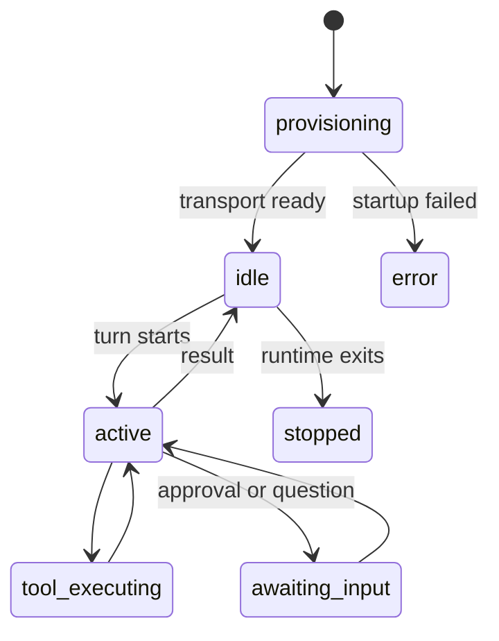

# A message's path

What happens between a person pressing send and the agent's reply on screen.
In short: Skuld accepts the message as `pending`, delivers it to the runtime
with retries, and turns it `active` once the runtime consumes it (`failed` if
it never does). Every frame the runtime emits is logged to Forge before any
client sees it.

## In one minute

- A client sends one JSON frame over `/session`. With no `type`, it is chat;
  anything else is a control (`interrupt`, `permission_response`, …).
- A chat message that carries a `request_id` is first **claimed** with Forge,
  so a resend with the same id can never run twice.
- The broker decides at delivery time whether to **send** (start a turn) or to
  **steer** (go into the running turn), from the transport's `steering_mode`.
- Delivery is retried on transient failure; the outcome is always visible:
  `delivered`, `blocked_on_question`, `pending` (unconfirmed) or `failed`.
- Runtime frames go to the durable event log, then to every channel. The local
  history file and the per-connect snapshot are rebuilt from that log.

## How it fits

Forge itself sends into a session the same way: its `POST
/sessions/{id}/messages` route relays over the session's WebSocket and
returns the same outcome (200 delivered, 202 pending, 502 rejected). Another agent's message arrives as a `peer_message` frame and goes
through the peer inbox instead (see [Channels, rooms and Forge tools](channels-and-tools.md)).

## Who may send what

Each WebSocket connection has a room role. The edge proxy has already checked
the caller's token. Skuld reads the identity headers and resolves the role
(`ws_auth.room_role_source`).

| Role | May send |
|---|---|
| viewer | chat, `directed_message`, `steer_active_turn`, `person_answer` (as the addressee), `get_effort`, `discover_slash_commands` |
| approver | the above, plus `permission_response` and `ask_user_answer` |
| owner | everything: `interrupt`, `set_model`, `set_effort`, `set_permission_mode`, `rewind_files`, terminal input, `slash_command`, `peer_message`, … |

Only the owner's `permission_response` may change the tool's input or widen
permissions. A test fails if a new frame type has no role.

## Delivery and steering

| Transport says | Session state | Broker does |
|---|---|---|
| `steering_mode: native` (tmux, Muse, PI) | any | Always uses the input route; the runtime places the text itself |
| `steering_mode: live` (Codex app-server) | turn running | `steer`: appended to the running turn |
| `steering_mode: interrupt_resume` (SDK, Grok) | turn running | `redirect`: stop the turn, start one with the new text |
| any | idle, or no `steer` capability | `send_message`: start a new turn |

The route is re-resolved on every attempt, because a turn can end or start
between accepting the message and delivering it.

| Outcome | Meaning |
|---|---|
| `delivered` | The transport accepted it. The turn flips to `active` on the runtime's consumption signal, or at once when the send ran the whole turn (`send_runs_turn`: SDK, `claude -p`) |
| `blocked_on_question` | Delivered, but the agent is waiting on a question; answer that first |
| `pending` | A claimed message whose native delivery was not confirmed. Not resent: check the conversation first |
| `failed` | Every attempt failed. The user turn is marked `failed`, persisted and broadcast |

## Interrupts, approvals and questions

| Situation | Frames |
|---|---|
| Stop the current turn | owner sends `interrupt` → `transport.send_control("interrupt")`. Not available on dsh |
| Steer without waiting | `steer_active_turn {content}` → `send_control("steer")` |
| Runtime asks to use a tool (`permission_requests`, approvals not skipped) | broker emits the request; an approver answers `permission_response {behavior}` |
| Claude's AskUserQuestion (`ask_user_question_enabled`) | broker emits it; an approver answers `ask_user_answer {answers}`; open questions survive a reconnect |
| Agent asks a named person (`ask_person` tool) | the addressee or an approver answers `person_answer` |

While a request or question is open, the session's activity is
`awaiting_input`, so the UI and Forge show it as needing attention.

## Session activity

Skuld reports the session's state to Forge (debounced) and a heartbeat every
`activity_heartbeat.interval_seconds`:

When the runtime dies, the broker reports `stopped` and exits
(`exit_when_transport_stops`). Forge then refuses new messages instead of
queueing them for a dead process. A startup failure is reported to Forge at
once with its error, so a waiting workflow run fails now, not on a timeout.

## Transcript capture

| Store | What | Lifetime |
|---|---|---|
| Forge event log (`/sessions/{id}/log`) | Every raw runtime frame, numbered `seq`, stamped at emission | Durable; the source of truth |
| `.skuld/conversation_<id>.json` in the workspace | The reduced conversation turns | Local cache, rebuilt from the log on start (`history_hydration`) |
| Connect snapshot | Recent turns sent to a new WebSocket | Per connection; bounded by `conversation_snapshot_max_bytes` |

A full buffer (`event_log_max_buffer`) drops the oldest frames and writes a
`log_gap` row with the count and the `seq` range, so replay shows the hole. The
drop is a cap hit: an error log and `cap_hits.event_log_max_buffer` on the
broker's `/health` (`caps`). A permanent rejection by Forge (bad session, bad
credential) raises `EventLogRejectedError` and stops the broker.

A turn goes to the event log first, then to the local history file. A history
file that cannot be written raises; it is never a warning while the file on disk
falls behind.

## Levers

| Knob | Default | What it changes | Where it is set |
|---|---|---|---|
| `delivery.max_attempts` | `4` | Tries per inbound message (1 disables retry) | Skuld config |
| `delivery.attempt_timeout_seconds` | `10` | Bound on one send; not applied when the send runs the whole turn | Skuld config |
| `delivery.initial_backoff_seconds` / `backoff_multiplier` / `max_backoff_seconds` | `0.5` / `2.0` / `5.0` | Retry spacing | Skuld config |
| `event_log_batch_size` | `100` | Frames per POST to Forge | Skuld config |
| `event_log_flush_interval_ms` | `500` | Flush cadence | Skuld config |
| `event_log_max_buffer` | `50000` | Frames held while Forge is unreachable; past it the oldest are dropped and counted | Skuld config |
| `history_hydration_enabled` | `true` | Rebuild history from Forge on start | Skuld config |
| `conversation_snapshot_max_bytes` | `921600` (900 KiB) | Largest connect snapshot | Skuld config |
| `activity_heartbeat.interval_seconds` | `30` | Heartbeat to Forge | Skuld config |
| `ws_auth.room_role_source` | `deployment` | Where a connection's room role comes from (`proxy`, `deployment`, `remote`) | Pod manager |

## Tradeoffs

| Choice | Gains | Costs |
|---|---|---|
| `pending` → `active` on the runtime's own signal | The UI never claims a message landed when it did not | Each transport must emit a consumption signal, or rely on `send_runs_turn` |
| Durable claim per `request_id` | A retried send never runs twice | A Forge round trip before delivery |
| No retry after a claimed send's lost ack | Never runs a message twice | The user sees `pending` and must look before resending |

## Code map

| Concern | Where |
|---|---|
| Frame dispatch and role gate | [`src/skuld/broker.py`](https://github.com/niuulabs/niuu/blob/dev/src/skuld/broker.py) (`_dispatch_browser_message`, `_deliver_user_message_and_ack`) |
| WebSocket accept, identity, room role | [`src/skuld/websocket_lifecycle.py`](https://github.com/niuulabs/niuu/blob/dev/src/skuld/websocket_lifecycle.py), [`src/skuld/websocket_auth.py`](https://github.com/niuulabs/niuu/blob/dev/src/skuld/websocket_auth.py) |
| Duplicate-send claims | [`src/skuld/delivery_claims.py`](https://github.com/niuulabs/niuu/blob/dev/src/skuld/delivery_claims.py) |
| Event log, usage, tracing | [`src/skuld/event_log.py`](https://github.com/niuulabs/niuu/blob/dev/src/skuld/event_log.py) |
| Activity states | [`src/skuld/activity_reporting.py`](https://github.com/niuulabs/niuu/blob/dev/src/skuld/activity_reporting.py) |
| History rebuild | [`src/skuld/history_hydration.py`](https://github.com/niuulabs/niuu/blob/dev/src/skuld/history_hydration.py) |
| Person questions | [`src/skuld/person_questions.py`](https://github.com/niuulabs/niuu/blob/dev/src/skuld/person_questions.py) |

## Related

- [Runtimes](runtimes.md): which transport has which steering mode.
- [Forge area](../forge/index.md): the event log and message routes on the Forge side.
