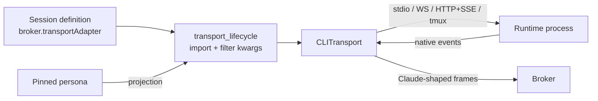

# Runtimes

A runtime is the agent program a session runs (Claude Code, Codex, …). Skuld
drives it through a **transport**: one adapter class per runtime and protocol,
all implementing the same `CLITransport` port.

## In one minute

- The session definition the user picks in Forge names the transport class
  (`broker.transportAdapter`). Skuld imports it and passes only the constructor
  arguments that class accepts.
- Every transport normalizes its runtime's events into the same Claude-shaped
  frames (`assistant`, `user`, `content_block_delta`, `result`, …), so the
  broker, UI, usage and transcript code never branch on the runtime.
- A transport declares what it can do in `TransportCapabilities` (resume,
  interrupt, steering mode, approvals, model switch, terminal). The broker and
  UI read those flags; they never test a runtime's name.
- Auth is per runtime: Claude defaults to the host's subscription login,
  Codex to the host's login or Forge-issued tokens, others to their own CLI login.

## How it fits

If the session has a pinned persona, Skuld projects it onto the transport's
arguments first. If the transport cannot enforce something the persona states,
the session refuses to start (`PersonaProjectionError`). It never drops the
setting silently.

## The runtimes

Forge offers these as session definitions (`src/niuu/config_models.py`).
"Cancel" is `interrupt`, which stops the current turn.

| Session definition | Transport | Protocol | Resume | Cancel | Steering mid-turn |
|---|---|---|---|---|---|
| Claude Code | `sdk.SDKTransport` | Claude Agent SDK over the CLI | yes | yes | interrupt, then resume with the new text |
| Claude Code Interactive | `tmux_interactive.TmuxInteractiveTransport` | Real `claude` REPL in tmux (TTY bytes) | no | yes | native: typed into the live pane |
| OpenAI Codex, Codex (Batch) | `codex_ws.CodexWebSocketTransport` | `codex app-server`, JSON-RPC 2.0 over WebSocket on a Unix socket | yes | yes | live: appended to the running turn |
| xAI Grok Build | `grok.GrokACPTransport` | Agent Client Protocol over stdio (`grok agent stdio`) | yes | yes | interrupt, then resume |
| Meta Muse Code | `muse.MuseMSPTransport` | Muse Session Protocol (JSON-RPC) over stdio (`muse serve`) | yes | yes | native (`turn/start ifBusy: steer`) |
| PI | `pi.PiRpcTransport` | PI's JSONL RPC over stdio | yes | yes | native |
| OpenCode | `opencode.OpenCodeHttpTransport` | `opencode serve`: REST for commands, SSE for events | yes | yes | no |
| DeepSeek Harness | `dsh.DshJsonRpcTransport` | dsh SDK JSON-RPC over stdio | **no** | **no** | no |
| Claude Remote Control | `remote_control.RemoteControlTransport` | `claude remote-control`; Skuld only supervises | — | — | — (the native app drives) |

Transports still in code but not offered as a session definition:

| Transport | What it is |
|---|---|
| `persistent_subprocess.PersistentSubprocessTransport` | One long-lived `claude -p` with stream-json stdin/stdout; no SDK dependency |
| `subprocess.SubprocessTransport` | One `claude -p` process per message (`transport: subprocess`) |
| `sdk_websocket.SdkWebSocketTransport` | Deprecated Claude `--sdk-url` bridge; the CLI connects back to `/ws/cli/{session_id}` |
| `codex.CodexSubprocessTransport` | One `codex exec` per message (`cli_type: codex`); no resume, no interrupt |

Ravn has no transport on this branch. A Ravn joins a session as a room
participant instead (see [Channels, rooms and Forge tools](channels-and-tools.md)).

## Model auth

| Runtime | Default credential | Alternatives |
|---|---|---|
| Claude (all Claude transports) | The host's claude.ai subscription login in `~/.claude`. Skuld strips `ANTHROPIC_API_KEY` / `ANTHROPIC_AUTH_TOKEN` from the child env | `SKULD__CLAUDE_AUTH=api_key` keeps the platform key; `SKULD__CLAUDE_OAUTH_TOKEN_FILE` (a 0400 file) for direct subscription inference; the model gateway |
| Codex | `HostCodexAuthProvider`: the host's own Codex login (`CODEX_HOME`, default `~/.codex`) | `VolundrCodexAuthProvider`: ChatGPT access tokens fetched from Forge (`/api/v1/internal/credentials/codex/tokens`); the model gateway |
| Grok | The `grok` CLI's login (`XAI_API_KEY` or its cached `auth.json`) | — |
| Muse | `META_API_KEY`, else a stored key, else a browser login | — |
| PI | PI's own provider login; none is a startup error | — |
| OpenCode | OpenCode's own provider config | — |
| DeepSeek Harness | `dsh.base_url` + `dsh.api_key` (any OpenAI-compatible endpoint) | Point `base_url` at Bifröst or a local server |
| Remote Control | claude.ai OAuth (`~/.claude/.credentials.json`) | — |

**Model gateway.** When Forge launches a session with the model server
provider, it sets `model_gateway.url` (and a token). The Claude SDK, persistent
subprocess and tmux transports then point the CLI at Bifröst
(`ANTHROPIC_BASE_URL` + `ANTHROPIC_AUTH_TOKEN`), and Codex app-server does the
same in its dialect. A gateway URL with a blank token is refused. Sending `""`
would make the CLI fall back to the user's real subscription token.

## Known gaps

| Runtime | Gap | Why |
|---|---|---|
| Claude Code (SDK) | A mid-turn message interrupts and restarts the turn, which drops the partial reply | SDK semantics; the interactive transport steers natively |
| DeepSeek Harness | No resume, no cancel; `interrupt()` raises | The dsh SDK protocol has no cancel method and cannot resume a session in a fresh process, so the process *is* the session |
| Claude Remote Control | Skuld cannot send turns (`send_message=False`); it re-shows the pairing link | The claude.ai app owns the conversation |
| Codex Remote Control | Not wired; it posts a notice | Launch/pairing path not built |
| OpenCode, Muse, PI, dsh, Remote Control | No `forge` MCP tools | Their transports take no MCP configuration |
| Grok | No model switch or approval prompts over ACP | Not in the ACP surface the transport uses |

## Levers

| Knob | Default | What it changes | Where it is set |
|---|---|---|---|
| `transport_adapter` | `skuld.transports.sdk.SDKTransport` | The runtime | Session definition |
| `session.model` | per definition (e.g. `gpt-6-astra` for Codex, `grok-4.7` for Grok) | Model the runtime starts with | Session create request |
| `skip_permissions` | `true` | No interactive tool approvals | Session definition |
| `claude_permission_mode` | `auto` | Claude mode when approvals are skipped (`auto`, `bypassPermissions`, `acceptEdits`) | Forge node config |
| `ask_user_question_enabled` | `false` | Route Claude tool permissions over the control protocol so questions reach a person | Skuld config |
| `agent_teams` | `true` | Claude tmux sessions start with agent teams | Session definition |
| `codex_auth.adapter` | `skuld.codex_auth.HostCodexAuthProvider` | Where Codex gets its ChatGPT tokens | Pod manager |
| `model_gateway.url` / `.token` | empty | Route Claude and Codex through Bifröst | Forge, per launch |
| `acp_prompt_timeout_s` | `300` | Turn timeout for Grok and Muse | Skuld config |
| `pi.turn_timeout_s` | `1800` | PI turn timeout | Skuld config |
| `dsh.prompt_timeout_s` | `600` | dsh turn timeout | Skuld config |

## Tradeoffs

| Pick | When |
|---|---|
| Claude Code (SDK) | Default chat sessions and unattended runs; structured events, resume |
| Claude Code Interactive | You want the real REPL: built-in slash commands, agent-team panes, native steering. Output is terminal bytes, so the chat view is a best-effort projection |
| Codex app-server | OpenAI models; it is the one transport with live steering into a running turn |
| A protocol-native runtime (Muse, PI, Grok) | You need that vendor's agent; check the gaps above first |

## Code map

| Concern | Where |
|---|---|
| Transport port and capabilities | [`src/niuu/ports/cli/transport.py`](https://github.com/niuulabs/niuu/blob/dev/src/niuu/ports/cli/transport.py) |
| Transports | [`src/skuld/transports/`](https://github.com/niuulabs/niuu/blob/dev/src/skuld/transports) |
| Construction, kwargs filter, persona projection | [`src/skuld/transport_lifecycle.py`](https://github.com/niuulabs/niuu/blob/dev/src/skuld/transport_lifecycle.py) |
| Legacy `cli_type` mapping | [`src/skuld/config.py`](https://github.com/niuulabs/niuu/blob/dev/src/skuld/config.py) (`_resolve_transport_adapter`) |
| Claude auth env | [`src/skuld/transports/claude_env.py`](https://github.com/niuulabs/niuu/blob/dev/src/skuld/transports/claude_env.py) |
| Codex auth adapters | [`src/skuld/codex_auth.py`](https://github.com/niuulabs/niuu/blob/dev/src/skuld/codex_auth.py) |
| Persona projection per transport | [`src/skuld/personas/`](https://github.com/niuulabs/niuu/blob/dev/src/skuld/personas) |
| Session definitions | [`src/niuu/config_models.py`](https://github.com/niuulabs/niuu/blob/dev/src/niuu/config_models.py) |

## Related

- [A message's path](message-path.md): how steering modes and `send_runs_turn` change delivery.
- [Models area](../models/index.md): Bifröst and provider connections.
