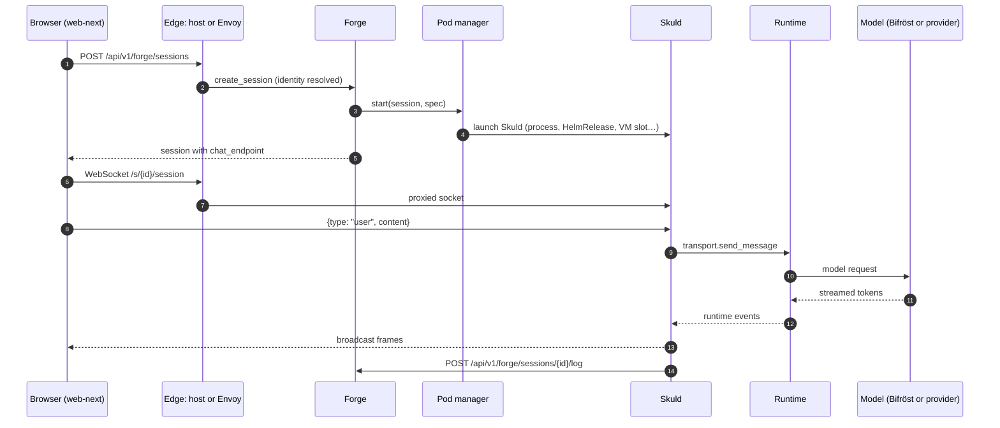

# One request end to end

A user starts a Forge session in the web UI and sends a message. This page follows
that request through the real code: what each hop does and where it lives.

## In one minute

- **Start** is REST: `POST /api/v1/forge/sessions`. Forge (Völundr) stores the
  session and asks its configured **pod manager** to launch Skuld.
- **Chat** is a WebSocket straight to Skuld at `/s/{session_id}/session`. Forge is not
  on the message path; the host (mini mode) or the gateway (Kubernetes) proxies the socket.
- Skuld hands the message to the **runtime** (Claude Code by default) and streams its
  output back over the same socket.
- The runtime goes through **Bifröst** only for models the catalog marks
  `provider: local`; cloud models go straight to their provider on the user's own login.
- Skuld writes every frame to Forge's **session event log**, so history survives the
  socket and the pod.

## How it fits

Steps 1–5 happen once per session; 6–14 repeat per message. Step 14 is
batched, not per token.

## 1. Start the session

| Hop | What happens | Code |
|---|---|---|
| Web UI | `startSession` posts the start body to `/api/v1/forge/sessions` | `plugin-volundr/src/adapters/http.ts` |
| Edge, mini mode | The root app dispatches by prefix. `/api/v1/forge/sessions` belongs to Platform's (Guild's) aggregate API, which picks the target Forge (by `instance_id` or tags) and forwards to the embedded Forge app | `niuu/app.py` (`_PrefixDispatchMiddleware`), `niuu/adapters/inbound/rest_volundr.py` (`create_session`) |
| Edge, Kubernetes | Envoy in front of Forge verifies the JWT (`jwt_authn`), strips spoofed claim headers, maps claims to headers, optionally asks Cedar (`ext_authz`) | `charts/volundr/templates/envoy-configmap.yaml` |
| Identity | Forge's identity adapter turns the request into a principal; allow-all unless configured | `identity.adapter` in `volundr/config.py` |
| Route | `create_session` → `ForgeService.create_and_start_session` | `volundr/adapters/inbound/rest.py`, `volundr/domain/services/forge.py` |
| Lifecycle | `SessionService.start_session` sets `chat_endpoint` (the pod manager's, else `{public_ws_origin}/s/{id}/session`) and calls `pod_manager.start` | `volundr/domain/services/session.py` |

## 2. Launch Skuld

The pod manager is chosen by `pod_manager.adapter`; each one launches the same
Skuld broker somewhere different. The [Forge area](../forge/index.md) covers them in depth.

| Pod manager | Launches Skuld as | Default for |
|---|---|---|
| `LocalProcessPodManager` | `python -m skuld` on the host, port registered with the host's session proxy | Mini mode (CLI) |
| `PlacementPodManager` | Local process, or a slot on a registered host / VM pool | Mini mode with compute hosts |
| `FluxPodManager` | One HelmRelease of the `skuld` chart per session | Forge config, the `volundr` chart |
| `DirectK8sPodManager` | Kubernetes objects created directly | CLI `cluster` mode |
| `DockerContainerPodManager` | A sibling container on one Docker host | Docker mode (`compose_bundle.py`) |
| `OpenShellGatewayPodManager` | A sandbox through an OpenShell gateway | CLI `openshell` mode |
| `VmPodManager` | A slot on a VM | VM compute pools |

Skuld's entry point is `skuld.broker:main`. It builds the runtime transport named by
`transport_adapter`; the default is `SDKTransport` (Claude Code through its SDK).
Codex, OpenCode and others have their own transports in `skuld/transports/`.

## 3. Send a message

| Hop | What happens | Code |
|---|---|---|
| Web UI | `useSkuldChat` opens `ws(s)://…/s/{id}/session` and sends `{type: "user", content, request_id}` | `web-next/packages/ui/src/chat/hooks/useSkuldChat.ts` |
| Socket, mini mode | The host's session proxy forwards the socket to the session's local port | `niuu/session_proxy.py` (`/s/{session_id}/session`) |
| Socket, Kubernetes | `wss://{gateway_domain}/s/{id}/session` → Envoy Gateway HTTPRoute with its own JWT policy → the Skuld pod | `flux.py` (`_chat_endpoint`), `charts/skuld/templates/httproute.yaml`, `securitypolicy.yaml` |
| Skuld | `websocket_endpoint` → `_dispatch_browser_message` → `_deliver_user_message_and_ack` → `transport.send_message` | `skuld/broker_api.py`, `skuld/broker.py` |
| Runtime | `SDKTransport.send_message` passes the turn to Claude Code | `skuld/transports/sdk.py` |

Agents and API callers that cannot hold a socket use
`POST /api/v1/forge/sessions/{id}/messages`; Forge opens its own socket to the
broker and returns the delivery acknowledgement (`send_session_message` in `rest.py`).

## 4. Call the model

| Case | Path | Code |
|---|---|---|
| Model marked `provider: local` in the Bifröst catalog | Forge's `ModelGatewayContributor` sets `SKULD__MODEL_GATEWAY__URL`; Skuld spawns Claude Code with `ANTHROPIC_BASE_URL` pointing at Bifröst. Bifröst's `/v1/messages` routes it (`ModelRouter`) to an adapter (Anthropic, OpenAI-compatible, Ollama) | `volundr/adapters/outbound/contributors/model_gateway.py`, `skuld/transports/claude_env.py`, `bifrost/inbound/routes.py`, `bifrost/router.py` |
| Any other model | No gateway env; the runtime uses its own provider login (`SKULD__CLAUDE_AUTH`, default `subscription`) | `skuld/transports/claude_env.py` |

A gateway URL with a blank token raises at spawn time; it never falls back to the
host's own login.

## 5. Stream it back

| Stream | Carries | Code |
|---|---|---|
| Session WebSocket | Every runtime event, live: `_handle_cli_event` → `ChannelRegistry.broadcast` → `WebSocketChannel` | `skuld/broker.py`, `skuld/channels.py` |
| Session event log | The same frames, batched to `POST /api/v1/forge/sessions/{id}/log` and stored in `session_event_log`; read back for history and replay | `skuld/event_log.py`, `volundr/adapters/inbound/rest_session_log.py`, `volundr/adapters/outbound/pg_session_event_log.py` |
| Fleet SSE | Session list and notification changes, not chat tokens: `/api/v1/forge/sessions/stream` | `rest.py` (`stream_sessions`), `volundr/adapters/outbound/broadcaster.py` |
| Sleipnir | Platform events Skuld subscribes to and forwards to the socket; a side channel, not the transcript | `skuld/sleipnir_bridge.py` |

## Levers

| Knob | Default | What it changes | Where it is set |
|---|---|---|---|
| `pod_manager.adapter` | `LocalProcessPodManager` (CLI), `FluxPodManager` (Forge, chart) | Where Skuld runs | CLI settings; Forge `pod_manager:`; `charts/volundr/values.yaml` |
| `identity.adapter` | allow-all | How Forge resolves the caller | Forge `identity:` |
| `host_auth.mode` | `none` | Mini-mode host verifies JWTs (`oidc`) or explicitly allows all | CLI settings |
| `transport_adapter` | `SDKTransport` | Which runtime Skuld drives | Skuld settings (`skuld/config.py`) |
| `bifrost.session_gateway_url` | empty | Gateway URL given to sessions on local models | Forge `bifrost:` |
| `SKULD__CLAUDE_AUTH` | `subscription` | How Claude Code signs in when no gateway is set | Session environment |

## Tradeoffs

| Choice | Gains | Costs |
|---|---|---|
| Chat socket goes straight to Skuld | No Forge hop per message or token | Two auth points: the API edge and the session socket |
| Cloud models bypass Bifröst | No gateway in the hot path; the user's own subscription | Bifröst sees no usage for those sessions |
| Durable log in Forge | History outlives the pod; one replay source | A write per batch from every session |

## Code map

| Concern | Where |
|---|---|
| Start session (UI) | [web-next/packages/plugin-volundr/src/adapters/http.ts](https://github.com/niuulabs/niuu/blob/dev/web-next/packages/plugin-volundr/src/adapters/http.ts) |
| Chat socket (UI) | [web-next/packages/ui/src/chat/hooks/useSkuldChat.ts](https://github.com/niuulabs/niuu/blob/dev/web-next/packages/ui/src/chat/hooks/useSkuldChat.ts) |
| Host dispatch and session proxy | [src/niuu/app.py](https://github.com/niuulabs/niuu/blob/dev/src/niuu/app.py), [src/niuu/session_proxy.py](https://github.com/niuulabs/niuu/blob/dev/src/niuu/session_proxy.py) |
| Aggregate Forge API | [src/niuu/adapters/inbound/rest_volundr.py](https://github.com/niuulabs/niuu/blob/dev/src/niuu/adapters/inbound/rest_volundr.py) |
| Edge auth on Kubernetes | [charts/volundr/templates/envoy-configmap.yaml](https://github.com/niuulabs/niuu/blob/dev/charts/volundr/templates/envoy-configmap.yaml) |
| Session routes and lifecycle | [src/volundr/adapters/inbound/rest.py](https://github.com/niuulabs/niuu/blob/dev/src/volundr/adapters/inbound/rest.py), [src/volundr/domain/services/session.py](https://github.com/niuulabs/niuu/blob/dev/src/volundr/domain/services/session.py) |
| Pod managers | [src/volundr/adapters/outbound/](https://github.com/niuulabs/niuu/tree/dev/src/volundr/adapters/outbound) (`local_process.py`, `flux.py`, `vm_pod_manager.py`, …) |
| Skuld broker and transports | [src/skuld/broker.py](https://github.com/niuulabs/niuu/blob/dev/src/skuld/broker.py), [src/skuld/transports/](https://github.com/niuulabs/niuu/tree/dev/src/skuld/transports) |
| Model gateway wiring | [src/volundr/adapters/outbound/contributors/model_gateway.py](https://github.com/niuulabs/niuu/blob/dev/src/volundr/adapters/outbound/contributors/model_gateway.py), [src/bifrost/router.py](https://github.com/niuulabs/niuu/blob/dev/src/bifrost/router.py) |
| Session event log | [src/skuld/event_log.py](https://github.com/niuulabs/niuu/blob/dev/src/skuld/event_log.py), [src/volundr/adapters/inbound/rest_session_log.py](https://github.com/niuulabs/niuu/blob/dev/src/volundr/adapters/inbound/rest_session_log.py) |

## Related

- [Services and channels](services.md)
- [Product and implementation names](names.md)
- [Security](../security/index.md) — edge auth and every credential on this path.
- [Skuld](../skuld/index.md) — runtimes and the message path inside a session.
- The Forge and Models areas go deeper on the other hops.
