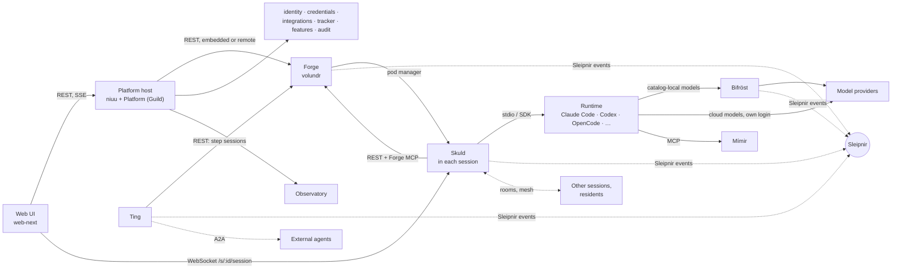

# Services and channels

Every service and shared library in the stack, what each one owns, and the
channels they use to talk to each other.

## In one minute

- Each top-level package in `src/` is one service or one library. Services register
  as **plugins** (`niuu.plugins` entry points) so one host process can mount them all.
- **Forge** (Völundr) owns sessions; **Skuld** runs inside each session and drives
  the agent runtime; **Platform** (Guild) fronts `/api/v1/forge` and fans out to
  every registered Forge.
- **Bifröst** is the model gateway (sessions use it for catalog-local models),
  **Mímir** holds memory, **Ting** runs workflows and launches its steps as Forge
  sessions.
- `niuu` is the shared library and the host; `sleipnir` is the event bus library.
  Neither imports a service.

## How it fits

Solid lines are request/response (REST, SSE, WebSocket, MCP). Dotted lines are
messaging: Sleipnir events, collaboration rooms, the flock mesh and A2A. The
browser's session socket reaches Skuld through the host's session proxy or the
Kubernetes gateway, never through Forge.

## Services

Every service below runs as its own process (`[project.scripts]` in
`pyproject.toml`) **and** as a plugin of the one host process.

| Package | Product name | Owns | Public prefix | Chart |
|---|---|---|---|---|
| `volundr` | Forge | Session lifecycle, launch specs, projects, pod managers, compute pools and hosts, resident runtimes, notifications, session event log | `/api/v1/forge`, `/api/v1/volundr` | `volundr` |
| `guild` | Platform | Instance registry, node join, aggregate Forge API (`/api/v1/forge/sessions`, `/chronicles`, …) over every registered Forge | `/api/v1/niuu/instances`, `/api/v1/forge` | `guild` |
| `skuld` | — | Runtime session gateway in each session: starts the runtime process, transcripts, WebSocket and channels, Forge MCP broker, rooms and mesh adapters | `/s/{session_id}/…` | `skuld` (session pods) |
| `ting` | Work | Workflows, runs, steps, gates, board, tracker intake, A2A agent card | `/api/v1/ting` | `ting` |
| `bifrost` | AI models | Model gateway: Anthropic, OpenAI-compatible, Ollama and subscription adapters; catalog, routing, usage, quotas | `/api/v1/bifrost` | `bifrost` |
| `mimir` | Memory | Knowledge sources and pages, retrieval, MCP server | `/api/v1/mimir` | `mimir` |
| `personas` | Agents | Persona registry: built-in catalogue, overrides, loaders | `/api/v1/personas` | via `niuu-shared` |
| `observatory` | Observatory | Topology, registry of component types, live event streams | `/api/v1/observatory` | `observatory` |
| `identity` | — | Tenants, tokens, identity adapters, the Cedar `ext_authz` server for Envoy | `/api/v1/identity`, `/api/v1/tokens` | `niuu-shared` |
| `credentials` | — | Credentials, secrets, MCP metadata | `/api/v1/credentials` | `niuu-shared` |
| `integrations` | — | Integration connections and OAuth | `/api/v1/integrations` | `niuu-shared` |
| `tracker` | — | Tracker issues, status, repo mappings | `/api/v1/tracker` | `niuu-shared` |
| `features` | — | Feature catalog and preferences | `/api/v1/features` | `niuu-shared` |
| `audit` | — | Audit log queries | `/api/v1/audit` | served by `volundr` (`rest_audit.py`) |

## Libraries and tools

| Package | Role | Used by |
|---|---|---|
| `niuu` | Shared ports, models and adapters (PATs, workload identity, Workspaces (Realms), repos), the collaboration library (`niuu.collaboration`), the mesh (`niuu.mesh`), cap telemetry, and the **platform host** that mounts every plugin | Every service |
| `sleipnir` | Event bus contract and transports: in-process, NATS, nng, RabbitMQ, Redis Streams, webhook | Forge, Ting, Skuld, Bifröst, `niuu` |
| `cli` | The `niuu` command: `niuu platform up`, `niuu join`, `niuu remote`; also the `niuu-shared` app (`cli.shared_host`) | Operators; mini and Docker modes |
| `ravn` | Today only the learned-tool runner (`valkyrie_evolution/`) and tool-build backends; the agent runtime is being rebuilt | Resident tool builds |
| `yggdrasil` | Standalone SSE stream of per-Workspace health summaries | Not mounted by the host or any chart |
| `web-next/` | The web UI: one publishable package per product (`plugin-volundr`, `plugin-ting`, `plugin-realms`, `plugin-mimir`, `plugin-bifrost`, `plugin-observatory`, `plugin-ravn`), a shell, an SDK, design tokens | Browsers |

## The platform host

`niuu platform up` (in mini mode) starts **one** uvicorn process, the root app.

| Step | What happens | Code |
|---|---|---|
| Discover | Load every `niuu.plugins` entry point | `cli/registry.py` |
| Select | A host profile picks route domains: `full` (everything) or `api` (no web UI); `--mounts` narrows it | `HOST_PROFILES` in `niuu/app.py` |
| Build | Create each plugin's FastAPI app; Forge is built first so Platform can use it as its embedded local target | `build_root_app` in `niuu/app.py` |
| Route | Dispatch by prefix to the owning sub-app; `/s/{id}/…` goes to the Skuld proxy; the rest serves the web UI | `_PrefixDispatchMiddleware`, `_STATIC_ROUTE_PREFIXES` |

On Kubernetes the same apps run as separate Deployments from the charts in
`charts/`, behind Envoy; the umbrella chart `charts/niuu` pulls them together.

## Channels

| Channel | Carries | Between |
|---|---|---|
| REST | Commands and reads | UI ↔ host; Ting → Forge; Skuld → Forge; Platform → remote Forges |
| SSE | Session list and activity streams | Forge/Platform → UI (`/api/v1/forge/sessions/stream`) |
| WebSocket | One session's live conversation | UI ↔ Skuld (`/s/{session_id}/session`) |
| MCP | Tools a runtime can call | Runtime → Skuld's Forge MCP broker, Mímir (`/api/v1/mimir/mcp`) |
| Sleipnir | Platform events (session, workflow, model usage) | Publishers and subscribers across services |
| Collaboration rooms | Shared conversation of agents and humans | Skuld channels over `niuu.collaboration` |
| Flock mesh | Direct, signed messages among flock members | Sessions and residents (`niuu.mesh`) |
| A2A | Discovery and tasks with external agents | Ting, resident runtimes |

## Levers

| Knob | Default | What it changes | Where it is set |
|---|---|---|---|
| `mode` | `mini` | `mini`, `openshell`, `cluster` or `docker` | CLI settings (`cli/config.py`) |
| `--host-profile` | `full` | Which route domains the host mounts (`full`, `api`) | `niuu platform up` |
| `--mounts` | all in the profile | Mount only the named route domains | `niuu platform up` |
| `--no-web` / `host.no_web` | off | Do not serve the web UI | CLI flag or `NiuuSettings` |
| `pod_manager.adapter` | `LocalProcessPodManager` (CLI `mini`), `FluxPodManager` (Forge config) | How Forge launches session processes | CLI settings, Forge `pod_manager:` |
| `sleipnir.enabled`, `sleipnir.adapter` | `false`, `InProcessBus` | Whether Forge publishes on the bus, and over which transport | Forge `sleipnir:` (`volundr/config.py`) |
| `host_auth.mode` | `none` | `none` (explicit allow-all) or `oidc` (verify JWTs in process) | CLI settings |

## Tradeoffs

| Choice | Gains | Costs |
|---|---|---|
| One host process | One port, one embedded Postgres, no network hops | One process to scale; a plugin that fails to start leaves its routes missing and `/health` returns 503 naming it |
| Separate charts | Scale and roll each service on its own; Envoy at the edge | More moving parts; inter-service calls go over the network |

## Code map

| Concern | Where |
|---|---|
| Service entry points and plugins | [pyproject.toml](https://github.com/niuulabs/niuu/blob/dev/pyproject.toml) (`[project.scripts]`, `niuu.plugins`) |
| Root host and route domains | [src/niuu/app.py](https://github.com/niuulabs/niuu/blob/dev/src/niuu/app.py), [src/niuu/root_server.py](https://github.com/niuulabs/niuu/blob/dev/src/niuu/root_server.py) |
| `niuu platform up` | [src/cli/commands/platform.py](https://github.com/niuulabs/niuu/blob/dev/src/cli/commands/platform.py) |
| Aggregate Forge API | [src/niuu/adapters/inbound/rest_volundr.py](https://github.com/niuulabs/niuu/blob/dev/src/niuu/adapters/inbound/rest_volundr.py), [src/guild/plugin.py](https://github.com/niuulabs/niuu/blob/dev/src/guild/plugin.py) |
| Shared APIs app | [src/cli/shared_host.py](https://github.com/niuulabs/niuu/blob/dev/src/cli/shared_host.py) |
| Sleipnir transports | [src/sleipnir/adapters/](https://github.com/niuulabs/niuu/tree/dev/src/sleipnir/adapters) |
| Charts | [charts/](https://github.com/niuulabs/niuu/tree/dev/charts) |

## Related

- [One request end to end](request-flow.md)
- [Product and implementation names](names.md)
- [Design principles](../design/index.md) — the hexagonal shape every service shares.
- The Forge, Skuld, Communication and Deployment modes areas go deeper on each row.
