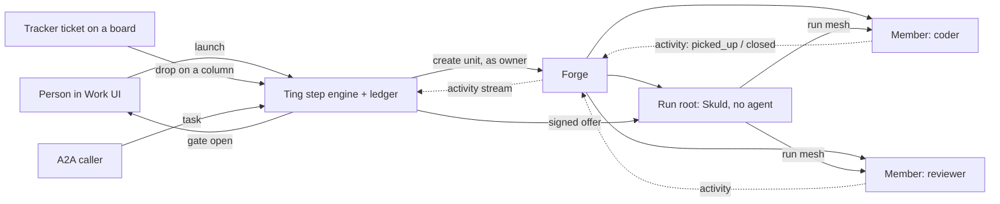

# Workflows

Workflows (Ting, shown as **Work** in the UI) turn a repeatable process — implement, review,
approve, merge — into a graph that runs on Forge sessions, with people deciding at gates.

## In one minute

- A **workflow** is a versioned graph of nodes joined by event-labelled edges. A **run** is one
  execution of it; its **steps** are what each node did, kept in a per-run ledger.
- A run is **one Forge unit**: a root session (the run's room, a Skuld with no agent) plus one
  session per stage member, created and started together in one pod, VM or VM slot.
- Each stage member is a **persona** with a model. Work is offered on the run's mesh; members
  pick it up by the event types their persona consumes. A team is just a workflow.
- **Gates** wait for a person; only `automated_approval` gates accept an agent's answer.
- Ting reaches Forge only over HTTP as the run's owner. It never imports Forge (Völundr) code.

## How it fits

Solid arrows are calls; dotted arrows are reports. Ting decides what is offered next from the
ledger; the members' Skulds decide whether an offer is theirs and report back through Forge.

## The model

| Thing | What it is | Where it lives |
|---|---|---|
| Workflow | A document: `graph.nodes`, `graph.edges`, pinned `persona_dependencies`, a semver `version` | The workflow catalogue (filesystem by default, or Postgres `workflows`), plus bundled YAML in `src/ting/workflows/` |
| Version | An immutable snapshot of each saved head | Catalogue `.history/`, or Postgres `workflow_versions` |
| Run | One execution: a frozen copy of the workflow (`workflow_snapshot`), owner, Forge connection; status `pending` → `running` ⇄ `blocked` (waiting on a person) → `completed` \| `failed` \| `canceled` | `workflow_campaigns` (the internal name for a run) |
| Step | One offer, pickup, gate, wait or end activation | `workflow_steps` |
| Run event | Append-only log of outcome events and `engine.*` transitions | `workflow_run_events` |

## Node kinds

| `kind` | What it does | Key fields |
|---|---|---|
| `trigger` | Where a run starts; emits its event | `dispatchEvent` |
| `stage` | Work done by one or more personas | `stageMembers[]` (`personaId`, `model`, `consumesEventTypes`, `eventFilters`), `executionMode`, `joinMode`, `maxConcurrent`, `reviewVerdictPolicy` |
| `gate` | A decision by a person (or an agent when automated) | `mode` (`human_approval` \| `automated_approval`), `approvalEvent`, `changesRequestedEvent`, `instructions` |
| `wait` | Parks until an outside condition is observed | `conditions` (e.g. `timer`), `deadlineSeconds` |
| `subworkflow` | Runs child work and joins on it | `blockedEvent` |
| `end` | Completes the run on a passing verdict | `completionEvent`, `passingVerdicts` |
| `resource` | Binds data for other nodes; never activated | — |

`include` nodes are resolved into copied nodes before a graph runs; any other kind is refused.
Edges are labelled `"source_event -> target_event"`; `rework: true` marks a loop back.
`graph.placement` (schema v2) picks which of the owner's Forge targets the whole run lands on,
by tags or one exact instance; without it a launch balances across targets by tags.
Not built yet: placing individual stages (a stage-level `placement` is refused).

The bundled **Code, Review and Merge** workflow shows the shape: a coder stage, a reviewer and a
security auditor in parallel, a human merge gate, and rework edges back to the coder from every
reviewer and the gate.

## How a step becomes a Forge session

1. A launch (Work UI, a ticket dropped on a board column, or A2A) creates the run record with
   the pinned workflow snapshot.
2. Ting resolves the owner's Forge connection: a Forge instance registered in the Platform
   (Guild) registry, and the owner's (or tenant's) stored credential bound to it, sent as a
   bearer token. Mini mode uses the one local Forge with no credential.
3. Ting creates the root (`wf-<run>`) and one member session per stage member
   (`wf-<run>-<member>`), each tagged `workflow:<run>`, inside the run's Forge project when the
   run has one, then starts the root, which starts the whole unit.
4. Each member session gets its persona document, model and the event topics it consumes.
5. Ting signs each offer and hands it to the root, which publishes it on the run's mesh.

Forge is the record of which sessions belong to a run: Ting finds them by name and tag, so a
restart cannot lose or duplicate one. Reassigning a step restarts that member's harness in place.
The task prompt is not put on the sessions; it reaches members as the offer's inputs.

Offers are signed with Ting's platform service certificate, so a member can verify them.
Workload-identity credentials are used only by durable execution, for child workflows.

**Legacy paths** still wired: the ticket dispatcher's one-session-per-ticket spawn
(`dispatch_service.py`, for projects without a workflow), the tracker-run review engine
(`review_engine.py`; confidence scoring is gone) and Sleipnir event triggers that create
projects from templates (`event_triggers.enabled`, off by default). New work goes through the
step engine.

## Levers

| Knob | Default | What it changes | Where it is set |
|---|---|---|---|
| `workflow_steps.sessions.adapter` | `ting.adapters.forge_step_sessions.ForgeStepSessions` | What creates a run's sessions | Ting config / chart `workflowSteps.sessions` |
| `workflow_steps.sessions.kwargs.default_model` | `dispatch.default_model` | Model for a member whose stage names none | Ting config |
| `dispatch.default_model` | `claude-sonnet-4-6` | Fallback model for dispatched sessions | Ting config |
| `workflow_repository.adapter` | `ting.adapters.filesystem_workflows.FilesystemWorkflowRepository` | Where workflow documents are stored | Ting config |
| `volundr.url` / `volundr.auth` | `http://localhost:8080` / no auth header | Forge endpoint and service auth header | Ting config |
| `guild_registry.base_url` | empty (required outside anonymous local mode) | Where Ting finds the owner's Forge instances | Ting config |

Run-level knobs (deadlines, pickup grace, stuck sweep) are on
[Runs, steps and gates](runs.md#levers).

## Tradeoffs

| Choice | Gains | Costs |
|---|---|---|
| Ting talks to Forge only over HTTP | Ting deploys on its own; no import cycle with Forge | Every session action is a network call that can fail and must be reported |
| Forge is the record of a run's sessions | Restarts cannot lose or duplicate a session | Session names are fixed (`wf-…`); a clash with another session is refused |
| Personas pinned per run | A run behaves the same after a persona edit | Fixing a persona does not fix a run already going |

## Code map

| Concern | Where |
|---|---|
| Graph model and node kinds | [`src/ting/domain/step_graph.py`](https://github.com/niuulabs/niuu/blob/dev/src/ting/domain/step_graph.py) |
| Document validation | [`src/ting/domain/workflow_document.py`](https://github.com/niuulabs/niuu/blob/dev/src/ting/domain/workflow_document.py) |
| Bundled workflow | [`src/ting/workflows/code-review-merge.yaml`](https://github.com/niuulabs/niuu/blob/dev/src/ting/workflows/code-review-merge.yaml) |
| Run's Forge sessions | [`src/ting/adapters/forge_step_sessions.py`](https://github.com/niuulabs/niuu/blob/dev/src/ting/adapters/forge_step_sessions.py) |
| Forge connection per owner | [`src/ting/adapters/volundr_factory.py`](https://github.com/niuulabs/niuu/blob/dev/src/ting/adapters/volundr_factory.py), [`src/ting/adapters/volundr_http.py`](https://github.com/niuulabs/niuu/blob/dev/src/ting/adapters/volundr_http.py) |
| Config | [`src/ting/config.py`](https://github.com/niuulabs/niuu/blob/dev/src/ting/config.py) |

## Related

- [Runs, steps and gates](runs.md) — offers, joins, rework, gates, stuck steps, version pinning
- [Trackers and projects](trackers-and-projects.md) — tickets, boards, projects
- [Personas](personas.md) — what a stage member is
