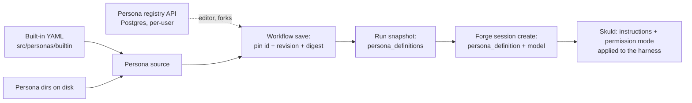

# Personas

A persona is a role a worker plays in a workflow: its instructions, its model settings,
how much it may change, and which events it takes in and gives back.

## In one minute

- A persona is a YAML document: `system_prompt_template`, `permission_mode`, `llm`,
  `iteration_budget`, `consumes`, `produces`. It does **not** choose the harness (Claude Code,
  Codex, …); the session does.
- A workflow stage lists **stage members**, each a `personaId` plus a `model`. The persona's
  event contract is what routes work to it and turns its verdict into the next event.
- When a workflow is saved or launched, each persona is **pinned** by revision and digest, and
  its full document is copied into the run. Forge checks the digest and plays it verbatim.
- Three personas ship built in: `coder`, `reviewer`, `security-auditor`. A team is just a
  workflow that puts several personas on stages; there is no separate team object.

## How it fits



The pin is what makes a run reproducible: editing a persona changes the next launch, never a
run already going.

## The document

| Field | What it does |
|---|---|
| `name`, `description` | Identity; the description is shown to peers, never put into a prompt |
| `system_prompt_template` | The role's instructions |
| `permission_mode` | `read_only`, `workspace_write`, `full_access` or `prompt` (legacy `allow_all`/`deny_all` still parse); anything else is an error |
| `llm` | `primary_alias`, `thinking_enabled`, `max_tokens` |
| `iteration_budget` | The role's turn budget |
| `consumes.event_types` | Events this role takes work from (a stage member can override with `consumesEventTypes`) |
| `consumes.injects` | Context fields put into the task (e.g. `repo`, `branch`, `diff_url`) |
| `produces.event_type`, `event_type_map` | The event it emits, and how each verdict maps to an event (`pass → review.passed`) |
| `produces.schema`, `when` | The outcome shape and when each verdict applies |

`allowed_tools` and `forbidden_tools` are **refused**: per-harness tool restrictions are not
built yet, so a persona carrying either field fails to load instead of running unrestricted.

## Built-in catalogue

| Persona | Role | Permission | Budget | Consumes → produces |
|---|---|---|---|---|
| `coder` | Implements features and fixes, with tests | `workspace_write` | 40 | `code.requested`, `*.changes_requested` → `code.changed` / `code.blocked` |
| `reviewer` | Correctness and conventions; pass or changes requested | `workspace_write` | 25 | `code.changed` → `review.passed` / `review.changes_requested` |
| `security-auditor` | Exploitable weaknesses; read-only | `read_only` | 25 | `code.changed` → `security.passed` / `security.changes_requested` |

Personas once shipped for planning, research and delivery are archived (listed in
`archived-personas.txt`). A workflow or config that still names one fails at startup with the
`git mv` that restores it.

## In a workflow

```yaml
- id: code-review
  kind: stage
  stageMembers:
    - personaId: reviewer
      model: gpt-5.6-terra
      consumesEventTypes: [code.changed]
```

| Step | What happens |
|---|---|
| Save | Every `personaId` must be declared in `persona_dependencies`; each is pinned to `{id, revision, digest}` |
| Launch | The run's snapshot carries the full document per alias (`persona_definitions`); a member with no pin is refused |
| Session | Forge gets `persona_definition`, `model` (stage → launch → `dispatch.default_model`), the alias, event filters and topics; an optional `systemPromptExtra` is appended |
| Offer | The member's Skuld reads the same contract to decide if an offer is its own |

## Levers

| Knob | Default | What it changes | Where it is set |
|---|---|---|---|
| `ravn.persona_source.adapter` | `personas.adapters.loader.FilesystemPersonaAdapter` | Where Forge reads personas from | Forge config |
| `ravn.persona_source.kwargs.persona_dirs` | unset: `./.ravn/personas`, `~/.ravn/personas`, then built-ins | When set, replaces the two local directories; built-ins stay last | Forge config |
| `stageMembers[].model` | `dispatch.default_model` | Model per member | Workflow document |

## Tradeoffs

| Choice | Gains | Costs |
|---|---|---|
| Pin by digest per run | Reproducible runs; no drift mid-run | A persona fix needs a new launch |
| Persona separate from harness | One role runs on Claude Code or Codex alike | No per-harness tool restriction yet |
| Refuse tool lists instead of ignoring them | No role runs with limits it thinks it has | Older personas must be edited before they load |

## Code map

| Concern | Where |
|---|---|
| Persona model | [`src/personas/domain/persona.py`](https://github.com/niuulabs/niuu/blob/dev/src/personas/domain/persona.py) |
| Portable document and pins | [`src/personas/domain/persona_document.py`](https://github.com/niuulabs/niuu/blob/dev/src/personas/domain/persona_document.py) |
| Permission modes | [`src/personas/domain/permission_mode.py`](https://github.com/niuulabs/niuu/blob/dev/src/personas/domain/permission_mode.py) |
| Built-in catalogue | [`src/personas/builtin/`](https://github.com/niuulabs/niuu/tree/dev/src/personas/builtin) |
| Sources (disk, mount, HTTP, inline, Postgres) | [`src/personas/adapters/`](https://github.com/niuulabs/niuu/tree/dev/src/personas/adapters) |
| REST (`/api/v1/ravn/personas`) | [`src/personas/api/personas.py`](https://github.com/niuulabs/niuu/blob/dev/src/personas/api/personas.py) |
| Event contract reader | [`src/niuu/domain/workflow_step.py`](https://github.com/niuulabs/niuu/blob/dev/src/niuu/domain/workflow_step.py) |
| Pinning at save/launch | [`src/ting/domain/workflow_snapshot.py`](https://github.com/niuulabs/niuu/blob/dev/src/ting/domain/workflow_snapshot.py) |
| Model per member | [`src/ting/domain/run_members.py`](https://github.com/niuulabs/niuu/blob/dev/src/ting/domain/run_members.py) |

## Related

- [Workflows overview](index.md)
- [Runs, steps and gates](runs.md)
- [Skuld runtimes](../skuld/runtimes.md) — the harness a persona runs on
