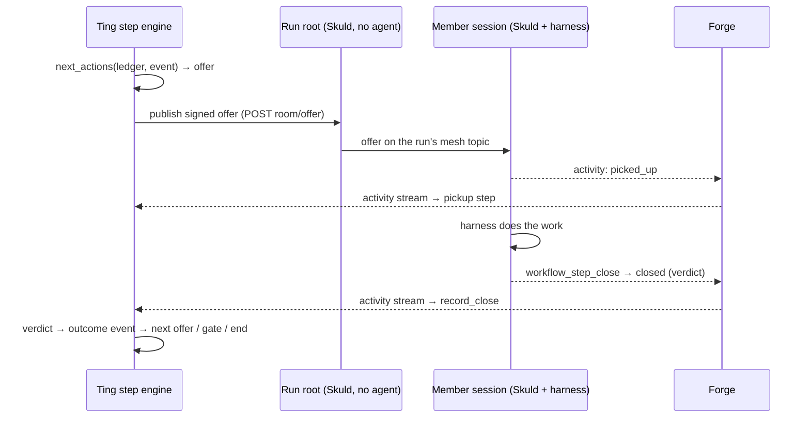

# Runs, steps and gates

How a run moves through its graph: Ting offers work, members of the run pick it up,
gates wait for a person, and an end node completes the run.

## In one minute

- A run advances by **offers**. A delivered event becomes one offer for a stage; every
  member whose persona consumes that event receives it and picks it up or passes.
- The decision of what comes next is a **pure function** of the run's ledger and the new
  event. It does no I/O, so a run can be replayed and audited from its event log.
- **Rework edges** loop work back. Taking one starts a new *generation*: older open steps go
  `stale` and reviewers run again on the new revision. There is no round limit unless the
  author sets `maxIterations`.
- **Gates** wait for a person. Only a gate with `mode: automated_approval` may be answered by
  an agent; any other gate refuses an agent's decision.
- A stuck step is **flagged, not guessed**: overdue, unclaimed, unclosed, session gone or
  unit stopped each reach the owner once through the notification feed.

## How it fits

Ting never joins the mesh and never relays conversation. It hands offers to the run's root
and records what the members report, which reaches it through Forge's activity stream (and,
after an outage, from each session's durable log).

## Offers, pickups and joins

| Idea | Rule in code |
|---|---|
| Edge label | `"source_event -> target_event"`: the source node's outcome event is delivered to the target as the target event |
| Readiness | A member consumes a delivery when the target event is in its `consumesEventTypes` (else its persona's `consumes.event_types`) and its `eventFilters` match |
| `joinMode: all` (default for stages) | Offer only when every forward edge group holds an unconsumed event of the current generation from every producer that picked the work up |
| `joinMode: any` / `merge` (default for gates: `any`) | Each delivery offers the node |
| `reviewVerdictPolicy` | A quorum: every reviewer that picked the work up must deliver before the node is offered, whatever the join mode |
| `executionMode: sequential` | One offer or working pickup in the node at a time |
| `executionMode: parallel` (default) | Up to `maxConcurrent`, unbounded when unset |
| One step per member | A member's Skuld refuses an offer while it holds a step, so an offer queues (`pending`) until its members are free |

A pickup is a step of its own, so a join counts the members that actually picked the work up,
not every member the graph lists.

## The ledger

| Step kind | What it is | Waits on |
|---|---|---|
| `offer` | What one event produced for one stage, open until a member picks it up | the run's members |
| `stage_member` | One member's pickup: the work one harness session holds | the session |
| `gate` | A decision request | a person, or an agent for `automated_approval` |
| `wait` | An outside condition (`conditions`); `timer` waits on the clock | an event or time |
| `end` | A completion check against `passingVerdicts` | — |

Step states: `pending` → `active` / `waiting` → `done` | `failed` | `stale` | `canceled`.
Every transition is also an `engine.*` row in the run's append-only event log.

## Gates

| Mode | Who may decide | What the decision does |
|---|---|---|
| `human_approval` (default) | A person, through the run's review surface | Emits the gate's `approvalEvent` or `changesRequestedEvent`; the comment travels on as `gate_feedback` |
| `automated_approval` | A person or an agent | Same events; the step waits on an agent instead of a person |

A gate that declares no event for the chosen decision is refused, naming the missing field.
Only the run's owner may decide (`POST /api/v1/ting/work/runs/{slug}/gate-decision`, or the
ticket's route on a board); requesting changes needs a note. An open human gate notifies the
owner through the notification feed unless the node sets `pendingBehavior: silent`.

## The review surface

A review is read back from the ledger: each opening of a gate is a revision, with the outcome
fields that stood when it opened and what the person decided. Ting stores nothing else for it.
`GET /api/v1/ting/work/reviews` lists everything waiting on a person across their projects.

| Board gate column field | What a person sees |
|---|---|
| `review: plan` | The plan document from the step outcome |
| `review: code` | Diff, files and pull request |
| `review: output` | A result summary |
| `panels` | Replaces the defaults: `document`, `file`, `link`, `page`, `diff`, `files`, `pullRequest`, `summary`, each sourced from an outcome field, a workspace file or a URL |

Extra widgets come from module packages (`review_widgets.module_manifest_files`); one that
cannot be read stops Ting at startup.

## Rework, failure and the end

- **Rework**: an edge marked `rework: true` that closes a cycle. `maxIterations` on it is the
  only cap; exceeding it fails the run naming the edge and the knob.
- **A failed step** ends only its own path; siblings keep running. The run fails when nothing
  is open and no end node was reached, and the reason lists what failed.
- **End**: completes when its join holds events whose verdict is in `passingVerdicts`. Other
  verdicts are recorded as rejected. Completing cancels whatever is still open.

## Waits and subworkflows

`wait` and `subworkflow` nodes park as waiting steps. What closes them is durable workflow
execution (`workflow_execution.enabled`, off by default): it fans out child workflows and joins
them (`joined` or `blocked`), and polls the configured wait observers per condition type
(`timer` ships; `forge.*` checks and merge observers come with the code-delivery extension).
A satisfied wait closes its step as `observed`. It needs workload identity outside anonymous
local mode, because children are launched with Ting-issued workload credentials.

## Stuck steps and recovery

| Flag | Raised when | Sweep action |
|---|---|---|
| `overdue` | Past `deadline_at` (`step_deadline_seconds`, or the node's `deadlineSeconds`) | Flag; an offer past it with no pickup fails |
| `unclaimed` | No pickup within `pickup_grace_seconds` | Publish the same offer again |
| `unclosed` | A turn ended with the step still open | Flag only |
| `session_gone` | The step's Forge session failed, stopped or vanished | Fail the step |
| `unit_stopped` | The run's root (and so its unit) is down | Offer waits for the run to resume; raised again each stop |

An operator can **retry**, **reassign** (restart the member's harness in place under a new
launch of the same session) or **abort** a step or run.

## Version pinning

Saving a workflow bumps its semver label (`patch` by default) and archives an immutable
snapshot of every version: under the catalogue's `.history/` with the default filesystem
store, or in `workflow_versions` with the Postgres store. A launch may name an older version.
The run copies its definition into the run record at launch (`workflow_snapshot`: includes
inlined, every persona pinned by revision and digest) and the engine reads only that snapshot.
Editing a workflow never changes a run already going, and nothing re-pins one; the next launch
uses the new head. Project boards pin a version per workflow too.

## Levers

| Knob | Default | What it changes | Where it is set |
|---|---|---|---|
| `workflow_steps.step_deadline_seconds` | `14400` (4 h) | How long an offer may wait and a pickup may stay active before it is overdue | Ting config / chart `workflowSteps` |
| `workflow_steps.pickup_grace_seconds` | `300` | When an unpicked offer is flagged and republished (never a cap) | Ting config |
| `workflow_steps.stuck.enabled` | `true` | Run the stuck-step sweep; `false` is a decision to go without it | Ting config |
| `workflow_steps.stuck.sweep_interval_seconds` | `120` | How long a stuck step can go unflagged | Ting config |
| `workflow_steps.catch_up_page_size` | `200` | Page size when reading back session logs after an outage; bounds nothing | Ting config |
| `deadlineSeconds` (node) | unset | Per-node deadline; the only deadline gates, waits and subworkflows get | Workflow document |
| `maxIterations` (rework edge) | unset | Round cap on one rework loop | Workflow document |
| `workflow_execution.enabled` | `false` | Durable fan-out/join and waits for `subworkflow` and `wait` nodes, plus the A2A child gateway | Ting config / chart `workflowExecution` |
| `workflow_execution.wait_observers` | chart: `timer` | Which wait conditions can be observed | Ting config |
| `workflow_execution.default_deadline_seconds` | `86400` | Deadline of a durable execution | Ting config |
| `review_widgets.module_manifest_files` | `[]` | Extra review widgets for gate panels | Ting config |

## Tradeoffs

| Choice | Gains | Costs |
|---|---|---|
| Pure engine over a ledger | Replayable, testable, no hidden state | Every decision is a DB transaction per run |
| Offers on the run's mesh, not direct delivery | Members decide by persona and filters; no Ting-side routing | An offer is only published once every member of its topic reports listening |
| Run = one unit (members fixed at start) | Root and members start together; one place to look | A member cannot be added to a running run |
| No default round limit | Loops end on the work's own verdicts | A loop that never converges runs until an operator aborts it |

## Code map

| Concern | Where |
|---|---|
| Decision function | [`src/ting/domain/step_engine.py`](https://github.com/niuulabs/niuu/blob/dev/src/ting/domain/step_engine.py) |
| Ledger models, flags, recovery | [`src/ting/domain/workflow_steps.py`](https://github.com/niuulabs/niuu/blob/dev/src/ting/domain/workflow_steps.py) |
| Persisting decisions, publishing offers | [`src/ting/domain/services/workflow_step_engine.py`](https://github.com/niuulabs/niuu/blob/dev/src/ting/domain/services/workflow_step_engine.py) |
| Run start/close/decide/cancel | [`src/ting/domain/services/workflow_runs.py`](https://github.com/niuulabs/niuu/blob/dev/src/ting/domain/services/workflow_runs.py) |
| Stuck detection sweep | [`src/ting/domain/services/workflow_step_watch.py`](https://github.com/niuulabs/niuu/blob/dev/src/ting/domain/services/workflow_step_watch.py) |
| Member side (pick up, close) | [`src/skuld/workflow_steps.py`](https://github.com/niuulabs/niuu/blob/dev/src/skuld/workflow_steps.py) |
| Gate decisions, reviews | [`src/ting/api/work.py`](https://github.com/niuulabs/niuu/blob/dev/src/ting/api/work.py), [`src/ting/domain/services/ticket_review.py`](https://github.com/niuulabs/niuu/blob/dev/src/ting/domain/services/ticket_review.py) |
| Review panels | [`src/ting/domain/workflow_board.py`](https://github.com/niuulabs/niuu/blob/dev/src/ting/domain/workflow_board.py) |
| Waits and children | [`src/ting/domain/services/workflow_execution.py`](https://github.com/niuulabs/niuu/blob/dev/src/ting/domain/services/workflow_execution.py), [`src/ting/adapters/engine_parent_continuation.py`](https://github.com/niuulabs/niuu/blob/dev/src/ting/adapters/engine_parent_continuation.py) |
| Version archive | [`src/ting/adapters/filesystem_workflows.py`](https://github.com/niuulabs/niuu/blob/dev/src/ting/adapters/filesystem_workflows.py), [`src/ting/adapters/postgres_workflows.py`](https://github.com/niuulabs/niuu/blob/dev/src/ting/adapters/postgres_workflows.py), [`migrations/ting/000044_workflow_versions.up.sql`](https://github.com/niuulabs/niuu/blob/dev/migrations/ting/000044_workflow_versions.up.sql) |
| Ledger tables | [`migrations/ting/000054_workflow_steps.up.sql`](https://github.com/niuulabs/niuu/blob/dev/migrations/ting/000054_workflow_steps.up.sql) … `000061` |

## Related

- [Workflows overview](index.md)
