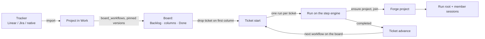

# Trackers, projects and boards

A project links tracker tickets to workflows: drop a ticket on a board column and the workflow engine starts
that column's workflow as a run of the ticket, inside the project on Forge.

## In one minute

- A **tracker** is where tickets live: Linear, Jira, or **native** (the workflow engine's own Postgres,
  always available). Each is a `TrackerPort` adapter bound to one connection.
- A **project** in Work is a linked tracker project with repositories and one or more
  workflows. Its runs join the matching **Forge project**, so sessions nest under it.
- A workflow may declare **board columns** (`graph.board`). A project's board puts its workflows
  in order between the tracker's own Backlog and Done.
- Dropping a ticket on a workflow's **first** column starts a run of that ticket. When the run
  completes, the ticket moves on to the next workflow by itself.
- One active run per ticket, enforced by a lock; each ticket keeps one record of what was
  started and why a start failed.

## How it fits

## Trackers

| Backend | Maps | Auth |
|---|---|---|
| `LinearTrackerAdapter` | Linear project → project, milestone → phase, issue → ticket | API key or OAuth token; optional `team_id` |
| `JiraTrackerAdapter` | Jira Cloud (REST v3) | API token + email, or OAuth |
| `NativeTrackerAdapter` | Rows in the workflow engine's database | none; bound as connection `native` |

- Connections are rows in `integration_connections` of type `issue_tracker`: an `adapter` class
  path, a `credential_name` and `config`. The factory imports the class, passes credential and
  config as kwargs, and binds the connection.
- A user's own connections come first, then those owned by each Forge project they belong to
  (a project's shared tracker). Writes through a project's connection are recorded as usage.
- A connection that cannot be built is reported in the resolution's failures, never dropped.
- Rows are bound to one `tracker_connection_id`, so two Linear accounts never get mixed up.

## Projects

| In the UI and API | In code and tables |
|---|---|
| Project (`project:<id>`) | `Saga`, table `sagas` |
| Run | `WorkflowCampaign`, table `workflow_campaigns` |
| Ticket | `TrackerIssue` |

"Saga" and "campaign" are retired words; they survive only as code and table names. A project
holds its repositories, base branch, its workflow or ordered `board_workflows`, and
`project_id`: the Forge project it joined (else its own id is used). Several tracker links can
share one Forge project.

A ticket's run joins that Forge project: the root joins as the run room, each member as its
alias with the root as parent session. The workflow engine reads and writes Forge projects only over
`/api/v1/forge/projects`.

## Boards and tickets

| Column kind | Holds |
|---|---|
| `work` | One or more of the workflow's nodes |
| `gate` | One person gate, with the review panels a person decides on |
| Backlog, Done | The tracker's own; not declared by any workflow |

| Ticket state on the board | Meaning |
|---|---|
| `notStarted` / `ready` | No run, or waiting to be started |
| `starting` / `running` | A run is launching or going |
| `needsDecision` | A gate of its run is open |
| `blocked` / `done` / `unknown` | Blocked, finished, or not readable |

Starting a ticket (`POST /api/v1/ting/work/project/{id}/tasks/{issue}/start` with a column):

1. Refused when the project has no workflow or repository, the ticket has an active run, or the
   column is not a workflow's first column ("X starts at Y").
2. The workflow version the board pins is resolved and the ticket's record is written.
3. A run is created with the ticket's brief and branch `<feature_branch>-<identifier>` (or
   `workflow/<slug>` for workflows that isolate their branch), under an advisory lock per ticket.
4. The run launches on the step engine. A failed start marks the run failed and records why.

When a run completes, the advancer starts the next workflow on the board, unless a person
started something since, the ticket closed, or a run is already active. The claim is atomic,
so a repeated event cannot start two runs.

## Levers

| Knob | Default | What it changes | Where it is set |
|---|---|---|---|
| `tracker.cache_ttl_seconds` | `30` | How long tracker reads are cached | Workflow engine config |
| `tracker.rate_limit_max_retries` | `3` | Retries on a tracker's rate-limit answer | Workflow engine config |
| `linear.api_key` / `linear.team_id` | empty | Seeds one Linear connection at startup | Workflow engine config |
| `board_workflows` | empty (the project's one workflow) | Which workflows the board runs, in order, each pinned to a version | Project settings in Work |
| `graph.board` | absent (no board) | The columns a workflow contributes | Workflow document |

## Tradeoffs

| Choice | Gains | Costs |
|---|---|---|
| Start only at a workflow's first column | A run always starts at its trigger | You cannot drop a ticket mid-workflow |
| Native tracker always present | Works offline and before any tracker is connected | Two places a ticket can live |
| Board pins workflow versions | A board behaves the same until someone moves it to a new version | Editing a workflow does not change boards until they are updated |

## Code map

| Concern | Where |
|---|---|
| Tracker port | [`src/ting/ports/tracker.py`](https://github.com/niuulabs/niuu/blob/dev/src/ting/ports/tracker.py) |
| Backends | [`linear.py`](https://github.com/niuulabs/niuu/blob/dev/src/ting/adapters/linear.py), [`jira.py`](https://github.com/niuulabs/niuu/blob/dev/src/ting/adapters/jira.py), [`native.py`](https://github.com/niuulabs/niuu/blob/dev/src/ting/adapters/native.py) |
| Connection resolution | [`src/ting/adapters/tracker_factory.py`](https://github.com/niuulabs/niuu/blob/dev/src/ting/adapters/tracker_factory.py) |
| Board columns | [`src/ting/domain/workflow_board.py`](https://github.com/niuulabs/niuu/blob/dev/src/ting/domain/workflow_board.py) |
| Ticket start and advance | [`ticket_coordinator.py`](https://github.com/niuulabs/niuu/blob/dev/src/ting/domain/services/ticket_coordinator.py), [`ticket_advance.py`](https://github.com/niuulabs/niuu/blob/dev/src/ting/domain/services/ticket_advance.py) |
| Work API | [`src/ting/api/work.py`](https://github.com/niuulabs/niuu/blob/dev/src/ting/api/work.py) |
| Run → Forge project | [`src/ting/domain/services/run_thread.py`](https://github.com/niuulabs/niuu/blob/dev/src/ting/domain/services/run_thread.py) |
| Tables | [`000048_ticket_coordinators`](https://github.com/niuulabs/niuu/blob/dev/migrations/ting/000048_ticket_coordinators.up.sql), [`000049_project_board_workflows`](https://github.com/niuulabs/niuu/blob/dev/migrations/ting/000049_project_board_workflows.up.sql), [`000052_saga_project`](https://github.com/niuulabs/niuu/blob/dev/migrations/ting/000052_saga_project.up.sql) |

## Related

- [Workflows overview](index.md)
- [Runs, steps and gates](runs.md)
- [Credentials](../security/credentials.md) — tracker and Forge credentials
